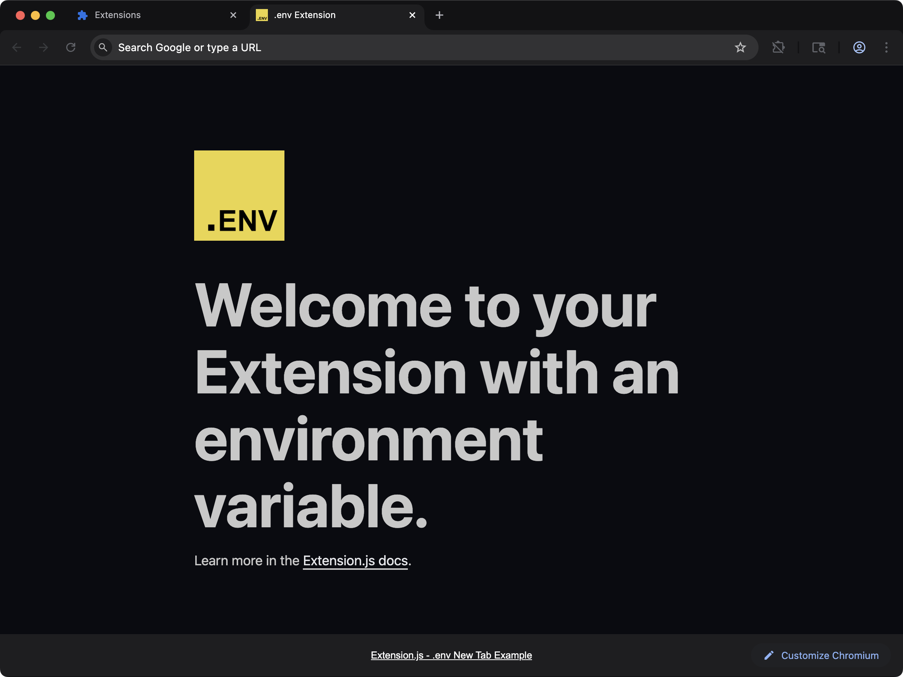
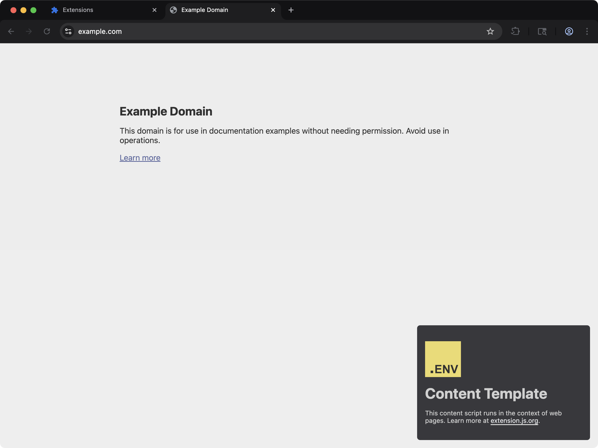

Use one extension codebase across browsers and environments without hardcoding values.

## Environment variables in browser extensions

Browser extensions ship code that runs on your users' machines. That makes the line between configuration and secrets sharper than in a typical web app. Anyone who installs your extension can read anything you bundle into JavaScript, HTML, or the compiled `manifest.json`.

Extension.js handles this with two environment loading paths. One serves **compiled extension bundles** (browser and mode aware). The other runs while loading **`extension.config.*`** in Node.

Both paths matter depending on where you read your variables.

## Template examples

### `new-env`



See environment variables in action with a new-tab extension that reads `EXTENSION_PUBLIC_*` values.

<CodeGroup>

```bash npm
npx extension@latest create my-extension --template=newtab-env
```

```bash pnpm
pnpx extension@latest create my-extension --template=newtab-env
```

```bash yarn 2+
yarn dlx extension@latest create my-extension --template=newtab-env
```

```bash bun
bunx extension@latest create my-extension --template=newtab-env
```

```bash deno
deno run -A npm:extension@latest create my-extension --template=newtab-env
```

</CodeGroup>

Repository: [extension-js/templates/newtab-env](https://github.com/extension-js/templates/tree/main/examples/newtab-env)

### `content-env`



Use environment variables inside content scripts injected into web pages.

<CodeGroup>

```bash npm
npx extension@latest create my-extension --template=content-env
```

```bash pnpm
pnpx extension@latest create my-extension --template=content-env
```

```bash yarn 2+
yarn dlx extension@latest create my-extension --template=content-env
```

```bash bun
bunx extension@latest create my-extension --template=content-env
```

```bash deno
deno run -A npm:extension@latest create my-extension --template=content-env
```

</CodeGroup>

Repository: [extension-js/templates/content-env](https://github.com/extension-js/templates/tree/main/examples/content-env)

## How it works

### Extension bundles (compile time)

When building your extension, the compiler chooses **one** env file from your extension package folder by the first match in this order:

1. `.env.[browser].[mode]` (for example, `.env.chrome.development`)
2. `.env.[browser]`
3. Engine-family variants of the two above (see the note below)
4. `.env.[mode]`
5. `.env.local`
6. `.env`

Browser-scoped files resolve **per engine family**, matching [browser-specific manifest fields](/docs/features/browser-specific-fields). After the exact browser name, Chromium-family targets (`chromium`, `chrome`, `edge`, `chromium-based`, the Chromium forks, and Safari builds) also try `.env.chromium`, `.env.chrome`, `.env.edge`, and `.env.chromium-based` (each with their `.[mode]` variants first). Gecko-family targets also try `.env.firefox` and `.env.gecko-based`. A single `.env.chromium` file therefore covers a `chrome`, `edge`, or `brave` build, and an exact browser file always wins over family files.

Extension.js **always merges** `.env.defaults` first when present, then the selected file's variables. Finally, **system** `process.env` takes highest precedence for overlapping keys.

<Note>
  Selection is a **single** env file from the list above (plus `.env.defaults`),
  not a full cascade through every file. `.env.example` is documentation only
  and is never loaded as a value source.
</Note>

If env files exist next to your project but none match the current browser and mode, the build prints a warning naming the files it found and the candidates it looked for, so a misspelled browser suffix fails loudly instead of silently shipping without values. A file named for another mode or browser, such as `.env.development` in a production build, is left alone without a warning, and the warning calls the values undefined only when nothing else, such as `extension.config.js`, defined them.

### Secrets never take the `EXTENSION_PUBLIC_` prefix

Every `EXTENSION_PUBLIC_*` value is written into the built JavaScript. Anyone who installs the extension can read it, and so can every store review. Code that reads `import.meta.env` as a whole object carries every public value, even the ones it never names.

An API key for an LLM or any other paid service belongs on a server that your extension calls. Give it a name without the `EXTENSION_PUBLIC_` prefix, so the bundle never contains it.

A production build warns when an `EXTENSION_PUBLIC_*` variable with a value has a name that looks secret. A name looks secret when it contains `SECRET`, `TOKEN`, `PASSWORD`, or `PRIVATE`. It also looks secret when `KEY` comes right after `API`, `ACCESS`, `AUTH`, or `SECRET`. A name that contains `PUBLISHABLE` is skipped. If the value is public by design, such as a Firebase web API key, the warning does not apply to it. This warning needs 4.1.39 or later.

If no matching file exists next to the project, Extension.js repeats the same search from the **nearest workspace root**. That root is the closest ancestor folder containing `pnpm-workspace.yaml`. Extensions inside monorepos can share root-level env files for **bundle** injection.

**Monorepo constraint:** Workspace fallback only runs when a `pnpm-workspace.yaml` marker exists on an ancestor. If you use pure npm or Yarn workspaces that rely only on `package.json` `"workspaces"`, this automatic root lookup does not apply. In that case, keep env files beside the extension package, or add a `pnpm-workspace.yaml` at the repository root.

### `extension.config.*` (Node, before your configuration runs)

`extension.config.js` / `.mjs` / `.cjs` runs in Node. Before Extension.js evaluates the file, it preloads a **small** set of files into `process.env` so the configuration can read them, weakest to strongest:

1. `.env.defaults`
2. `.env`
3. `.env.local`
4. `.env.development`

Every file that exists loads, and a later file overrides the values of an earlier one. A variable your shell or CI exported always wins over every file. An `.mjs` config that reads `import.meta.env` sees the same winners as `process.env`.

Extension.js does **not** use browser-scoped files such as `.env.chrome` or `.env.chrome.development` for this preload step. Instead, set values through plain `process.env` in your shell or continuous integration (CI) pipeline.

You can also rely on bundle-time env (described above) to inject `EXTENSION_PUBLIC_*` values into extension code.

**Workspace fallback:** If none of those files exist in the extension package folder, the same preload runs from the nearest folder containing `pnpm-workspace.yaml` (same constraint as above).

This split exists because configuration loading is browser-agnostic at file-read time, while the bundler knows the active browser and mode.

<Frame>
  <iframe
    className="w-full aspect-video rounded-xl"
    src="https://www.youtube-nocookie.com/embed/kofpJH4AX4s?rel=0"
    title="Extension.js: change .env, the running page shows it"
    loading="lazy"
    allow="encrypted-media; picture-in-picture; fullscreen"
    allowFullScreen
  />
</Frame>

## Built-in environment variables

Extension.js injects built-in variables at compile time, so browser and mode are always available in your extension code.

| Variable name              | Description                                                                               |
| -------------------------- | ----------------------------------------------------------------------------------------- |
| `EXTENSION_PUBLIC_BROWSER` | The current browser target for your extension (for example, `chrome`, `firefox`, `edge`). |
| `EXTENSION_PUBLIC_MODE`    | The mode in which your extension is running, such as `development` or `production`.       |
| `EXTENSION_BROWSER`        | Browser target (non-legacy alias).                                                        |
| `EXTENSION_MODE`           | Build mode (non-legacy alias).                                                            |
| `BROWSER`                  | Short browser alias.                                                                      |
| `MODE`                     | Short mode alias.                                                                         |
| `NODE_ENV`                 | Node environment aligned to compiler mode (`development` / `production`).                 |

All built-ins above are available through both `process.env.*` and `import.meta.env.*`.

## Environment variable inventory

### Public/runtime variables (user-defined)

| Variable pattern     | Purpose                                      | Available in JS runtime                 | Notes                    |
| -------------------- | -------------------------------------------- | --------------------------------------- | ------------------------ |
| `EXTENSION_PUBLIC_*` | Expose user-defined values to extension code | Yes (`process.env` + `import.meta.env`) | Safe-to-ship values only |

### Static placeholder variables

| Variable pattern                                   | Purpose                                             | Available in JS runtime | Notes                                   |
| -------------------------------------------------- | --------------------------------------------------- | ----------------------- | --------------------------------------- |
| `$EXTENSION_*` tokens in emitted `.html` / `.json` | Build-time placeholder replacement in static assets | Not as JS vars          | Avoid using secrets in static templates |

### Built-in/alias variables

| Variable                   | Type           | Notes              |
| -------------------------- | -------------- | ------------------ |
| `EXTENSION_PUBLIC_BROWSER` | built-in       | Browser target     |
| `EXTENSION_PUBLIC_MODE`    | built-in       | Build mode         |
| `EXTENSION_BROWSER`        | built-in alias | Browser target     |
| `EXTENSION_MODE`           | built-in alias | Build mode         |
| `BROWSER`                  | built-in alias | Short browser name |
| `MODE`                     | built-in alias | Short mode name    |
| `NODE_ENV`                 | built-in       | Compiler mode      |

### CLI and dev-server operational variables

| Variable                          | Purpose                                                                                                                                      | Typical usage                                                                 |
| --------------------------------- | -------------------------------------------------------------------------------------------------------------------------------------------- | ----------------------------------------------------------------------------- |
| `EXTENSION_AUTO_EXIT_MS`          | Auto-exit dev process after N ms                                                                                                             | CI hard-stop control                                                          |
| `EXTENSION_FORCE_KILL_MS`         | Hard exit N ms after start (default: auto-exit + 4000). Exits `1` only when it cuts an auto-exit teardown short, `0` when it fires first    | CI cleanup resilience                                                         |
| `EXTENSION_VERBOSE`               | Verbose diagnostics in selected flows                                                                                                        | Debugging CLI behavior                                                        |
| `EXTENSION_DEBUG`                 | Enable the debug output channel (`1`/`true` to set), same as passing `--debug`                                                               | Diagnosing CLI behavior without editing commands                              |
| `EXTENSION_AUTHOR_MODE`           | Legacy alias for `EXTENSION_DEBUG`; an explicit `EXTENSION_DEBUG` value wins over it                                                         | Superseded, use `EXTENSION_DEBUG`                                             |
| `EXTENSION_OUTPUT`                | Force machine output (`json` or `ndjson`); human stdout goes quiet, any other value means pretty                                             | Same effect as `--output` for wrapped invocations                             |
| `EXTENSION_CLI_NO_BROWSER`        | Disable browser launch from CLI (`1` to set)                                                                                                 | Equivalent to `--no-browser` flag                                             |
| `EXTENSION_DEV_INSTANCE_ID`       | Pin the dev-session instance id instead of generating one                                                                                    | Stable session identity for harnesses that attach to a run                    |
| `EXTENSION_CONTROL_PORT`          | Set by the dev server to hand the control-channel port to the compiler in the same process                                                   | Internal coordination value, read it, do not set it                           |
| `EXTENSION_WATCH_POLL`            | Switch file watching to polling (`true` to set)                                                                                              | Network drives and containers where inotify events do not arrive              |
| `EXTENSION_WATCH_POLL_INTERVAL`   | Polling interval in ms when polling is on (default `1000`)                                                                                   | Tune rebuild latency against CPU cost                                         |
| `EXTENSION_TMP_PROFILE_MAX_AGE_HOURS` | Age in hours before ephemeral managed profiles are swept on launch (default `12`)                                                        | Keep or reclaim temp profiles faster in CI                                    |
| `EXTENSION_USE_SYSTEM_PROFILE`    | Launch with the system browser profile instead of a managed one (`true` to set). `EXTJS_USE_SYSTEM_PROFILE` is an accepted alias. Chromium family only, a Gecko target is refused before launch ([details](/docs/browsers/browser-profile#system-profile-mode-on-firefox-and-other-gecko-browsers)) | Sessions that need your real logins and extensions                            |
| `EXTENSION_HEADLESS`              | Force the headless backend (`1`/`true` to set)                                                                                               | Focus-steal guard for automated sessions on macOS                             |
| `EXTENSION_PREFER_CHROMIUM_SNAPSHOT` | Prefer the managed Chromium tip-of-tree snapshot over a system stable browser (`true` to set)                                             | Testing against the newest Chromium                                           |
| `EXTENSIONJS_BINARIES_IN_DIST`    | Store managed browser binaries under the project `dist/` instead of the shared cache (`1` to set)                                            | Fully self-contained project checkouts                                        |
| `EDGE_BINARY`                     | Absolute path to the Edge binary to launch for `--browser=edge`. A missing or non-executable path fails with `E_BROWSER_BINARY_INVALID`     | Non-standard Edge install locations                                           |
| `CHROME_BINARY`                   | Absolute path to the binary to launch for `--browser=chrome`. Read last of the three Chrome variables                                      | A Chrome for Testing build outside the managed cache                          |
| `CHROME_FOR_TESTING_PATH`         | Absolute path to a Chrome for Testing binary for `--browser=chrome`. Read first                                                             | A CI image that ships Chrome for Testing                                      |
| `CHROMIUM_BINARY`                 | Absolute path to the binary to launch for `--browser=chromium` and `--browser=chrome`                                                        | A system or self-built Chromium                                               |
| `FIREFOX_BINARY`                  | Absolute path to the Firefox binary to launch for `--browser=firefox`                                                                        | Firefox Developer Edition, or a CI image that ships Firefox                   |
| `EXTENSION_DEV_NO_BROWSER`        | Disable browser launch in dev server                                                                                                         | Monorepo watch without browser spawns                                         |
| `EXTENSION_NO_RELOAD`             | Skip content-script reload runtime in dev                                                                                                    | Equivalent to `extension dev --no-reload`                                     |
| `EXTENSION_DEV_DRY_RUN`           | Skip dev server startup (return early)                                                                                                       | Smoke-testing CLI wiring                                                      |
| `EXTENSION_BROWSER_FLAGS`         | Extra launch flags appended to every launched browser (whitespace-separated; applied after config `browserFlags`, so the environment wins)   | CI/harness flags like `--headless=new` without touching `extension.config.js` |
| `EXTENSION_ALLOW_INSTALL_SCRIPTS` | Run lifecycle scripts during dependency auto-install (`true` to set); auto-install passes `--ignore-scripts` by default for safety           | Projects whose dependencies genuinely need postinstall scripts                |
| `EXTENSION_STRICT_REFS`           | Make dead HTML asset references fail the build (`true` to set); by default they warn and are skipped, matching how Chrome 404s them silently | Strict CI validation of HTML references                                       |
| `EXT_BROWSERS_CACHE_DIR`          | Override managed browser cache folder                                                                                                        | Custom CI cache paths                                                         |

From the release after 4.1.39, every browser resolves its binary in one order. The binary flag comes first, then the variable, the managed binary, and the system install. A variable that names a missing or non-executable path fails the launch with `E_BROWSER_BINARY_INVALID`. See [How the binary is chosen](/docs/browsers/browsers-available#how-the-binary-is-chosen).

### Telemetry control variables

| Variable                          | Purpose                                         | Default |
| --------------------------------- | ----------------------------------------------- | ------- |
| `EXTENSION_TELEMETRY_DISABLED`    | Disable telemetry entirely (`1` to set)         | unset   |
| `EXTENSION_TELEMETRY`             | Back-compat disable (`0` to disable)            | unset   |
| `EXTENSION_TELEMETRY_SAMPLE_RATE` | Sampling rate for `command_executed` (0.0–1.0)  | `0.2`   |
| `EXTENSION_TELEMETRY_MAX_EVENTS`  | Maximum events emitted per CLI process          | `3`     |
| `EXTENSION_TELEMETRY_DEBOUNCE_MS` | Deduplication window for identical event tuples (ms)    | `60000` |
| `EXTENSION_TELEMETRY_TIMEOUT_MS`  | HTTP timeout for telemetry requests (ms)        | `300`   |
| `EXTENSION_TELEMETRY_DEBUG`       | Print telemetry payloads to stderr (`1` to set) | unset   |
| `EXTENSION_TELEMETRY_AUDIT_MAX_BYTES` | Local audit log rotation cap in bytes       | `1048576` |

`EXTENSION_TELEMETRY=1` is also the explicit opt-in for CI, where telemetry is otherwise off by default. See [Telemetry and privacy](/docs/features/telemetry-and-privacy) for the full consent contract.

### Scaffolding (`extension create`) variables

| Variable                          | Purpose                                                                                     | Default        |
| --------------------------------- | ------------------------------------------------------------------------------------------- | -------------- |
| `EXTENSION_CREATE_TEMPLATE_REF`   | Template corpus ref: a branch, tag, or commit SHA; `main` restores the floating branch      | a pinned commit |
| `EXTENSION_CREATE_TEMPLATE_URL`   | Override the template archive URL entirely. From 4.1.19 the URL must use `https://`         | unset          |
| `EXTENSION_ALLOW_HTTP_TEMPLATE`   | Allow an `http://` template URL, or a download that redirects to `http://` (`true` to set)  | unset          |
| `EXTENSION_CREATE_ENGINE_VERSION` | Pin the `extension` dependency version written into scaffolded projects                     | CLI version    |
| `EXTENSION_CREATE_TIMEOUT_MS`     | Time limit for the whole template download, retry included (ms)                             | `60000`        |

See [Templates](/docs/getting-started/templates) for how the pinned corpus works.

### Browser transport tuning variables

These variables override internal Chrome DevTools Protocol (CDP) and Remote Debugging Protocol (RDP) timeouts. They are useful for slow continuous integration (CI) environments, Docker containers, or debugging flaky browser connections.

| Variable                              | Purpose                                 | Default |
| ------------------------------------- | --------------------------------------- | ------- |
| `EXTENSION_CDP_COMMAND_TIMEOUT_MS`    | CDP sendCommand timeout (ms)            | `12000` |
| `EXTENSION_CDP_HTTP_TIMEOUT_MS`       | CDP HTTP `/json` discovery timeout (ms) | `1200`  |
| `EXTENSION_CDP_HEARTBEAT_INTERVAL_MS` | CDP WebSocket heartbeat interval (ms)   | `30000` |
| `EXTENSION_RDP_EVAL_TIMEOUT_MS`       | Firefox RDP evaluation timeout (ms)     | `8000`  |
| `EXTENSION_RDP_MAX_RETRIES`           | Firefox RDP connect retry count         | `150`   |
| `EXTENSION_RDP_RETRY_INTERVAL_MS`     | Firefox RDP connect retry interval (ms) | `1000`  |
| `EXTENSION_RDP_REQUEST_TIMEOUT_MS`    | Firefox RDP per-request timeout (ms)    | `30000` |

## Browser-specific environment variables

The rules below apply to **compile-time / bundle** env selection (see [Extension bundles](#extension-bundles-compile-time) above). They do **not** apply to the narrow `extension.config.*` preload in Node.

Need different values per browser? Extension.js supports browser-scoped env files such as `.env.chrome` (Chrome extension environment variables) and `.env.firefox` (Firefox extension environment variables). You can also combine browser and mode for a single build variant:

- `.env.chrome.development`: Extension.js applies this only when running the extension in Chrome during development mode.
- `.env.firefox.production`: Extension.js applies this only when building the extension for Firefox in production mode.

Priority order is:

- `.env.[browser].[mode]`
- `.env.[browser]`
- Engine-family variants (for example, `.env.chromium` for any Chromium-family target)
- `.env.[mode]`
- `.env.local`
- `.env`

You rarely need one file per vendor. Because resolution is per engine family, `.env.chromium` covers `chrome`, `edge`, and the Chromium forks, and `.env.firefox` covers the Gecko forks. Add an exact browser file (such as `.env.edge`) only when one target needs different values from the rest of its family.

### Example files

```ini
# .env.chrome.development
EXTENSION_PUBLIC_API_URL=https://api-dev.chrome.com
```

```ini
# .env.firefox.production
EXTENSION_PUBLIC_API_URL=https://api.firefox.com
```

## Custom environment variables

You can define custom variables in env files at project root.  
Extension.js only injects variables prefixed with `EXTENSION_PUBLIC_` into JavaScript bundles (`process.env` / `import.meta.env`).

```ini
# .env
EXTENSION_PUBLIC_API_URL=https://api.example.com
EXTENSION_PUBLIC_SITE_URL=https://example.com
PRIVATE_KEY=abc123  # Not injected into JS bundles
```

**Important:** Extension.js does not inject variables without `EXTENSION_PUBLIC_` into JS bundles.  
However, placeholders in emitted `.json`/`.html` files can resolve `$EXTENSION_*` tokens, so avoid referencing secrets in static asset templates.

## Using environment variables

You can use environment variables in `manifest.json`, locales, HTML, and JavaScript/TypeScript files.

### 1. In `manifest.json`

`manifest.json` does not natively support environment variables, but Extension.js replaces supported placeholders during build. For example:

```json
{
  "name": "My Extension",
  "version": "1.0",
  "description": "This extension is connected to $EXTENSION_PUBLIC_API_URL",
  "background": {
    "service_worker": "service_worker.js"
  }
}
```

During compilation, Extension.js replaces `$EXTENSION_PUBLIC_API_URL` with the resolved env value.

#### Keep a local origin out of the production manifest

The same placeholders work in match patterns, which is how a development mock server stays out of the store package. Put the origin in a placeholder and give each mode its own value:

```json
{
  "content_scripts": [
    {
      "matches": ["$EXTENSION_PUBLIC_SITE/*"],
      "js": ["content.js"]
    }
  ]
}
```

```bash
# .env.development
EXTENSION_PUBLIC_SITE=http://localhost:4322

# .env
EXTENSION_PUBLIC_SITE=https://example.com
```

`extension dev` reads `.env.development` and matches `http://localhost:4322/*`. `extension build` reads `.env` and ships only `https://example.com/*`. A production build that still names `localhost`, `127.0.0.1`, `[::1]`, or `0.0.0.0` in `content_scripts`, `host_permissions`, `externally_connectable`, or `web_accessible_resources` prints a warning with the code `E_PROD_LOOPBACK_ORIGIN` and ships the pattern as written, since a production build pointed at a local server can be on purpose.

### 2. In locale files

You can also use placeholders in locale files when values should change by environment. For example:

```json
{
  "appName": {
    "message": "My Extension - $EXTENSION_PUBLIC_SITE_URL"
  },
  "appDescription": {
    "message": "Connected to API at $EXTENSION_PUBLIC_API_URL"
  }
}
```

When Extension.js emits assets, it replaces placeholders such as `$EXTENSION_PUBLIC_SITE_URL` with resolved values.

### 3. In HTML files

You can also use placeholders in static HTML files (for example, under `pages/`):

```html
<!doctype html>
<html lang="en">
  <head>
    <meta charset="UTF-8" />
    <meta name="viewport" content="width=device-width, initial-scale=1.0" />
    <title>My Extension</title>
  </head>
  <body>
    <h1>Welcome to My Extension</h1>
    <p>API: $EXTENSION_PUBLIC_API_URL</p>
  </body>
</html>
```

During compilation, Extension.js replaces `$EXTENSION_PUBLIC_API_URL` in the output HTML.

### 4. In JSX components

In React/JSX/TS files, read env values with `process.env`:

```jsx
const ApiInfo = () => {
  const siteUrl = process.env.EXTENSION_PUBLIC_SITE_URL;
  const apiUrl = process.env.EXTENSION_PUBLIC_API_URL;

  return (
    <div>
      <h1>API Information</h1>
      <p>Site: {siteUrl}</p>
      <p>API: {apiUrl}</p>
    </div>
  );
};

export default ApiInfo;
```

Extension.js inlines these values at compile time, and they can vary by browser/mode.

## `import.meta` support

For ECMAScript Module (ESM) workflows, Extension.js also supports `import.meta.env`:

```js title="service_worker.mjs"
const apiUrl = import.meta.env.EXTENSION_PUBLIC_API_URL;
console.log(`API URL for the current environment: ${apiUrl}`);
```

`import.meta.env` and `process.env` have parity for injected env keys.

Reading a key that no env file defines yields `undefined` instead of crashing: Extension.js defines the bare `import.meta.env` as an object of every injected variable (Vite parity), so `import.meta.env.MISSING_KEY` and destructuring like `const {FOO} = import.meta.env` are both safe in any output format.

### `import.meta.url` at runtime

Before 4.1.19, the bundler replaced `import.meta.url` with the source file's `file://` path. That path put folder names from the build machine into the shipped bundle. From 4.1.19, Extension.js resolves a bare `import.meta.url` at runtime instead, in `dev` and in production builds alike, and the value never contains a build machine path:

| Where the code runs                                         | Value of `import.meta.url`                          |
| ----------------------------------------------------------- | --------------------------------------------------- |
| Extension pages (popup, options, sidebar, devtools)         | The URL of that page                                |
| Content scripts                                             | The extension root, the same as `runtime.getURL("/")` |
| Scripts in the `MAIN` world                                 | The URL of the web page                             |
| A module the build compiles because it is loaded at runtime | The URL of that module, from 4.1.21                 |

A module counts as loaded at runtime when your code reaches it through `chrome.runtime.getURL`, `importScripts`, `executeScript({files})`, or a root-absolute `<script src>`. Before 4.1.21 such a module took the value of the context that loaded it.

`new URL("./image.png", import.meta.url)` still works. The bundler emits the file and points the URL at the emitted copy. `import.meta.dirname` and `import.meta.filename` are `undefined` in extension code, because no file system path exists at runtime.

## Secrets in browser extension builds

Browser extensions run on your users' machines. Anyone who installs your extension can inspect any value you bundle into JavaScript, HTML, or the compiled `manifest.json`. Treat the bundle as public.

A few rules to follow:

- Never put API secrets, signing keys, or auth tokens behind `EXTENSION_PUBLIC_*`. The prefix exists to mark a value as safe to ship, not to hide it.
- Avoid `$EXTENSION_*` placeholders in static `manifest.json`, locale, or HTML templates when the value is sensitive. Those expand at build time and end up in the artifact.
- Move anything privileged behind a backend you own and call it from the extension at runtime.
- For continuous integration (CI), keep build secrets in `process.env` (not committed env files) and rely on `.env.defaults` for safe shared values.

## Best practices

- **Expose only what must ship:** Prefix only client-safe keys with `EXTENSION_PUBLIC_`.
- **Use `.env.defaults` for shared defaults:** Keep predictable team defaults while allowing local/system overrides.
- **Keep secrets out of static placeholders:** Avoid putting secret `$EXTENSION_*` tokens in HTML/JSON templates.
- **Version control hygiene:** Commit `.env.example` as documentation (the build never reads it as a value source) and ignore real env files (`.env`, `.env.local`, browser/mode variants). A scaffold from `extension create` already does this: its `.gitignore` ignores every `.env*` file, then re-allows `.env.example`, `.env.*.example` and the `.env.<name>` files the template itself ships.

## Next steps

- Review browser targeting in [Browsers available](/docs/browsers/browsers-available).
- Configure shared defaults in [`extension.config.js`](/docs/features/extension-configuration).
- Build for release with [`extension build`](/docs/commands/build).

## See the template run

<Frame>
  <iframe
    className="w-full aspect-video rounded-xl"
    src="https://www.youtube-nocookie.com/embed/Q-ugTIZVZ-U?rel=0"
    title="Extension.js: Content Env template"
    loading="lazy"
    allow="encrypted-media; picture-in-picture; fullscreen"
    allowFullScreen
  />
</Frame>
