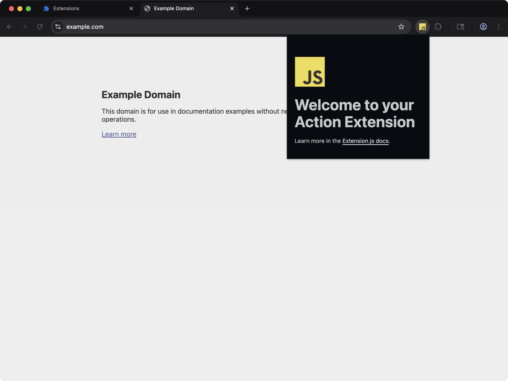
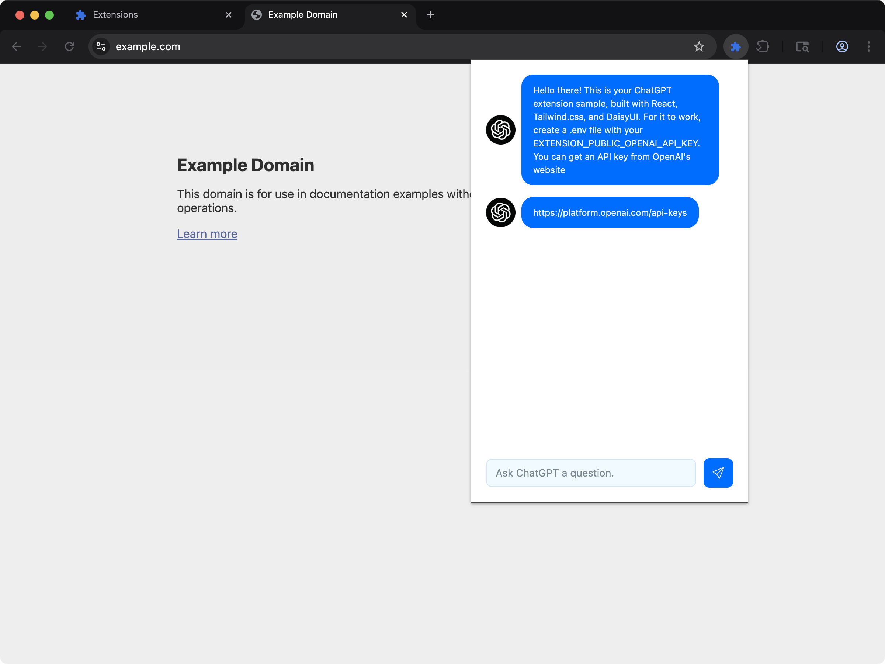

Run extension-wide logic in background contexts with clear support for both Manifest V2 (MV2) background scripts and Manifest V3 (MV3) service workers.

Extension.js reads background entries from `manifest.json` and compiles them into dedicated background outputs. It applies browser-specific reload behavior during development.

## Template examples

### `action`



An action popup extension with a background service worker handling browser events.

<CodeGroup>

```bash npm
npx extension@latest create my-extension --template=action
```

```bash pnpm
pnpx extension@latest create my-extension --template=action
```

```bash yarn 2+
yarn dlx extension@latest create my-extension --template=action
```

```bash bun
bunx extension@latest create my-extension --template=action
```

```bash deno
deno run -A npm:extension@latest create my-extension --template=action
```

</CodeGroup>

Repository: [extension-js/templates/action](https://github.com/extension-js/templates/tree/main/examples/action)

### `ai-chatgpt`



Action popup with a background service worker that integrates with an external API (ChatGPT).

<CodeGroup>

```bash npm
npx extension@latest create my-extension --template=ai-chatgpt
```

```bash pnpm
pnpx extension@latest create my-extension --template=ai-chatgpt
```

```bash yarn 2+
yarn dlx extension@latest create my-extension --template=ai-chatgpt
```

```bash bun
bunx extension@latest create my-extension --template=ai-chatgpt
```

```bash deno
deno run -A npm:extension@latest create my-extension --template=ai-chatgpt
```

</CodeGroup>

Repository: [extension-js/templates/ai-chatgpt](https://github.com/extension-js/templates/tree/main/examples/ai-chatgpt)

## Background capabilities

| Capability                   | What it gives you                                                    |
| ---------------------------- | -------------------------------------------------------------------- |
| MV2/MV3 compatibility        | Support `background.scripts` and `background.service_worker` entries |
| Dedicated background outputs | Emit background runtime files per active manifest shape              |
| Reload-aware development     | Apply hard reload/restart behavior for structural changes            |
| Worker mode control          | Respect `background.type` module/classic runtime behavior            |

## Background script support

Declare background scripts with these `manifest.json` fields:

| Manifest field              | File type expected           | dev behavior                                 |
| --------------------------- | ---------------------------- | -------------------------------------------- |
| `background.service_worker` | `.js`, `.ts`, `.mjs`, `.tsx` | hard reload flow                             |
| `background.scripts`        | `.js`, `.ts`, `.mjs`, `.tsx` | hot module replacement (HMR)-compatible path |

`background.type` can also affect runtime mode (`module` vs classic service worker behavior).

## Sample background script declaration

Example background script declaration in `manifest.json`:

```json
{
  "manifest_version": 3,
  "name": "My Extension",
  "version": "1.0.0",
  "background": {
    "service_worker": "./scripts/background.ts"
  }
}
```

## Development behavior

- Extension.js tracks service worker/source changes and can trigger hard extension reload.
- When a manifest edit adds, removes, or renames a script entry, a running `extension dev` session restarts its compiler and reloads the extension. You do not restart the command. From the release after 4.1.41, the session also restarts when a script moves to another manifest key, such as the same file moved from `background.scripts` to `background.service_worker`.
- Browser launch plugins apply target-specific hard reload strategies (Chromium/Firefox).
- Extension.js treats structural entrypoint changes more strictly than regular module edits.

## Firefox: service worker translated to an event page

Firefox does not run MV3 `background.service_worker` (loading such an add-on fails with _"background.service_worker is currently disabled. Add background.scripts."_). You don't need to special-case it: for the Firefox build, Extension.js automatically translates a `background.service_worker` entry into a `background.scripts` event page pointing at the same compiled bundle. Author one `background.service_worker` and it loads on both Chromium and Firefox.

## Chromium: scripts translated to a service worker

The translation runs in the other direction too. In a Chromium MV3 build, a `background.scripts` array becomes `background.service_worker` pointing at the compiled bundle.

Chromium MV3 never starts `background.scripts`. With no `service_worker` beside it, Chrome 151 loads the extension, shows no error, and runs no background. Extension.js therefore always removes the `scripts` key from the emitted Chromium MV3 manifest. When the source declares both fields, the existing `service_worker` entry wins.

## Safari: a background page, not a service worker

From 4.1.20, Safari builds emit a non-persistent background page. Extension.js translates a `background.service_worker` entry into `background: {scripts: [...]}`, the same translation it runs for Firefox.

The reason was measured. A Manifest V3 service worker never started on Safari 26.5.2, including for extensions built by Apple's own converter. A background page ran immediately. WebKit deliberately prefers the page form ([WebKit bug 270750](https://bugs.webkit.org/show_bug.cgi?id=270750)).

<Warning>
  One unguarded Chromium-only call at the **top level** of a background script
  throws on Safari, and Safari then discards the background context. You get no
  logs, no reload, and no error, so the extension looks dead. Guard the
  call, or branch at build time.
</Warning>

```js
// Throws on Safari and takes the whole background context with it.
chrome.sidePanel.setPanelBehavior({ openPanelOnActionClick: true });

// Safe on every target.
chrome.sidePanel?.setPanelBehavior({ openPanelOnActionClick: true });
```

Safari builds from 4.1.20 also warn about the extension APIs that Safari lacks, which is the cheapest way to find this before you start debugging. See [Building Safari extensions](/docs/browsers/safari).

## MV3 service worker lifecycle

`background.service_worker` runs under the browser's service-worker lifecycle, not as a long-running process.

That means:

- In-memory state can disappear between events.
- Design long-running work around events, not process permanence.
- Startup should stay small and predictable.
- Your code should restore important state from storage or recompute it safely.

Use `background.scripts` only for MV2-style compatibility cases. For MV3-first extensions, treat the service worker as the central coordinator for browser API calls and cross-context communication.

## Output behavior

Common outputs include:

- `background/service_worker.js`
- `background/scripts.js`

The exact output depends on which manifest field remains active after browser filtering.

## Module and classic notes

- `background.type: "module"` uses module worker semantics.
- Classic service worker mode uses `importScripts`-based chunk loading behavior.
- Avoid dynamic imports in background code that must load immediately on startup.
- From the release after 4.1.41, in a service worker background, code loaded with `import()` is bundled into the worker file, because Chromium only lets a service worker fetch scripts while it installs. The module still runs only when first imported. Extension pages and Firefox background pages keep separate lazy chunks.

## Runtime-loaded files

Some files never appear as import statements but still must ship with the extension. Extension.js traces these into the output so the built extension behaves like the source loaded unpacked in the browser:

- **`importScripts(...)` dependencies of classic service workers.** String-literal arguments are resolved recursively (a dependency can call `importScripts` itself) against the emitted worker location, so worker-relative URLs keep working even though the worker moves to `background/service_worker.js`. WebAssembly sibling files loaded by wasm-bindgen glue (`*_bg.wasm`) ship alongside their loader.
- **`chrome.scripting.executeScript({files: [...]})` and `insertCSS({files: [...]})` payloads.** Files referenced only from `files:` arrays (not declared in manifest `content_scripts`) are copied verbatim at their extension-root paths.
- **`contentScripts.register` and `userScripts.register` files.** From the release after 4.1.41, a script that one of these calls names as `{file: "..."}` is copied at its extension-root path.
- **Paths kept as plain strings.** From the release after 4.1.41, a path that a script holds as a string ships the file that it names, when that file exists in a folder of your project. An example is a table of paths that the code passes to `fetch` or `chrome.action.setIcon`:

  ```js
  const CONFIG = {
    remote: `${CONFIG_URL_BASE}/sites.config`,
    local: "../config/sites.config", // ships config/sites.config
  };

  const response = await fetch(CONFIG.local);
  ```

  The build copies data and media files this way. It does not copy scripts, pages, or style sheets this way. A path that the code builds from parts at runtime names no file. For that path, the build prints a warning that names the folder. Put those files in `public/`.
- **Style sheets of a page opened by path.** A page that your code opens by path, for example with `chrome.runtime.getURL("/ui/options/index.html")`, ships with its scripts and style sheets. From the release after 4.1.41, the fonts and images that those style sheets load with `url()` ship too.
- **Style sheets injected by file.** From the release after 4.1.41, a style sheet named by `scripting.insertCSS({files})`, `tabs.insertCSS({file})`, or a `css` list of `scripting.registerContentScripts` ships with the fonts and images that it loads with `url()` and the sheets that it imports. On Chrome, a `url()` in an injected sheet is read against the visited page. Spell the target as `chrome-extension://__MSG_@@extension_id__/path`. The build lists the files that the sheet loads under `web_accessible_resources`: every file on Chromium and Safari targets, and only fonts on Firefox targets. Firefox Manifest V3 blocks an injected sheet's font without the entry and loads its images unlisted.
- **`@import` in an injected style sheet.** From the release after 4.1.41, on Chromium targets, the build writes an `@import` into the sheet, under its media, supports, or layer condition. Chrome drops the rule in an injected sheet. This covers a sheet injected by file with `scripting.insertCSS` or `scripting.registerContentScripts`, and a sheet declared in `content_scripts`. An import of another origin stays as written, and the build warns with the file and line.
- **Injected style sheets in `public/`.** From the release after 4.1.41, a sheet in `public/` ships byte for byte. If it is injected by file, the build warns once for an `@import` that Chrome drops. It warns once more for the first `url()` that Chrome reads against the visited page, and suggests the `chrome-extension://__MSG_@@extension_id__/…` spelling.
- **Where a named file ships.** From the release after 4.1.41, a path handed straight to `fetch` ships beside the script that reads it, a path handed straight to `chrome.runtime.getURL` ships at the extension root, and a path kept in a table or a variable ships in both places. Chrome loads a `devtools.panels.create` page path and a `sidePanel.setOptions` path from the extension root. An icon that a dynamically imported module sets ships beside the worker or page that loads the module.

A referenced file that does not exist in your project produces a build warning naming the missing path, instead of a silent runtime failure.

## Recommended architecture

- Keep the background entry thin and move feature logic into shared modules.
- Use the background context as the central coordinator for messaging, storage access, and browser API calls.
- Restore durable state from storage instead of assuming the background script stays running permanently.
- Use alarms, explicit event listeners, and small feature modules instead of one large startup path.

## Common mistakes

- Treating the service worker like a permanently running server process.
- Keeping critical state only in memory.
- Doing expensive startup work on every event wakeup.
- Putting too much feature logic in popup or content-script code when it actually needs background-level browser API access.

## Best practices

- Prefer `background.service_worker` for MV3-first extensions.
- Keep background entry files small and delegate logic to shared modules.
- Avoid expensive startup work in service workers; initialize lazily where safe.
- Treat manifest background field edits as structural changes in dev flow.
- Route privileged actions through validated message handlers.
- Store durable settings and caches in browser storage, not only in module-level variables.

## Next steps

- Understand update outcomes in [dev update behavior](/docs/workflows/dev-update-behavior).
- Persist durable runtime state with [Storage](/docs/implementation-guide/storage).
- Coordinate contexts with [Messaging](/docs/implementation-guide/messaging).
- Learn more about [JavaScript in development](/docs/implementation-guide/javascript).
- Continue with [content scripts](/docs/implementation-guide/content-scripts).
- Troubleshoot service worker behavior in [Manifest V3 troubleshooting](/docs/concepts/manifest-v3).
