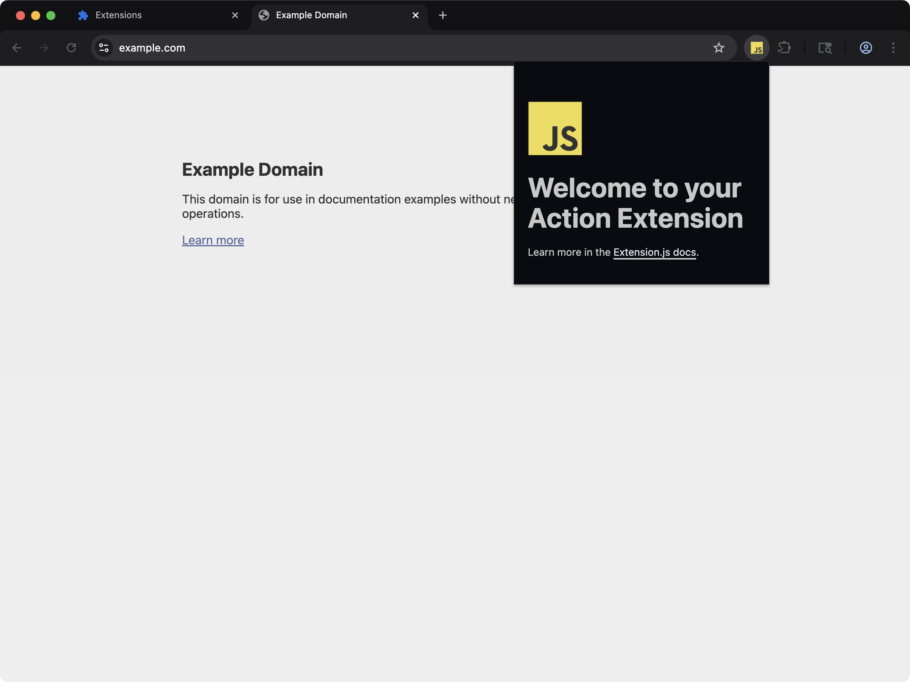

Keep extension branding and action UI consistent by declaring icons in manifest fields that Extension.js can validate, rewrite, and emit predictably.

Extension.js processes icon paths from `manifest.json`, resolves public/relative paths, emits icon assets, and watches icon files during development.

## Template example

### `action`



An action extension with toolbar icons declared in `manifest.json`.

<CodeGroup>

```bash npm
npx extension@latest create my-extension --template=action
```

```bash pnpm
pnpx extension@latest create my-extension --template=action
```

```bash yarn 2+
yarn dlx extension@latest create my-extension --template=action
```

```bash bun
bunx extension@latest create my-extension --template=action
```

```bash deno
deno run -A npm:extension@latest create my-extension --template=action
```

</CodeGroup>

Repository: [extension-js/templates/action](https://github.com/extension-js/templates/tree/main/examples/action)

## Icon capabilities

| Capability                  | What it gives you                                           |
| --------------------------- | ----------------------------------------------------------- |
| Manifest icon field support | Validate and compile icons for supported extension surfaces |
| Path resolution             | Handle relative and public-root icon paths consistently     |
| Dev watch updates           | Recompile icon changes during local development             |
| Browser-safe output         | Emit icon assets in extension output with stable references |

## Supported icon fields

| Manifest field                | Chromium (Chrome, Edge, Brave, Opera) | Firefox               |
| ----------------------------- | ------------------------------------- | --------------------- |
| `action.default_icon`         | .png, .jpg                            | .png, .jpg, .svg      |
| `browser_action.default_icon` | .png, .jpg                            | .png, .jpg, .svg      |
| `icons`                       | .png, .jpg                            | .png, .jpg, .svg      |
| `page_action.default_icon`    | .png, .jpg                            | .png, .jpg, .svg      |
| `sidebar_action.default_icon` | Not supported                         | .png, .jpg, .svg (\*) |
| `browser_action.theme_icons`  | Not supported                         | .png, .jpg, .svg      |

<Note>
  Chromium does not accept `.svg` (or `.webp`) for `icons` and action icons. A
  manifest that points these fields at an SVG loads in Firefox and fails in
  Chrome, Edge, Brave, and Opera. Ship PNG files for every Chromium target.
  `sidebar_action` and `browser_action.theme_icons` are Firefox fields, and
  `.svg` support for `sidebar_action.default_icon` is partial there (\*).
</Note>

## Sample icon declaration in `manifest.json`

```json
{
  "manifest_version": 3,
  "name": "My Extension",
  "version": "1.0.0",
  "icons": {
    "16": "icons/icon-16.png",
    "48": "icons/icon-48.png",
    "128": "icons/icon-128.png"
  },
  "action": {
    "default_icon": "icons/action-icon.png"
  }
}
```

## Icon variants

`icon_variants` declares one icon group per color scheme. Extension.js reads the key at the top level and under `action`, `browser_action`, and `page_action`.

```json
{
  "icons": {
    "16": "icons/icon-16.png",
    "48": "icons/icon-48.png"
  },
  "icon_variants": [
    {
      "16": "icons/dark-16.png",
      "48": "icons/dark-48.png",
      "color_schemes": ["dark"]
    },
    {
      "16": "icons/light-16.png",
      "48": "icons/light-48.png",
      "color_schemes": ["light"]
    }
  ]
}
```

The files under the key ship and are checked like `icons`:

- Each variant file is emitted at its source location, and its manifest path follows the same rules as `icons`.
- A missing variant file stops the build with the icons error, which names the key: `Can't find an icon file listed in icon_variants.`

Chromium reads `icon_variants` only with its `ExtensionIconVariants` flag on, and Firefox does not read the key yet. For those targets, the build keeps the `icons` and the action `default_icon` that your manifest declares.

When the manifest has none, the build fills them from the variant group with no `color_schemes`, then from the light group. Chromium takes PNG sizes only, and Firefox can also take the `any` SVG. The Safari output keeps the manifest as written.

The build prints one notice that says which icons the browser shows:

```plaintext
Firefox does not read icon_variants yet.
Firefox shows icons from your manifest instead.
```

When the build fills `icons` for you, the notice says so:

```plaintext
Chromium reads icon_variants only with its ExtensionIconVariants flag on.
The manifest had no icons, so the build filled it from the variant that fits every color scheme, or the light one.
```

Browser prefixes work on the key. A list under `chromium:icon_variants` or `firefox:icon_variants` ships its files in that browser's build only. See [Browser-specific manifest fields](/docs/features/browser-specific-fields).

## Generate PNG sizes from an SVG

Keep the SVG as the design source and export the PNG sizes that every browser accepts. This one-liner uses `rsvg-convert` from librsvg (`brew install librsvg` on macOS, `apt install librsvg2-bin` on Debian and Ubuntu):

```bash
for size in 16 32 48 128; do rsvg-convert -w $size -h $size icon.svg -o icons/icon-$size.png; done
```

Then point `icons` and `action.default_icon` at the PNG files, as in the sample above.

## Output path

Typical icon outputs:

```plaintext
<path-relative-to-manifest>            # icons keep their source location
browser_action/<theme-icon-filename>   # for theme_icons
```

Icons are not moved into an `icons/` folder. An icon declared as `images/icon.png` is
emitted at `images/icon.png`, and the output manifest keeps pointing at that same path.

## Path behavior

- Extension.js resolves relative icon paths from the manifest folder.
- Leading `/` and `public/...` resolve to extension public-root semantics.
- Extension.js can watch public-folder assets without re-emitting them through the icon feature itself.

## Development behavior

- Changing existing icon files triggers recompilation.
- Changing manifest icon entrypoint references can require restarting the dev server.
- Missing required icon files produce build errors (some optional icon groups can warn instead).

## Best practices

- Declare manifest icon fields explicitly instead of relying on incidental asset imports.
- Provide multiple icon sizes (`16`, `32`, `48`, `128`) for sharper UI across browser surfaces.
- Keep icon filenames stable to reduce manifest churn during development.
- Use public-root paths intentionally and test resulting manifest output paths.

## Next steps

- Continue with [web-accessible resources](/docs/implementation-guide/web-accessible-resources).
- Learn more about [Special folders](/docs/features/special-folders).
