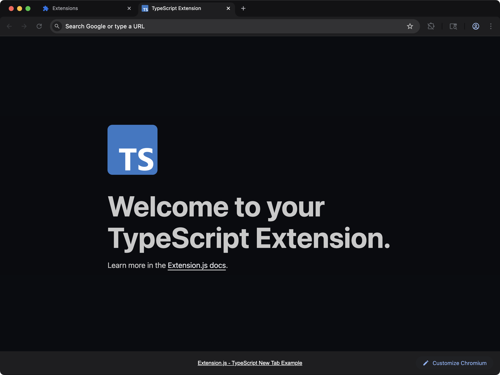
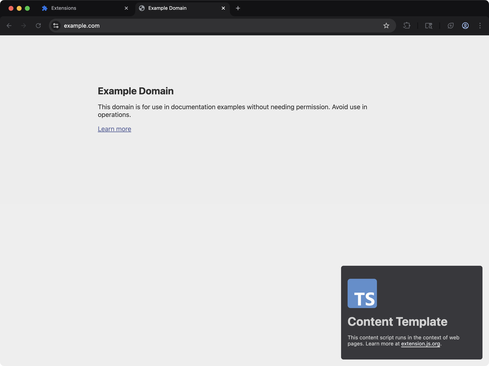
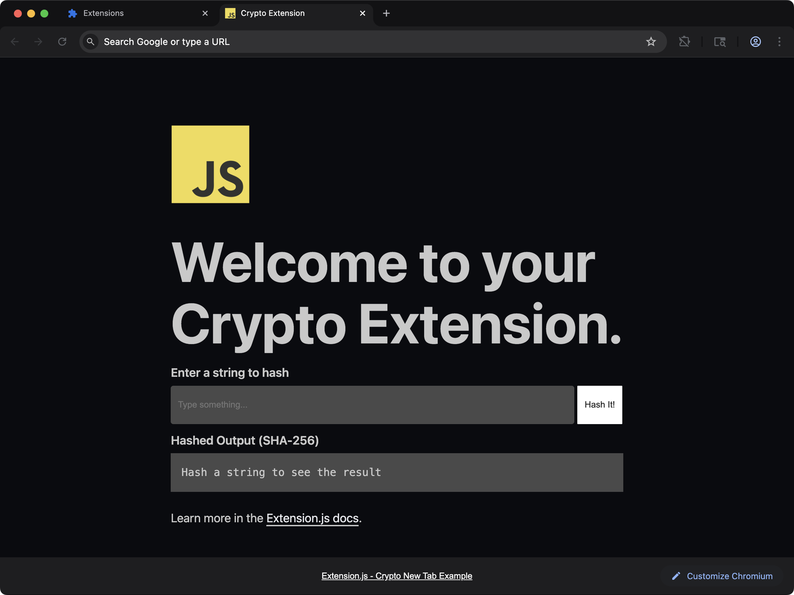

Extension.js targets the browser runtime by default. It does not automatically polyfill Node core modules, which keeps bundles small. If a dependency reaches for `buffer`, `stream`, or `os`, you see a resolution error at build time. The sections below explain when to add polyfills and when to choose a browser-native alternative.

## When Node polyfills are a good fit

- A required dependency needs Node core modules in browser runtime.
- You are incrementally migrating code from Node-centric packages.
- You can accept larger bundles for specific runtime capabilities.

## Template examples

### `new-typescript`



Start from a TypeScript baseline when your extension needs explicit bundler/polyfill tuning.

<CodeGroup>

```bash npm
npx extension@latest create my-extension --template=newtab-typescript
```

```bash pnpm
pnpx extension@latest create my-extension --template=newtab-typescript
```

```bash yarn 2+
yarn dlx extension@latest create my-extension --template=newtab-typescript
```

```bash bun
bunx extension@latest create my-extension --template=newtab-typescript
```

```bash deno
deno run -A npm:extension@latest create my-extension --template=newtab-typescript
```

</CodeGroup>

Repository: [extension-js/templates/newtab-typescript](https://github.com/extension-js/templates/tree/main/examples/newtab-typescript)

### `content-typescript`



Use a content-script TypeScript base when Node-dependent libraries run inside page-injected flows.

<CodeGroup>

```bash npm
npx extension@latest create my-extension --template=content-typescript
```

```bash pnpm
pnpx extension@latest create my-extension --template=content-typescript
```

```bash yarn 2+
yarn dlx extension@latest create my-extension --template=content-typescript
```

```bash bun
bunx extension@latest create my-extension --template=content-typescript
```

```bash deno
deno run -A npm:extension@latest create my-extension --template=content-typescript
```

</CodeGroup>

Repository: [extension-js/templates/content-typescript](https://github.com/extension-js/templates/tree/main/examples/content-typescript)

### `new-crypto`



See the Web Crypto API (`window.crypto.subtle`) used directly in a new-tab extension, no polyfill.

<CodeGroup>

```bash npm
npx extension@latest create my-extension --template=newtab-crypto
```

```bash pnpm
pnpx extension@latest create my-extension --template=newtab-crypto
```

```bash yarn 2+
yarn dlx extension@latest create my-extension --template=newtab-crypto
```

```bash bun
bunx extension@latest create my-extension --template=newtab-crypto
```

```bash deno
deno run -A npm:extension@latest create my-extension --template=newtab-crypto
```

</CodeGroup>

Repository: [extension-js/templates/newtab-crypto](https://github.com/extension-js/templates/tree/main/examples/newtab-crypto)

## Default behavior

- Build target is browser-first (`web`).
- Resolution prioritizes browser exports (`browser`, `module`, `main`).
- `crypto`, `path`, and `fs` are mapped to `false`, so they resolve to an empty module. The
  build succeeds and the import fails at runtime instead (for example `path.join` is undefined).
- Every other Node core module, including `buffer`, `stream`, `os` and `node:`-prefixed
  specifiers, has no fallback and fails the build with `Module not found: Can't resolve`.

So a missing Node API shows up in one of two places, and which one depends on the module.
Add explicit fallbacks below to handle either case.

### `node:` specifiers and the build error

From the release after 4.1.39, `node:fs` and `fs` are the same request, so both spellings get the same answer:

- `crypto`, `fs`, and `path` resolve to an empty module under either spelling. That includes a subpath such as `fs/promises`.
- Any other built-in stops the build. The message names the built-in, the file that imports it, and the `resolve.fallback` key to set.
- A `require()` of a built-in with no stand-in is a warning. The call stays verbatim in the output and throws only if that code path runs. Set `EXTENSION_STRICT_REFS=true` to fail the build on it.

```plaintext
The Node.js built-in util does not exist in a browser, and this build has no stand-in for it. background.js imports it.
Only crypto, fs, path are replaced with an empty module. In extension.config.js, set resolve.fallback from the config hook: {'util': false} for an empty module, or the path of a browser polyfill you installed, such as require.resolve('util/'). node:util and util read the same key.
```

On 4.1.39 and earlier, a `node:`-prefixed specifier fails the build for every module, `crypto`, `fs`, and `path` included.

## Setting up Node polyfills

Use `extension.config.js` (or `.mjs` / `.cjs`) to extend the Rspack configuration and define safe fallbacks.

```js
import NodePolyfillPlugin from "node-polyfill-webpack-plugin";
import { createRequire } from "node:module";

const require = createRequire(import.meta.url);

export default {
  config: (config) => {
    config.resolve = config.resolve || {};
    config.resolve.fallback = {
      ...(config.resolve.fallback || {}),
      crypto: require.resolve("crypto-browserify"),
      path: require.resolve("path-browserify"),
      fs: false,
    };
    config.plugins = config.plugins || [];
    config.plugins.push(new NodePolyfillPlugin());
    return config;
  },
};
```

### Add one fallback at a time

You do not need a polyfill plugin for one or two modules. Install the browser packages, then extend `resolve.fallback` from the `config` hook. Set a key to `false` for an empty module. `Buffer` is a global in Node.js, so provide it with a `ProvidePlugin`.

From the release after 4.1.39, the hook's second argument carries `rspack`, the bundler that Extension.js compiles with. Take the plugin class from it, so your project needs no `@rspack/core` of its own:

<CodeGroup>

```bash npm
npm install buffer util
```

```bash pnpm
pnpm add buffer util
```

```bash yarn
yarn add buffer util
```

```bash bun
bun add buffer util
```

```bash deno
deno add npm:buffer npm:util
```

</CodeGroup>

```js extension.config.js
import { createRequire } from "node:module";

const require = createRequire(import.meta.url);

export default {
  config: (config, { rspack }) => {
    config.resolve.fallback = {
      ...config.resolve.fallback,
      buffer: require.resolve("buffer/"),
      util: require.resolve("util/"),
      os: false,
    };
    config.plugins.push(
      new rspack.ProvidePlugin({ Buffer: ["buffer", "Buffer"] }),
    );
    return config;
  },
};
```

Spread the existing `resolve.fallback` so the three default keys stay. The trailing slash in `require.resolve("buffer/")` names the installed package, not the Node.js built-in.

A name that exists only with the prefix, such as `node:test`, has no bare key for `resolve.fallback` to reach. Replace it with a module of your own through `rspack.NormalModuleReplacementPlugin`:

```js extension.config.js
import { createRequire } from "node:module";

const require = createRequire(import.meta.url);

export default {
  config: (config, { rspack }) => {
    config.plugins.push(
      new rspack.NormalModuleReplacementPlugin(
        /^node:test$/,
        require.resolve("./src/test-stand-in.js"),
      ),
    );
    return config;
  },
};
```

## Install optional polyfill packages

<CodeGroup>

```bash npm
npm install -D node-polyfill-webpack-plugin crypto-browserify path-browserify
```

```bash pnpm
pnpm add -D node-polyfill-webpack-plugin crypto-browserify path-browserify
```

```bash yarn
yarn add -D node-polyfill-webpack-plugin crypto-browserify path-browserify
```

```bash bun
bun add -d node-polyfill-webpack-plugin crypto-browserify path-browserify
```

```bash deno
deno add -D npm:node-polyfill-webpack-plugin npm:crypto-browserify npm:path-browserify
```

</CodeGroup>

## Extension APIs vs Node APIs

Setting `polyfill: true` in CLI/config enables `webextension-polyfill`, a compatibility layer that gives Chromium browsers older than 148 access to the `browser.*` API namespace (older than 152 with a `devtools_page`). Newer versions expose `browser` natively. It does not enable Node core module polyfills.

Use Node polyfills only for libraries that cannot run with standard Web APIs.

## Caveats

- Do not assume filesystem access in extension runtime; keep `fs: false` unless you have a specific browser-safe strategy.
- Prefer Web Crypto (`crypto.subtle`) over large Node crypto shims when possible.
- Polyfills (browser-compatible replacements for Node APIs) increase bundle size and can affect startup time in extension pages and content scripts.
- From the release after 4.1.39, a `node:` specifier reads the same `resolve.fallback` key as its bare name. On earlier versions, it fails the build.

## Next steps

- Learn how to customize [Rspack configuration](/docs/features/rspack-configuration).
- Learn how to manage [Extension configuration](/docs/features/extension-configuration).

## Video walkthrough

<Frame>
  <iframe
    className="w-full aspect-video rounded-xl"
    src="https://www.youtube-nocookie.com/embed/dPdh5H_sTgw?rel=0"
    title="Extension.js: New Tab Crypto template"
    loading="lazy"
    allow="encrypted-media; picture-in-picture; fullscreen"
    allowFullScreen
  />
</Frame>
