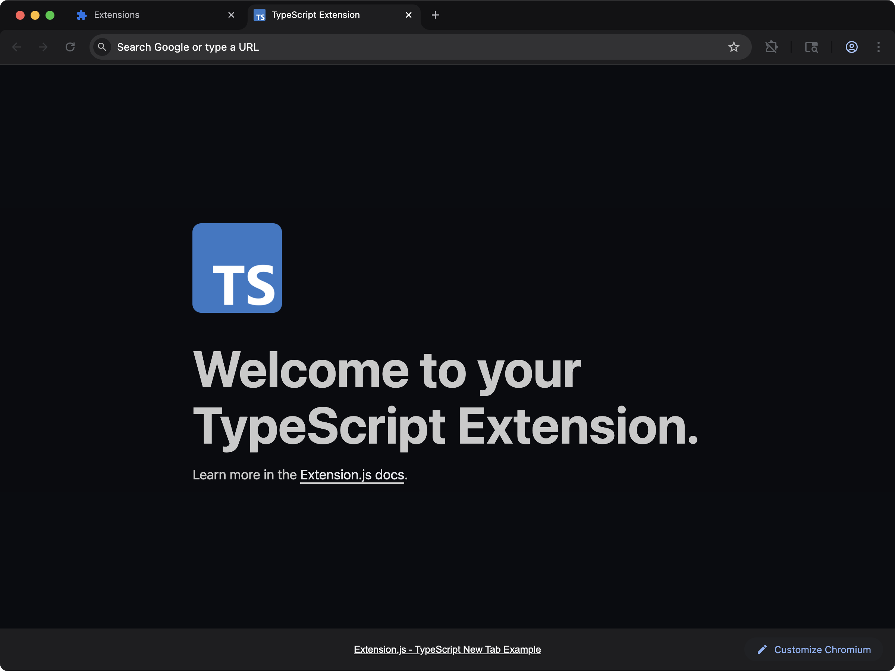
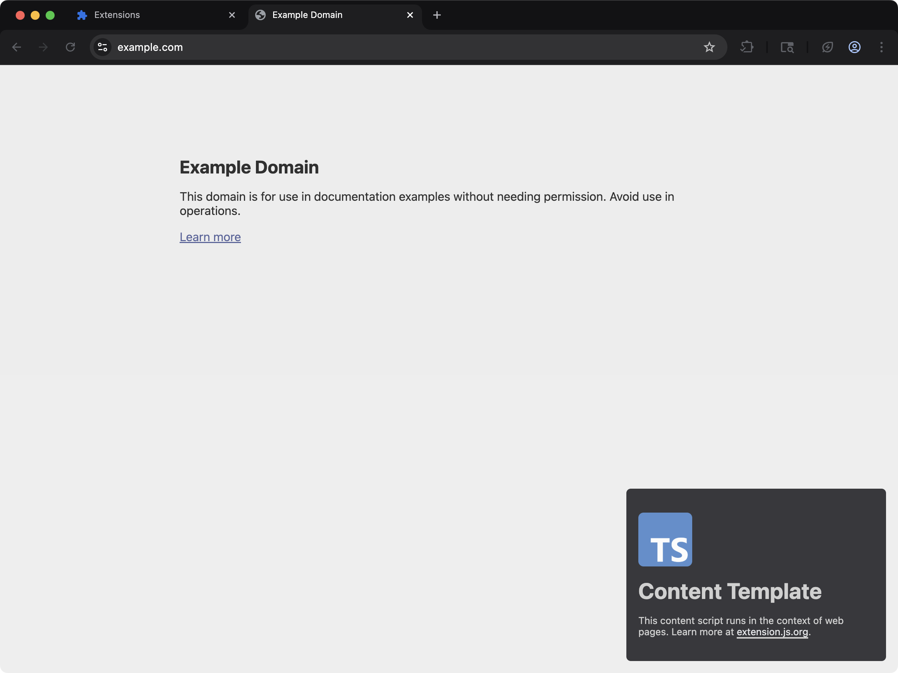

Extension.js builds and runs browser extensions from one `manifest.json` for Chrome, Edge, Firefox, and Safari. It runs TypeScript across every extension context: background, content scripts, popup, options, and sidebar. It uses the Rspack + SWC pipeline by default. You do not need a separate `tsc` step, a ts-loader, or an extra bundler rule.

Builds do not need the `typescript` package at all. SWC compiles your sources and strips the types. The package matters only for editor tooling and a `tsc --noEmit` typecheck. For that reason a missing `typescript` package never fails a build, unlike missing framework integration packages.

## When TypeScript is a good fit

- You want safer refactors and clearer contracts across extension contexts.
- You share logic between background scripts, content scripts, and UI surfaces.
- You need predictable API usage when working with AI-generated code.

## Template examples

### `new-typescript`



Best for building a new-tab extension with TypeScript defaults already configured.

<CodeGroup>

```bash npm
npx extension@latest create my-extension --template=newtab-typescript
```

```bash pnpm
pnpx extension@latest create my-extension --template=newtab-typescript
```

```bash yarn 2+
yarn dlx extension@latest create my-extension --template=newtab-typescript
```

```bash bun
bunx extension@latest create my-extension --template=newtab-typescript
```

```bash deno
deno run -A npm:extension@latest create my-extension --template=newtab-typescript
```

</CodeGroup>

Repository: [extension-js/templates/newtab-typescript](https://github.com/extension-js/templates/tree/main/examples/newtab-typescript)

### `content-typescript`



Best for injecting TypeScript-powered content scripts into existing pages.

<CodeGroup>

```bash npm
npx extension@latest create my-extension --template=content-typescript
```

```bash pnpm
pnpx extension@latest create my-extension --template=content-typescript
```

```bash yarn 2+
yarn dlx extension@latest create my-extension --template=content-typescript
```

```bash bun
bunx extension@latest create my-extension --template=content-typescript
```

```bash deno
deno run -A npm:extension@latest create my-extension --template=content-typescript
```

</CodeGroup>

Repository: [extension-js/templates/content-typescript](https://github.com/extension-js/templates/tree/main/examples/content-typescript)

## Generated ambient types

For TypeScript projects, Extension.js generates an `extension-env.d.ts` file at your project root with ambient declarations (browser/runtime globals, `EXTENSION_PUBLIC_*` env, and bundler types). [`dev`](/docs/commands/dev), [`build`](/docs/commands/build), and [`start`](/docs/commands/start) each regenerate it, so editor types and a CI `tsc --noEmit` stay in sync. Commit it (or git-ignore it). Either works, because the next run recreates it.

From the release after 4.1.39, a missing file is created only where your `tsconfig.json` would read it. See [Keep extension-env.d.ts in the include list](/docs/languages-and-frameworks/extension-api-types).

## Usage with an existing extension

Add TypeScript to an existing extension with the steps below.

### Installation

1. Install TypeScript as a development dependency:

<CodeGroup>

```bash npm
npm install -D typescript
```

```bash pnpm
pnpm add -D typescript
```

```bash yarn
yarn add -D typescript
```

```bash bun
bun add -d typescript
```

```bash deno
deno add -D npm:typescript
```

</CodeGroup>

2. Initialize the TypeScript configuration file `tsconfig.json`:

<CodeGroup>

```bash npm
npx tsc --init
```

```bash pnpm
pnpm exec tsc --init
```

```bash yarn
yarn tsc --init
```

```bash bun
bunx tsc --init
```

```bash deno
deno run -A npm:typescript/tsc --init
```

</CodeGroup>

### Configuration

#### TypeScript detection and requirements

Extension.js looks for `tsconfig.json` next to your `package.json`.

- A project with no `tsconfig.json` gets a baseline one when the build compiles TypeScript: a script the manifest names, a script a page loads, or a file those import by a relative path. The build says `Creating a default tsconfig.json` and carries on.
- A `.ts` file that nothing loads does not count, and neither does the `typescript` dependency alone. From the release after 4.1.41, the build writes nothing into such a project.

Example baseline configuration:

```json
{
  "compilerOptions": {
    "allowJs": true,
    "allowSyntheticDefaultImports": true,
    "esModuleInterop": true,
    "forceConsistentCasingInFileNames": true,
    "isolatedModules": false,
    "jsx": "react-jsx",
    "jsxImportSource": "react",
    "lib": ["dom", "dom.iterable", "esnext"],
    "moduleResolution": "bundler",
    "module": "esnext",
    "resolveJsonModule": true,
    "strict": true,
    "target": "esnext",
    "skipLibCheck": true
  },
  "exclude": ["node_modules", "dist"]
}
```

Two defaults worth knowing:

- `moduleResolution` is `bundler`, which models the Rspack + SWC pipeline. The removed `node` (node10) mode fails `tsc --noEmit` on TypeScript 7.
- `jsx` is `react-jsx` only when Extension.js detects a JSX framework in the project. Without one, it stays `preserve` and `jsxImportSource` is left out. From 4.1.20, a framework project also gets `jsxImportSource` set to `react`, `preact`, `vue`, or `solid-js` to match the detected framework, so `tsc --noEmit` resolves the same JSX runtime as the build.

#### Automatic types

Extension.js generates `extension-env.d.ts` in your project root. `dev`, `build`, and `start` each rewrite it. This file references the type declarations for the extension APIs, the Extension.js environment keys, and asset imports.

```ts extension-env.d.ts
// Required Extension.js types for TypeScript projects.
// This file is auto-generated and should not be excluded.
// If you need additional types, consider creating a new *.d.ts file and
// referencing it in the "include" array of your tsconfig.json file.
// See https://www.typescriptlang.org/tsconfig#include for more information.
/// <reference types="extension/types" />

// Polyfill types for browser.* APIs
/// <reference types="extension/types/polyfill" />
```

#### Extension API types

Extension.js types the extension APIs with [`chrome-types`](https://www.npmjs.com/package/chrome-types). Chrome generates that package from the Chromium source. `browser` is the native namespace, and its methods return promises. `chrome` is an alias of it. The package installs with `extension`, so a new project needs no extra type package.

```ts
const [tab] = await browser.tabs.query({ active: true, currentWindow: true });
```

`chrome-types` does not declare the APIs that only Firefox has. Extension.js types Firefox's `browser.sidebarAction` and `browser.browserAction` itself.

From the release after 4.1.40, Extension.js also adds three things on top of `chrome-types`, so that code the browser accepts type-checks:

- A callback right after the arguments that you passed, for example `chrome.tabs.sendMessage(tabId, message, callback)`. `chrome-types` alone only types a callback after every optional argument.
- The enum objects that Chrome has at run time, such as `chrome.runtime.OnInstalledReason.INSTALL`. These are Chrome's objects. Firefox has fewer of them and names some keys differently, so code for both browsers should compare with the string, as in `reason === 'install'`.
- `chrome.tabs.OnUpdatedInfo`, also available as `chrome.tabs.TabChangeInfo`, for the change argument of `tabs.onUpdated`.

One call still reports an error that Chrome does not: `new chrome.declarativeContent.ShowAction()` reports a missing argument. Write `new chrome.declarativeContent.ShowAction({})`, which Chrome treats the same.

#### Projects that install @types/chrome

A project that installs `@types/chrome` keeps it. That package types `chrome`, and `browser` is typed from `webextension-polyfill` as before.

`@types/chrome` and `chrome-types` both declare the `chrome` global, so the two packages cannot load together. The generated `extension-env.d.ts` references one or the other. It references `@types/chrome` when your `package.json` lists that package. It does the same when `node_modules/@types/chrome` exists in the project folder or in a parent folder:

```ts extension-env.d.ts
/// <reference types="extension/types/legacy" />

// This project installs @types/chrome, so it types the extension APIs.
// Remove that package to get chrome-types and the native browser namespace.
/// <reference types="chrome" />

// Polyfill types for browser.* APIs
/// <reference types="extension/types/polyfill" />
```

To move to `chrome-types`:

1. Remove `@types/chrome` from your project.
2. Run `extension dev` or `extension build` once.

To go back to `@types/chrome`:

1. Install `@types/chrome` as a development dependency.
2. Run `extension dev` or `extension build` once.

#### Polyfill types

On the default setup, the `browser` global has the native types from `chrome-types`. For the `webextension-polyfill` types, import the module:

```ts
import browser from "webextension-polyfill";
```

The import only changes the types and the object that your code calls. Read [Cross-browser compatibility](/docs/features/cross-browser-compatibility) for when the polyfill runs.

#### Upgrade note

Earlier releases installed `@types/chrome` with `extension` and typed `browser` from `webextension-polyfill`. A project that installs `@types/chrome` keeps those types. A project without `@types/chrome` moves to `chrome-types` on upgrade.

After that move, `tsc` can report names such as `chrome.tabs.TabChangeInfo` missing. Install `@types/chrome` to keep the previous types, then run `extension dev` or `extension build` once.

#### Transpilation vs type-checking

The default bundler pipeline compiles TypeScript but does not run full `tsc` type-checking as part of bundling.

Recommended scripts:

```json
{
  "scripts": {
    "dev": "extension dev",
    "typecheck": "tsc --noEmit"
  }
}
```

`tsc` does not write `extension-env.d.ts`. Only `dev`, `build`, and `start` regenerate it. In CI, run one of them before `tsc`:

```bash
npx extension build
npx tsc --noEmit
```

## Next steps

- Learn how Extension.js handles [ECMAScript modules](/docs/languages-and-frameworks/ecmascript-modules).
- Explore styling options like [Sass modules](/docs/languages-and-frameworks/sass).
- Read about [JavaScript and TypeScript files in browser extensions](/docs/concepts/javascript-typescript-browser-extension-files).
- Compare TypeScript support across each [browser extension framework](/docs/compare).

## Video walkthrough

<Frame>
  <iframe
    className="w-full aspect-video rounded-xl"
    src="https://www.youtube-nocookie.com/embed/9OBuuh3N_cM?rel=0"
    title="Extension.js: Content TypeScript template"
    loading="lazy"
    allow="encrypted-media; picture-in-picture; fullscreen"
    allowFullScreen
  />
</Frame>
