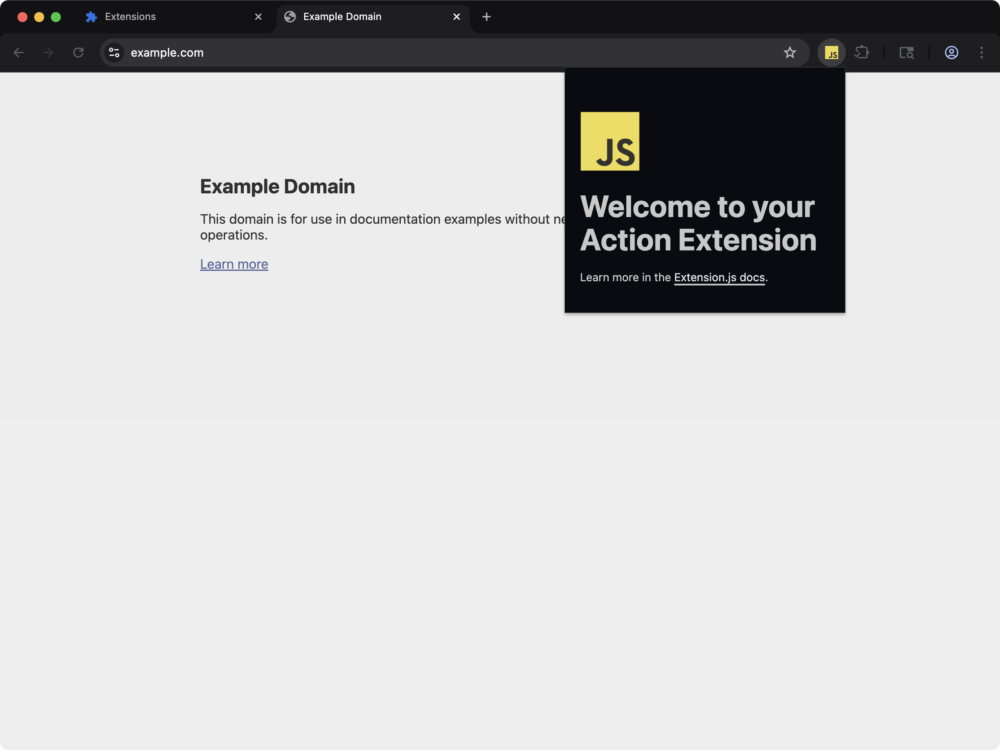

Extension.js 在开发与构建期间处理浏览器特定的设置。你可以从同一个项目为 Chromium、
Gecko(Firefox 引擎) 与 Safari 目标生成运行时正确的产物。

## 跨浏览器扩展开发

跨浏览器扩展开发意味着写一个扩展同时发布到 Chrome、Edge、Firefox 和 Safari，而无需 fork 代码。Extension.js 会把同一个项目编译成各浏览器对应的产物(`dist/chrome`、`dist/edge`、`dist/firefox`、`dist/safari`)，并按当前目标过滤 manifest。重载循环、运行时 API 和打包流程都与你当前调试的浏览器保持一致。

使用一份 `manifest.json` 即可针对特定浏览器或自定义二进制文件。如果你需要在早于 148 版的 Chromium 浏览器里使用 `browser.*`，可以启用 polyfill。

## Chrome 与 Firefox 扩展兼容性

Chrome 与 Firefox 扩展在大部分 WebExtensions 接口上是一致的，但有三处日常都会遇到的差异：

- **后台脚本：** Chrome (Manifest V3) 要求 `background.service_worker`。Firefox 使用 `background.scripts`，并采用非持久事件页。Extension.js 会在这两种形态之间做双向翻译，所以一份 manifest 里两种写法都能用。
- **运行时 API 命名空间：** Firefox 原生支持 `browser.*`。Chromium 在每个版本上都支持 `chrome.*`，并自 148 版起支持 `browser.*`（扩展声明了 `devtools_page` 时自 152 版起）。在更旧的 Chromium 版本上传入 `--polyfill` 可以填平这个差异。
- **权限与内容安全策略 (CSP)：** 浏览器对部分 `permissions` 和 `host_permissions` 条目的处理不同。把浏览器差异放进带前缀的 manifest 键里，而不是在运行时做特性检测。

## 浏览器特定的 manifest 字段

浏览器特定的 manifest 字段是 Extension.js 让一份 `manifest.json` 在多浏览器中工作的方式。编译时 Extension.js 会按当前目标过滤带前缀的键(`chromium:`、`chrome:`、`edge:`、`firefox:`、`gecko:`、`safari:`)。`chromium:` 覆盖所有 Chromium 系浏览器，`chrome:` 与 `edge:` 只覆盖对应的那个浏览器。不带前缀的键在所有目标中都生效。完整前缀列表请参见[浏览器特定的 manifest 字段](/zh-Hans/docs/features/browser-specific-fields)。

## 模板示例

### `action`



通过一个能在 Chrome、Firefox 和 Edge 中运行的 action 弹窗，体验跨浏览器兼容性。

<CodeGroup>

```bash npm
npx extension@latest create my-extension --template=action
```

```bash pnpm
pnpx extension@latest create my-extension --template=action
```

```bash yarn 2+
yarn dlx extension@latest create my-extension --template=action
```

```bash bun
bunx extension@latest create my-extension --template=action
```

```bash deno
deno run -A npm:extension@latest create my-extension --template=action
```

</CodeGroup>

代码仓库：[extension-js/templates/action](https://github.com/extension-js/templates/tree/main/examples/action)

## 工作原理

### 1) 选择浏览器目标

选择你想运行扩展的位置。

用 `--browser` 选择常见目标，或传入自定义的浏览器二进制路径。

<CodeGroup>

```bash npm
npx extension@latest dev --browser firefox
```

```bash pnpm
pnpx extension@latest dev --browser firefox
```

```bash yarn
yarn dlx extension@latest dev --browser firefox
```

```bash bun
bunx extension@latest dev --browser firefox
```

```bash deno
deno run -A npm:extension@latest dev --browser firefox
```

</CodeGroup>

<CodeGroup>

```bash npm
npx extension@latest dev --chromium-binary /Applications/Brave\\ Browser.app/Contents/MacOS/Brave\\ Browser
```

```bash pnpm
pnpx extension@latest dev --chromium-binary /Applications/Brave\\ Browser.app/Contents/MacOS/Brave\\ Browser
```

```bash yarn
yarn dlx extension@latest dev --chromium-binary /Applications/Brave\\ Browser.app/Contents/MacOS/Brave\\ Browser
```

```bash bun
bunx extension@latest dev --chromium-binary /Applications/Brave\\ Browser.app/Contents/MacOS/Brave\\ Browser
```

```bash deno
deno run -A npm:extension@latest dev --chromium-binary /Applications/Brave\\ Browser.app/Contents/MacOS/Brave\\ Browser
```

</CodeGroup>

使用与你的操作系统匹配的二进制路径：

- **macOS**：`/Applications/Brave Browser.app/Contents/MacOS/Brave Browser`
- **Linux**：`/usr/bin/brave-browser`(或其他基于 Chromium 的浏览器二进制)
- **Windows**：`"C:\\Program Files\\BraveSoftware\\Brave-Browser\\Application\\brave.exe"`

在 macOS 上，`--browser safari` 会转换扩展并通过 Xcode 构建 Safari 应用。详见[构建 Safari 扩展](/zh-Hans/docs/browsers/safari)。

当你传入二进制路径时，Extension.js 会把它映射到对应的浏览器引擎目标：

- `--chromium-binary` 对应 `chromium-based`
- `--gecko-binary` 对应 `gecko-based`

### 2) 按浏览器过滤 manifest 字段并编译

编译期间，Extension.js 只包含当前所选浏览器对应的 manifest 字段。

例如：

```json
{
  "chromium:background": {
    "service_worker": "sw.js"
  },
  "firefox:background": {
    "scripts": ["sw.js"]
  }
}
```

对于 Chromium 系目标，Extension.js 用 `chromium:` 覆盖整个家族，用 `chrome:` 或 `edge:` 指定单个浏览器。  
对于 Firefox 系目标，则使用 `firefox:` 和 `gecko:`。  
对于 Safari 目标，`safari:` 和 `webkit:` 优先于 Safari 继承的 `chromium:` 键。

<Note>
  完整的带前缀 manifest 字段说明，请参见[浏览器特定的 manifest
  字段](/zh-Hans/docs/features/browser-specific-fields)。
</Note>

#### background 的翻译是双向的

常见场景下你不需要给 background 加前缀。Extension.js 会双向翻译一个普通的 MV3 `background`：

- Gecko 构建如果发现 `background.service_worker` 而没有 `background.scripts`，会通过 `scripts` 把 background 重新指向产出的 bundle，并去掉 Firefox 会拒绝的 `service_worker` 与 `type`。
- Chromium MV3 构建如果发现 `background.scripts` 且没有设置 worker，会用第一个脚本填充 `service_worker`。

在 Chromium 方向上，`scripts` 总是会从输出中移除。Chromium MV3 永远不会启动 `background.scripts`。旁边没有 `service_worker` 时，Chrome 151 会加载这个扩展，不显示任何错误，也不运行任何 background。

#### Firefox 构建会移除 Firefox 拒绝的权限

从 4.1.39 之后的版本起，Gecko 构建会从 `permissions` 和 `optional_permissions` 里移除 Firefox 拒绝的权限字符串，例如 `sidePanel`、`debugger` 和 `offscreen`。构建会打印一条警告，列出每一项。这些字符串在 Firefox 上不授予任何东西，所以扩展不会失去任何它本来能运行的功能。如果你有只用于 Firefox 的替代项，请用 `firefox:` 前缀声明它。

构建会按声明保留 `incognito: "split"`，并打印一条警告说明这一点。Firefox 没有 split 模式，会把这个值读作 `"not_allowed"`，所以扩展永远不会在隐私窗口里运行。把 `firefox:incognito` 设为 `"spanning"` 或 `"not_allowed"` 来做出选择。

#### 每个构建只修复它的浏览器拒绝的键

有些 manifest 键在一个浏览器里能加载，却会让另一个浏览器拒绝整个扩展。构建只为自己的目标修复产出的 manifest，并点名每一次修复。你的源 `manifest.json` 保持原样。

- **`options_ui.chrome_style`**：Manifest V3 下的 Chromium 构建会移除这个键。无论它的值是什么，Chrome 都会因为它拒绝整个扩展。Firefox 和 Safari 构建会保留它，Manifest V2 构建也会保留。
- **图标尺寸键**：Chrome 和 Firefox 构建会移除引擎拒绝的每一个尺寸键，范围包括 `icons`，以及 `action`、`browser_action` 和 `page_action` 的 `default_icon`。两个引擎都只接受 `"48"` 这样的整数像素尺寸，所以 `"48.5"`、`"big"` 和 `"0"` 会被移除。Firefox 还会拒绝 `"016"` 这样带前导零的键，所以只有 Firefox 构建会移除它。Safari 构建保留所有键。
- **空的 `background.scripts`**：Firefox 构建会移除空列表。Firefox 会为它启动一个空的 background 页面，而 Chrome 和 Safari 不会启动任何 background。如果没有别的字段指明 background，`background` 键也会一并移除。
- **带 `../` 的 `web_accessible_resources` 模式**：这个模式会原样留在 manifest 里，构建不会为它复制任何文件，并会打印一条警告，给出应该改写成的路径。Chrome 和 Firefox 都不会为这样的模式暴露任何文件。请从扩展根目录写起，例如 `assets/*`。
- **`trial_tokens` 和 `background.async_listener_registration`**：这两个键在每个目标上都原样通过。

每个被移除的键都会打印一行修复说明，并点名是哪个引擎：

```plaintext
Repaired the icons.48.5 field, which Firefox refuses to load the extension over.
REASON removed "48.5": "images/icon.png", Firefox takes only a whole pixel size such as "48" as the key and refuses the whole extension over any other
Fix the field in your manifest.json file.
```

### 3) 按浏览器目标输出

Extension.js 会把每个目标写入各自的构建目录：

- `dist/chrome`
- `dist/edge`
- `dist/firefox`
- `dist/chromium`(默认目标)
- `dist/chromium-based`(自定义 Chromium 引擎)
- `dist/gecko-based`(自定义 Gecko 引擎)
- `dist/safari`(Safari，生成的 Xcode 项目位于 `dist/safari-xcode`)

这样你的构建产物井井有条，也更便于在 CI 中发布。

### 4) 可选：为 Chromium 目标启用 `browser.*` polyfill

Chromium 148 及更高版本把每个扩展 API 同时放在 `browser` 与 `chrome` 之下，所以 `browser.*` 代码在那里无需 polyfill 就能运行。声明了 `devtools_page` 的扩展要到 Chromium 152 才有原生的 `browser` 命名空间。起决定作用的是 Chromium 版本，而不是 Chrome 这个品牌，所以同样的版本号也适用于 Edge 和其他 Chromium 浏览器。

polyfill 在 `dev`、`start` 和 `build` 中默认关闭。要启用它，请传入 `--polyfill`，或在 `extension.config.js` 中把 `commands.<command>.polyfill` 设为 `true`。

当你的用户运行早于 148 的 Chromium 浏览器（带 `devtools_page` 时为早于 152）时，你仍然需要 polyfill。如果你不支持这些版本，请在 manifest 中设置 `"minimum_chrome_version": "148"`（带 `devtools_page` 时为 `"152"`），并在不带 polyfill 的情况下构建。

<Warning>
  在低于 152 的 Chromium 上，声明了 `devtools_page` 的扩展在任何脚本里都没有
  `browser` 对象。不只是 DevTools 页面，background、各个页面和 content script
  也都没有。请为这样的扩展启用 polyfill，或改用 `chrome.*`。
</Warning>

如果你的代码使用 `browser.*`，并且要支持这些更旧的版本，可以在 Chromium 系目标中启用 `--polyfill`：

<CodeGroup>

```bash npm
npx extension@latest build --browser chrome --polyfill
```

```bash pnpm
pnpx extension@latest build --browser chrome --polyfill
```

```bash yarn
yarn dlx extension@latest build --browser chrome --polyfill
```

```bash bun
bunx extension@latest build --browser chrome --polyfill
```

```bash deno
deno run -A npm:extension@latest build --browser chrome --polyfill
```

</CodeGroup>

启用后，Extension.js 只会为 Chromium 目标使用 `webextension-polyfill`(Mozilla 的 `browser.*` 兼容库)。Firefox 和 Safari 原生提供 `browser.*`。  
对于 Firefox，Extension.js 会跳过这一步，因为 Firefox 已原生支持 `browser.*`。

polyfill 模块会先从你的项目里解析，然后才回落到 Extension.js 内置的依赖。包管理器可能会把 `webextension-polyfill` 提升到你的项目根目录，而你自己安装的那份会优先于内置的那份。如果完全解析不到任何一份，构建会打印一条警告并在没有 polyfill 的情况下继续，而不是失败。

从 4.1.41 之后的版本起，polyfill 不会进入没有扩展 API 的代码。这包括 `MAIN` world 的 content script 和沙盒页面，也包括你的代码用 `chrome.scripting` 注册或注入到 `MAIN` world 的脚本。在这些文件中，`browser` 是页面自己的全局变量。更早的版本也会把 polyfill 打包进去，而它在那里一加载就会抛出错误。

如果某个脚本在 polyfill 关闭时读取 `browser.*`，而 manifest 仍然允许更旧的 Chromium 安装这个扩展，构建会打印一条警告：

```plaintext
background.ts:3 uses browser.*, which chrome has natively only from Chromium 148. The cross-browser polyfill is off, the default for every command, and manifest.json sets no minimum_chrome_version, so a chrome older than 148 can install this extension, where this code may throw "browser is not defined". Set minimum_chrome_version to "148" in manifest.json if older versions are out of scope, run extension build with --polyfill, set commands.build.polyfill to true in extension.config.js, guard the read with a typeof browser check or a branch on import.meta.env.EXTENSION_PUBLIC_BROWSER, or call chrome.* instead.
```

`dev` 会话只会对声明了 `devtools_page` 的扩展打印这条警告。

#### 升级说明

更早的版本在 `dev` 和 `start` 中默认开启 polyfill。如果你的代码读取 `browser.*`，并且要支持早于 148 的 Chromium 浏览器，请给这两个命令加上 `--polyfill`。你也可以把 `commands.dev.polyfill` 和 `commands.start.polyfill` 设为 `true`。

声明了 `devtools_page` 的扩展也需要同样的改动，直到它的用户都运行 Chromium 152 或更高版本，因为 `dev` 启动的浏览器仍可能低于 152。`build` 原本就默认关闭 polyfill，所以它的输出没有变化。

## 针对浏览器差异的构建警告

有些代码在一个浏览器里能用，在另一个浏览器里却会失败，而构建时没有任何报错。构建会对三种这样的情况发出警告。每条警告都不会改动输出，构建会继续。

### 在 Chrome 上，内容脚本的 matches 不等于主机访问权限

Firefox 会把内容脚本的 `matches` 当作主机访问权限，Chrome 不会。当 manifest 声明了 `scripting`、`cookies` 或 `webRequest`，带有内容脚本，却没有写任何主机权限时，Manifest V3 扩展的 Chromium 构建会发出警告：

```plaintext
manifest.json declares "scripting", "cookies", "webRequest" and no host permission, and Chromium takes none from content_scripts matches.
MATCHES http://localhost/*
The content script still runs on those pages, but on Chrome the permission reaches none of them: scripting.executeScript rejects, cookies.getAll comes back empty, webRequest events never fire. Firefox reads the same matches as host access, so this works on Firefox and not on Chrome.
Add the hosts to host_permissions, or to chromium:host_permissions to keep them out of the other builds.
```

请把这些主机加到 `host_permissions`，或者加到 `chromium:host_permissions`。只要 manifest 里有任何 `host_permissions`、任何 `optional_host_permissions` 或 `activeTab`，这条警告就不会出现。Firefox 和 Safari 构建不会打印它。`dev` 会话只打印一次，生产构建每次运行都会打印。

在 Chrome 上，即使没有主机权限，`permissions.contains` 也会列出匹配到的源，所以这个调用查不出这个缺口。

### 六个方法在 Firefox 上不接受回调

Firefox 只接受这些方法的 Promise 形式，脚本传入回调时会抛出 `Incorrect argument types`：

- `action.setBadgeTextColor`
- `action.getBadgeTextColor`
- `action.isEnabled`
- `action.openPopup`
- `tabs.discard`
- `tabs.ungroup`

Chrome 对这六个方法都会执行回调。Firefox 生产构建会按每个文件里的每个方法警告一次：

```plaintext
background.js passes a callback to chrome.tabs.discard, which Firefox takes in promise form only.
Firefox throws "Incorrect argument types for tabs.discard" on that call, where Chrome runs the callback.
Drop the callback and await browser.tabs.discard, which returns a promise on Firefox.
```

请改为 await 这个 Promise。

### Chrome 拒绝的规则集

Chromium 构建会对两种 `declarativeNetRequest` 规则集形态发出警告，它们会让 Chrome 拒绝整个扩展。两种形态都写在 [Chrome 拒绝的规则集](/zh-Hans/docs/implementation-guide/json)里。

## 最佳实践

- **保持一份代码**：尽量用带前缀的 manifest 字段表达浏览器差异。
- **每次只构建一个目标**：在持续集成 (CI) 中为每个浏览器单独生成产物(`dist/<browser>`)。
- **必要时再用 `--polyfill`**：`dev`、`start` 和 `build` 默认都关闭它，需要你显式传入 `--polyfill`。只有面向早于 148 的 Chromium 浏览器（带 `devtools_page` 时为早于 152）时才需要 polyfill。
- **及早检查 API 支持情况**：依赖浏览器特定 API 前先查阅 [MDN WebExtensions 文档](https://developer.mozilla.org/en-US/docs/Mozilla/Add-ons/WebExtensions)。

## 下一步

- 进一步了解[可用浏览器](/zh-Hans/docs/browsers/browsers-available)。
- 进一步了解[浏览器特定的 manifest 字段](/zh-Hans/docs/features/browser-specific-fields)。
