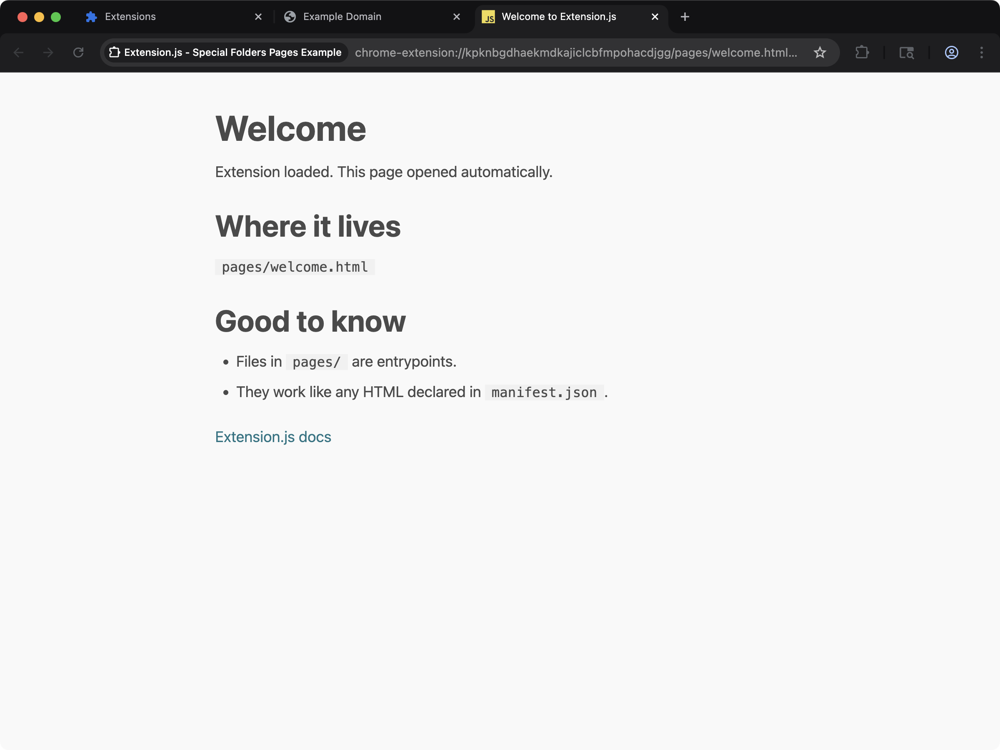
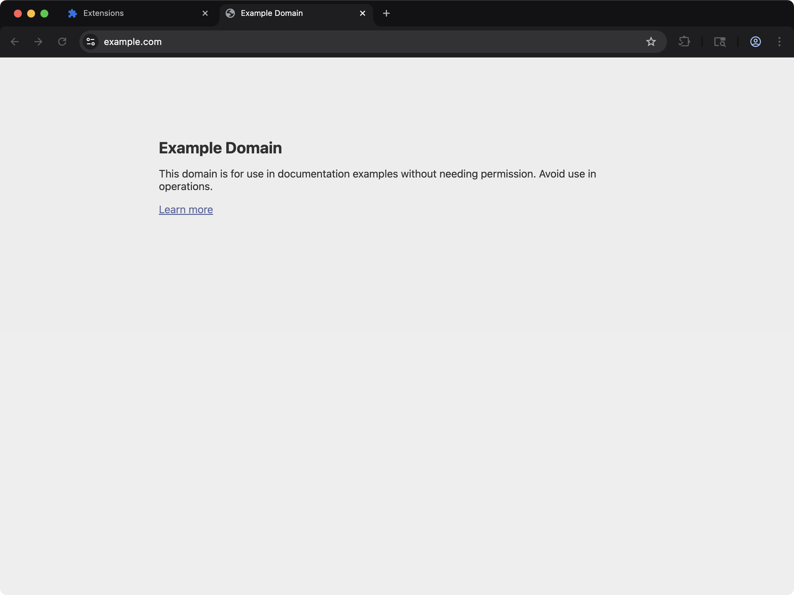

当你的扩展需要在 `manifest.json` 中无法妥善表达的入口或资产时，使用特殊文件夹。

在不拆分项目结构的前提下，处理额外页面、运行时注入的脚本、需要精确路径的静态资产，以及用于本地开发的附属扩展。

## 特殊文件夹放在哪里

特殊文件夹从项目根目录解析，而且只从那里解析。规则是：

- 项目根目录是包含你的 `package.json`(或 `deno.json`)的目录。
- 把 `pages/`、`scripts/`、`public/` 与 `extensions/` 放在那个目录里，和 `package.json` 并排。
- `src/scripts/` 不是特殊文件夹。Extension.js 会忽略嵌套的特殊文件夹副本，所以放在那里的文件永远不会成为入口或被复制的资产。
- 把 `manifest.json` 移进 `src/` 不会移动项目根目录。脚手架模板把 `src/manifest.json` 和上一层的 `package.json` 一起发布，特殊文件夹属于 `package.json` 所在的层级。

唯一一个以 src 为根的例外：一个既没有 `package.json` 也没有 `deno.json` 的项目。此时包含 `manifest.json` 的目录成为项目根目录。当那个 manifest 位于 `src/` 时，`src/` 就是根目录，特殊文件夹(以及 `dist/`)都住在 `src/` 里。

<Warning>
  **我的 `scripts/` 文件夹没有出现在 `dist/` 里。**这几乎总是对应上面的规则：
  这个文件夹放在了 `src/` 下面，而不是和 `package.json` 并排。把它移到项目根目录。
  如果它已经在那里，请确认该文件不是 Node.js 辅助脚本，[构建会把这类文件排除在外](#文件夹契约)。
</Warning>

## 模板示例

### `special-folders-pages`



通过额外的 HTML 入口看看 `pages/` 特殊文件夹是如何工作的。

<CodeGroup>

```bash npm
npx extension@latest create my-extension --template=special-folders-pages
```

```bash pnpm
pnpx extension@latest create my-extension --template=special-folders-pages
```

```bash yarn 2+
yarn dlx extension@latest create my-extension --template=special-folders-pages
```

```bash bun
bunx extension@latest create my-extension --template=special-folders-pages
```

```bash deno
deno run -A npm:extension@latest create my-extension --template=special-folders-pages
```

</CodeGroup>

代码仓库：[extension-js/templates/special-folders-pages](https://github.com/extension-js/templates/tree/main/examples/special-folders-pages)

### `special-folders-scripts`



通过独立的脚本入口看看 `scripts/` 特殊文件夹是如何工作的。

<CodeGroup>

```bash npm
npx extension@latest create my-extension --template=special-folders-scripts
```

```bash pnpm
pnpx extension@latest create my-extension --template=special-folders-scripts
```

```bash yarn 2+
yarn dlx extension@latest create my-extension --template=special-folders-scripts
```

```bash bun
bunx extension@latest create my-extension --template=special-folders-scripts
```

```bash deno
deno run -A npm:extension@latest create my-extension --template=special-folders-scripts
```

</CodeGroup>

代码仓库：[extension-js/templates/special-folders-scripts](https://github.com/extension-js/templates/tree/main/examples/special-folders-scripts)

## 为什么重要

manifest 并不会直接声明很多扩展文件，比如 iframe 页面、你用 `chrome.scripting.executeScript` 动态注入的脚本，以及静态厂商资产。开发期你还可能需要附属扩展。特殊文件夹让这些都成为构建流水线中的一等公民。

## 工作原理

每个特殊文件夹都有特定的角色：

| 文件夹名      | 说明                                                                      |
| ------------- | ------------------------------------------------------------------------- |
| `pages/`      | 把 HTML 页面加入编译作为入口，即便 manifest 没有声明它们。                |
| `scripts/`    | 把每个脚本文件都加入编译作为入口，无论 manifest 或你的代码是否提到它的路径。Node.js 辅助脚本会被排除在外。 |
| `public/`     | 把静态资产原样复制到输出根目录(`public/**` → `dist/**`)，不做打包或转换。 |
| `extensions/` | 在 dev/preview/start 流程中作为仅加载的附属扩展的约定位置。               |

## `pages/`：额外的 HTML 入口

把 `pages/` 用于额外的扩展页面，例如 sandbox iframe、诊断页或内部工具。

Extension.js 会把 `pages/` 中的每个 `.html` 文件视为一个入口，按和 manifest 声明页面相同的方式编译。

从 4.1.41 之后的版本开始，如果脚本用 `getURL` 指明了 `pages/` 里的某个页面（例如 `pages/welcome/index.html`），编译后的页面也会在这个路径上提供。它的源文件不会被复制。

sandbox iframe 示例可参见 [Chrome Sandbox Sample](https://github.com/GoogleChrome/chrome-extensions-samples/tree/main/api-samples/sandbox/sandbox)。

## `scripts/`：独立的脚本入口

把 `scripts/` 用于可执行脚本，这些脚本你会动态加载、且并不绑定到某个 HTML 页面入口。

Extension.js 会把 `scripts/` 中的文件作为入口编译，使用与项目其他部分相同的扩展解析流水线。

### 根目录位置与输出路径

大多数 `scripts/` 设置问题都出在这两点。

**位置。**`scripts/` 放在 `package.json`(或 `deno.json`)旁边，也就是项目根目录，而不是 `src/` 里。即使 `manifest.json` 位于 `src/`，这条规则也成立。唯一的例外是既没有 `package.json` 也没有 `deno.json` 的项目，此时 manifest 所在目录就是根目录。参见[特殊文件夹放在哪里](#特殊文件夹放在哪里)。

**输出路径。**注入编译后的文件。`scripts/foo.ts` 源文件会被编译为 `scripts/foo.js`，所以 `chrome.scripting.executeScript({ files })` 和 `chrome.scripting.registerContentScripts({ js })` 必须写 `.js` 文件。写 `.ts` 路径时构建正常，但在浏览器里会 404。Extension.js 会在构建时对编译源路径字面量发出警告，并给出应使用的输出路径。

```ts background.ts
// 源文件：scripts/foo.ts
// 输出文件：scripts/foo.js

chrome.scripting.executeScript({
  target: { tabId },
  files: ["scripts/foo.js"],
});

chrome.scripting.registerContentScripts([
  { id: "foo", matches: ["<all_urls>"], js: ["scripts/foo.js"] },
]);
```

在扩展页面里，路径要从根开始写，例如 `/scripts/foo.js`。Firefox 会相对于页面解析开头没有斜杠的路径。要让这个文件运行在页面自己的 world 中，参见[在运行时注入脚本](/zh-Hans/docs/implementation-guide/inject-scripts)。

### 文件夹契约

你放进 `scripts/` 或 `pages/` 的每个文件都会输出到一个可预测的路径。`scripts/foo.ts` 会变成 `dist/<browser>/scripts/foo.js`，`pages/extra.html` 会变成 `dist/<browser>/pages/extra.html`。不需要在任何地方声明该文件。像 `chrome.runtime.getURL("pages/extra.html")` 或 `chrome.scripting.executeScript({ files: ["scripts/foo.js"] })` 这样的运行时字符串都能找到它。没有任何地方引用的文件同样会被输出，构建也不会为此打印警告。构建会把 Node.js 辅助脚本排除在外：带有 shebang、含有 Node.js import，或者路径被某个 `package.json` script 运行的文件。要关闭某个文件夹，在 `extension.config.js` 中把它的键设为 `false`：

```js extension.config.js
export default {
  folders: {
    scripts: false,
    pages: false,
  },
};
```

完整的 `folders` 键请参阅[特殊文件夹的位置](/zh-Hans/docs/features/extension-configuration#特殊文件夹的位置)。

从 4.2.0 之后的版本起，构建只在 `pages/` 与 `scripts/` 中查找入口，任意深度，并跳过 `node_modules` 文件夹。页面以 `.html` 结尾。脚本以 `.js`、`.mjs`、`.jsx`、`.mjsx`、`.ts`、`.mts`、`.tsx` 或 `.mtsx` 结尾，并且必须是小写，所以 `scripts/Foo.JS` 不是入口。两个文件夹里的链接只要仍在项目之内就会被跟随。`pages/` 或 `scripts/` 里构建无法读取的文件夹会让构建以 `E_FOLDER_UNREADABLE` 停止，消息会点名那个文件夹。

### `scripts/` 里的辅助模块

`scripts/` 里的每个文件都会被构建成一个独立的入口。被其他文件导入的辅助模块会多输出一个没有任何东西加载的文件。从 4.1.39 之后的版本起，如果一个文件被其他文件导入，又没有任何地方按输出路径提到它，构建会为它打印一条警告。警告里给出可以直接粘贴的 `exclude` 值：

```plaintext
scripts/helper.js is built as an entry of its own because every file in scripts/ is, yet other files import it and nothing names its output path. For a helper module, add exclude: ['scripts/helper.js'] to extension.config.js. For a script the extension injects, keep it.
```

```js extension.config.js
export default {
  exclude: ["scripts/helper.js"],
};
```

加上这个键之后，这个文件不再输出，警告也随之消失。你的代码按输出路径提到的文件不会触发警告，因为那是一个被注入的脚本。

### 重要契约

当你把 `scripts/` 中的某个条目当作类似 content script 的运行时入口使用时，请遵循 content script 初始化模式。这是 Extension.js 期望的默认导出契约，用于安全地热重载注入脚本：

- 导出一个默认函数。
- 在该函数内完成初始化。
- 可选地返回一个同步的清理函数。

这在开发期尤其重要，Extension.js 会安全地重新挂载类似 content script 的入口，而不是触发整页重载。

### `scripts/` 中不允许放 Node.js 脚本

Extension.js 会用浏览器 content-script 挂载运行时包装 `scripts/` 中的每个文件。如果你把一个只能在 Node.js 中运行的文件(例如 CLI 启动器或构建辅助脚本)放进去，包装器会破坏该文件。

shebang 不再位于第 1 行，且 Node 专属 API 在浏览器上下文中无法使用。

Extension.js 会检测两类 Node.js 标志，并把该文件排除在构建之外：

- 第 1 行的 shebang(`#!/usr/bin/env node`)。
- 来自 `node:` 协议的 import(例如 `import fs from 'node:fs'`)。

<Warning>
  如果你看到 `scripts/ is a reserved folder in
  Extension.js`，请把文件移到项目根目录下其他文件夹，比如
  `bin/`、`tools/`、`ops/`、`tasks/` 或 `ci-scripts/`。
</Warning>

动态注入示例可参见 [Chrome Scripting Sample](https://github.com/GoogleChrome/chrome-extensions-samples/tree/main/api-samples/scripting)。

## 仅开发期的入口

名字中在扩展名之前带有 `.dev.` 的页面或脚本是仅开发期的入口。`extension dev` 会像编译该文件夹中其他文件一样编译它。生产构建(`extension build`、`extension start`)则会把它排除在外：没有 HTML，没有 chunk，生成的 manifest 中也不会有任何地方点名它。

```text
pages/
├── engine.html          # ships
├── player.dev.html      # development only
└── bench/
    └── parity.dev.html  # development only
scripts/
├── content.ts           # ships
└── bench.dev.ts         # development only
```

把它用于测试用的 harness 页面、模型一致性 bench，或者只有开发者才会运行的脚本。harness 页面可以在扩展的 overlay 之下播放本地素材。开发期间该文件保留其所在文件夹的输出路径，因此 `chrome.runtime.getURL("pages/player.dev.html")` 能找到它。这个页面不在生产输出中，所以在会发布的代码里请给这个引用加上保护，例如放在 `process.env.NODE_ENV !== "production"` 之后。

- 这一约定只看文件名。名为 `dev/` 的文件夹只是普通文件夹，`pages/dev/player.html` 会发布。
- `extension build --mode development` 是开发期编译，所以会保留这些入口。
- 不是入口的文件，例如某个页面 import 的 `player.dev.css`，跟随 import 它的页面。
- 要按模式或环境把额外文件复制进构建，见 [extension.config.js 中的 `include`](/zh-Hans/docs/features/extension-configuration#extra-files-in-the-build)。

## `public/`：仅复制的静态资产

当你需要稳定的文件路径且不希望经过打包/转换时，使用 `public/`。

Extension.js 会把 `public/` 下的所有内容 1:1 复制到输出根目录。

从 4.1.39 之后的版本起，这次复制在每种模式下都是逐字节的。生产构建不会压缩或转换 `public/` 下的文件。第三方脚本会保留它的许可证头注释、最后一个表达式，以及 `sourceMappingURL` 注释。你在 `extension.config.js` 的 `include` 下声明的文件也以同样的方式产出，脚本除外。除非你选择关闭，生产构建会压缩 include 进来的脚本，见[构建中的额外文件](/zh-Hans/docs/features/extension-configuration#extra-files-in-the-build)。

<Frame>
  <iframe
    className="w-full aspect-video rounded-xl"
    src="https://www.youtube-nocookie.com/embed/ZAsyjtiUbNM?rel=0"
    title="Extension.js: the public folder"
    loading="lazy"
    allow="encrypted-media; picture-in-picture; fullscreen"
    allowFullScreen
  />
</Frame>

### `public/` 的重要保护

不要把 `manifest.json` 放到 `public/manifest.json`。为了避免在编译过程中覆盖生成的 manifest，Extension.js 会阻止这种用法。

构建会以 `E_MANIFEST_IN_PUBLIC` 停止。从 4.2.0 之后的版本起，消息如下：

```plaintext
public/manifest.json is left out of the build: the manifest the build writes comes from the manifest.json the project names, and only one file can claim that output path.
Move it out of the public folder, or delete it.
```

从 4.2.0 之后的版本起，某个入口已经写入其输出路径的 `public/` 文件不会被复制。入口的文件胜出，一条 `W_PROJECT_LAYOUT` 警告会点名该文件。

### 文件夹名必须小写

从 4.2.0 之后的版本起，public 文件夹必须命名为小写的 `public/`。`Public/` 或 `PUBLIC/` 文件夹会打印一条 `W_PROJECT_LAYOUT` 警告，请你重命名：

- 在不区分大小写的磁盘上（macOS 的默认设置），这个文件夹仍会发布。
- 此时警告会说明，其他拼写会在下一个大版本中失效。
- 在区分大小写的磁盘上（大多数 Linux 系统如此），这个文件夹里的内容都不会发布。

### 永远不会打包的文件

从 4.1.41 之后的版本起，私有文件永远不会进入构建，即使它们位于 `public/` 中。这包括 `.env`、`.npmrc`、`.git` 和 `.DS_Store` 等文件。引用这类文件的页面或样式表 `url()` 会警告一次，说明该文件未被打包。警告带有同类缺失文件所用的代码。请把内容移到另一个名字的文件中。

从 4.1.41 之后的版本起，`dev` 也不会提供这些文件。这包括 env 文件、`Thumbs.db` 和 `desktop.ini` 等操作系统元数据、仓库文件，以及 `name~` 等编辑器备份。请求这类文件会像缺失文件一样返回 404，编辑它们也不会重新加载扩展。

## `extensions/`：附属扩展(仅加载)

当你使用附属扩展(例如 DevTools 辅助工具)时，Extension.js 在 dev/preview/start 流程中支持把 `extensions/` 文件夹作为仅加载来源。

简要说明：

- 扫描 `extensions/` 下含 `manifest.json` 的子文件夹作为未打包的扩展根。
- 以浏览器命名的子文件夹只会为该浏览器家族加载：`extensions/chrome/` 用于 Chromium 目标，`extensions/edge/` 用于 Edge，`extensions/firefox/` 用于 Gecko 目标。根级子文件夹与你显式配置的条目在所有浏览器上都会加载。
- Extension.js 会把附属扩展和你的主扩展一起加载。
- 把这个文件夹用于加载附属扩展，而不是把它们构建进你的主产物。

你也可以通过 `--extensions` CLI 参数或 `extension.config.js` 中的 `extensions` 键加载附属扩展：

```bash
# Load from a local folder
npx extension@latest dev --extensions ./path/to/companion

# Load from Chrome Web Store or Firefox Add-ons
npx extension@latest dev --extensions "https://chromewebstore.google.com/detail/react-developer-tools/fmkadmapgofadopljbjfkapdkoienihi"
```

Extension.js 会自动下载、解包并与你的扩展一起加载这些商店 URL。

可接受的商店链接有 `chromewebstore.google.com`（以及旧的 `chrome.google.com/webstore` 形式）、`microsoftedge.microsoft.com` 与 `addons.mozilla.org`，带不带协议或 `www.` 前缀都可以。下载的商店扩展会落在 `extensions/<browser>/` 下，并且只为该浏览器加载。来自其他主机的链接、裸的商店 id，或既不是链接也不是路径的条目会被报告为错误，而不是被悄悄丢弃。

从 4.1.41 之后的版本起，有些伴随扩展条目只会警告，警告码为 `W_COMPANION_EXTENSION_PATH`。这包括项目之外的条目、不是解包扩展的文件夹，以及不存在的文件夹。浏览器打开时不会带上它。唯一的 manifest 属于 `extensions/` 下某个伴随扩展的项目，仍会以 `E_COMPANION_EXTENSION_PATH` 被拒绝。

## 开发期行为(watch 模式)

在 watch 模式下，Extension.js 会监控 `pages/` 与 `scripts/` 的文件集合变化。

在 `pages/` 或 `scripts/` 下添加文件，会让编译器自行重启。从 4.1.41 之后的版本开始，在那里删除或重命名文件也会这样，并且重启会移除已不存在的文件的输出。不需要手动重启。

## 最佳实践

- **把共享的运行时资产放在 `public/`**：用于必须在输出中保留原文件名和路径的文件。
- **把 `pages/` 与 `scripts/` 用于真正的入口**：让 manifest 之外的执行路径保持显式。
- **让附属扩展保持隔离**：把 `extensions/` 视为本地工作流中的仅加载依赖。
- **不要把 `manifest.json` 放进 `public/`**：Extension.js 会阻止 `public/manifest.json`，以保护生成的扩展产物。

## 下一步

- 进一步了解[页面重载与热模块替换 (HMR)](/zh-Hans/docs/features/reload-and-hmr)。
- 在 [Content scripts](/zh-Hans/docs/implementation-guide/content-scripts) 中了解挂载契约。
- 浏览[模板](/zh-Hans/docs/getting-started/templates) 以快速搭建你的下一个扩展。

## 模板演示

<Frame>
  <iframe
    className="w-full aspect-video rounded-xl"
    src="https://www.youtube-nocookie.com/embed/P8Q8TDQqbQE?rel=0"
    title="Extension.js: Special Folders Scripts template"
    loading="lazy"
    allow="encrypted-media; picture-in-picture; fullscreen"
    allowFullScreen
  />
</Frame>
