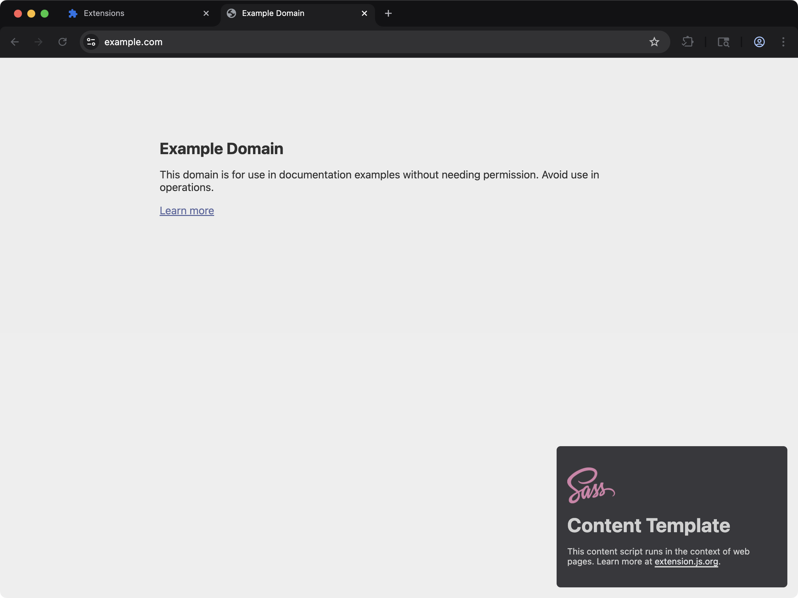
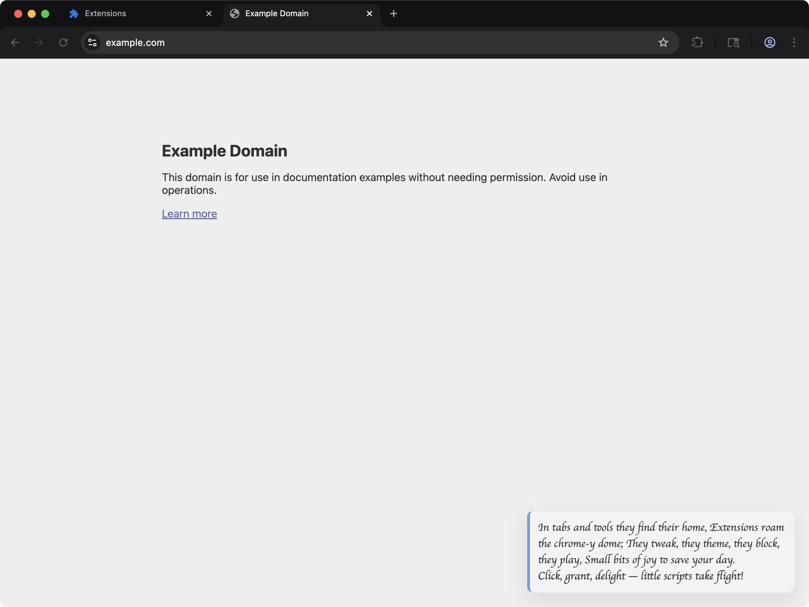

Extension.js 无需任何配置即可支持纯 CSS 以及 Sass、Less 预处理器。对页面上下文（popup、options、side panel）和 content script 上下文，它会采用不同的样式路由方式。

页面样式会作为关联的资源发布。在 content script 里，样式作用在哪里取决于你怎么引用它。本页的 content script 一节列出了每一种方式。

## 模板示例

### `content-sass`



带有 Sass 样式的 content script，注入到网页中。

<CodeGroup>

```bash npm
npx extension@latest create my-extension --template=content-sass
```

```bash pnpm
pnpx extension@latest create my-extension --template=content-sass
```

```bash yarn 2+
yarn dlx extension@latest create my-extension --template=content-sass
```

```bash bun
bunx extension@latest create my-extension --template=content-sass
```

```bash deno
deno run -A npm:extension@latest create my-extension --template=content-sass
```

</CodeGroup>

仓库：[extension-js/templates/content-sass](https://github.com/extension-js/templates/tree/main/examples/content-sass)

### `content-custom-font`



演示通过 CSS 加载自定义字体的 content script。

<CodeGroup>

```bash npm
npx extension@latest create my-extension --template=content-custom-font
```

```bash pnpm
pnpx extension@latest create my-extension --template=content-custom-font
```

```bash yarn 2+
yarn dlx extension@latest create my-extension --template=content-custom-font
```

```bash bun
bunx extension@latest create my-extension --template=content-custom-font
```

```bash deno
deno run -A npm:extension@latest create my-extension --template=content-custom-font
```

</CodeGroup>

仓库：[extension-js/templates/content-custom-font](https://github.com/extension-js/templates/tree/main/examples/content-custom-font)

## CSS 能力

| 能力             | 你会得到什么                                          |
| ---------------- | ----------------------------------------------------- |
| 多上下文样式     | 对页面和 content script 使用同一种编写模型            |
| Sass/Less 编译   | 当相关依赖存在时编译 Sass/Less                        |
| 上下文感知的输出 | 将页面 CSS 与 content script CSS 分别输出到正确的目标 |
| 开发期更新流程   | 在受支持时通过热模块替换（HMR）/重新挂载应用样式更新  |

## 在哪里引用 CSS

- `manifest.json`（`content_scripts[].css`）
- HTML 文件（`<link rel="stylesheet" href="...">`）
- 脚本导入（`import "./styles.css"`，启用时也包括 Sass/Less）。在 content script 里，这种导入本身不会给任何东西加上样式。

## CSS 支持

Manifest CSS 入口：

| Manifest 字段         | 期望的文件类型                    |
| --------------------- | --------------------------------- |
| `content_scripts.css` | `.css`、`.scss`、`.sass`、`.less` |

## 示例：`manifest.json` 中的 CSS

```json
{
  "manifest_version": 3,
  "name": "My Extension",
  "version": "1.0.0",
  "content_scripts": [
    {
      "matches": ["<all_urls>"],
      "css": ["./styles/content.css"],
      "js": ["./scripts/content.ts"]
    }
  ]
}
```

## 示例：扩展页面脚本中的 CSS

```ts
import "./styles/popup.scss";
```

## content script 中的样式

在 content script 里，单纯的 `import "./styles.css"` 得到的值是一个 `data:` URL 形式的样式表。它本身不会给任何东西加上样式。Sass 和 Less 的导入也是一样。

Extension.js 只在一种情况下替你放置这份样式表。这条导入必须写在已声明的 content script 的入口文件里，并且脚本必须用 `data-extension-root` 标记一个宿主元素。样式表随后会进入这个宿主的 shadow root。参见 [Shadow DOM](/zh-Hans/docs/implementation-guide/shadow-dom)。

要给页面本身加样式，请使用下面任意一种方式：

| 你写的内容                                                             | 在哪里有效                                |
| ---------------------------------------------------------------------- | ----------------------------------------- |
| 列在 manifest 的 `content_scripts[].css` 下的样式表                    | 已声明的 content script                   |
| CSS 模块，`import styles from "./x.module.css"`                        | 已声明的 content script                   |
| `import href from "./styles.css"`，再设到 `<link rel="stylesheet">` 上 | 已声明的 content script 和 `scripts/` 文件 |

最后一种方式读取导入得到的值，再自己放置它：

```ts
import href from "./styles.css";

export default function main() {
  const link = document.createElement("link");
  link.rel = "stylesheet";
  link.href = href;
  document.head.appendChild(link);

  return () => link.remove();
}
```

你在运行时注入的 `scripts/` 文件不会得到任何自动放置。在那里请读取这个值，再把它设到 `<link>` 上。

从 4.1.39 之后的版本起，如果一条只为副作用而写的样式导入没有被任何东西放置，构建会打印一条警告。

## 内容脚本中的网页字体

把界面渲染到 shadow root 的内容脚本，无法只靠 CSS 加载网页字体。有两条平台规则会挡住它，而且都是静默的。

**shadow root 内部的 `@font-face` 永远不会生效。** 字体（font face）解析的是文档的字体集，而不是 shadow 树，所以 Chrome 会忽略该规则并静默回退。修复前在 `content-custom-font` 模板上实测：`document.fonts` 为空，没有发出任何字体请求，用 `"Momo Signature", cursive` 排版的文本宽度与纯 `cursive` 完全相同。

**注入样式表里的根绝对 `url()` 会相对宿主页面解析。** 注入到 `example.com` 的样式表中的 `url(/fonts/Momo.woff2)` 请求的是 `https://example.com/fonts/Momo.woff2`，而不是扩展自己的那份文件。

改为把字体注册到页面自身的字体集上，URL 指向扩展，并在内容脚本卸载时移除它：

```js
export default function initial() {
  const rootDiv = document.createElement("div");
  document.body.appendChild(rootDiv);
  const shadowRoot = rootDiv.attachShadow({ mode: "open" });

  const customFace = new FontFace(
    "Momo Signature",
    `url("${chrome.runtime.getURL("fonts/MomoSignature-Regular.woff2")}")`,
  );

  customFace
    .load()
    .then((face) => document.fonts.add(face))
    .catch(() => {
      // Ignore
    });

  return () => {
    document.fonts.delete(customFace);
    rootDiv.remove();
  };
}
```

该字体文件必须能被页面访问，所以要在 `web_accessible_resources` 中声明：

```json
{
  "web_accessible_resources": [
    {
      "resources": ["fonts/*.woff2"],
      "matches": ["<all_urls>"]
    }
  ]
}
```

字体一旦进入 `document.fonts`，shadow 树就可以在普通的 `font-family` 规则里按名称使用它。可运行的版本见 [content-custom-font](https://github.com/extension-js/templates/tree/main/examples/content-custom-font)。

## 按上下文的输出行为

| 上下文          | 输出行为                                                                       |
| --------------- | ------------------------------------------------------------------------------ |
| HTML/页面上下文 | Extension.js 将 CSS 与页面入口一起打包（`feature.css`）                        |
| Content script  | Extension.js 将 CSS 作为 `content_scripts/[name].css` 资源输出，并同步改写 manifest |

Extension.js 会根据哪个入口导入了 CSS 自动拆分上下文。

## 开发期行为

- Content script 的 CSS 导入会参与 content script 的 HMR/重新挂载流程。
- Extension.js 会为只有 CSS 的 content script 入口添加一个开发期辅助脚本，使更新得以传播。
- 页面 CSS 遵循常规的页面 HMR 管线行为。
- 结构性的 manifest/content script 变更仍可能需要扩展完整重载或重启。

## 模块化与预处理器

- CSS 模块在扩展页面上下文中表现最好。
- 当你安装相关依赖时，Extension.js 会启用 Sass/Less 支持。
- 如果项目引用了 `.scss`/`.less` 文件但没有安装预处理器，构建不会失败，而是发出警告并把源文件原样拷贝过去（不编译）。浏览器会把这份未编译的源码当作坏掉的 CSS，于是相关界面会完全没有样式，因此请安装预处理器以获得真正的编译。
- 当 Extension.js 检测到项目中存在 PostCSS 配置，或者你显式配置时，会自动运行 PostCSS。

## 最佳实践

- 把 content script 样式有意识地限定作用范围，减少与宿主页面的冲突。
- 对扩展页面 UI，优先使用组件级的模块样式。
- 显式地维护预处理器和 PostCSS 配置，避免随时间发生非预期的构建行为变化。
- 在持续集成（CI）中校验 manifest 字段所引用的 CSS 路径。

## 下一步

- 在 [dev 更新行为](/zh-Hans/docs/workflows/dev-update-behavior) 中了解更新结果。
- 进一步了解 [CSS 模块](/zh-Hans/docs/languages-and-frameworks/css-modules)。
- 进一步了解 [PostCSS 集成](/zh-Hans/docs/integrations/postcss)。

## 视频讲解

<Frame>
  <iframe
    className="w-full aspect-video rounded-xl"
    src="https://www.youtube-nocookie.com/embed/IAbckjfGO5Y?rel=0"
    title="Extension.js: Content Custom Font template"
    loading="lazy"
    allow="encrypted-media; picture-in-picture; fullscreen"
    allowFullScreen
  />
</Frame>
