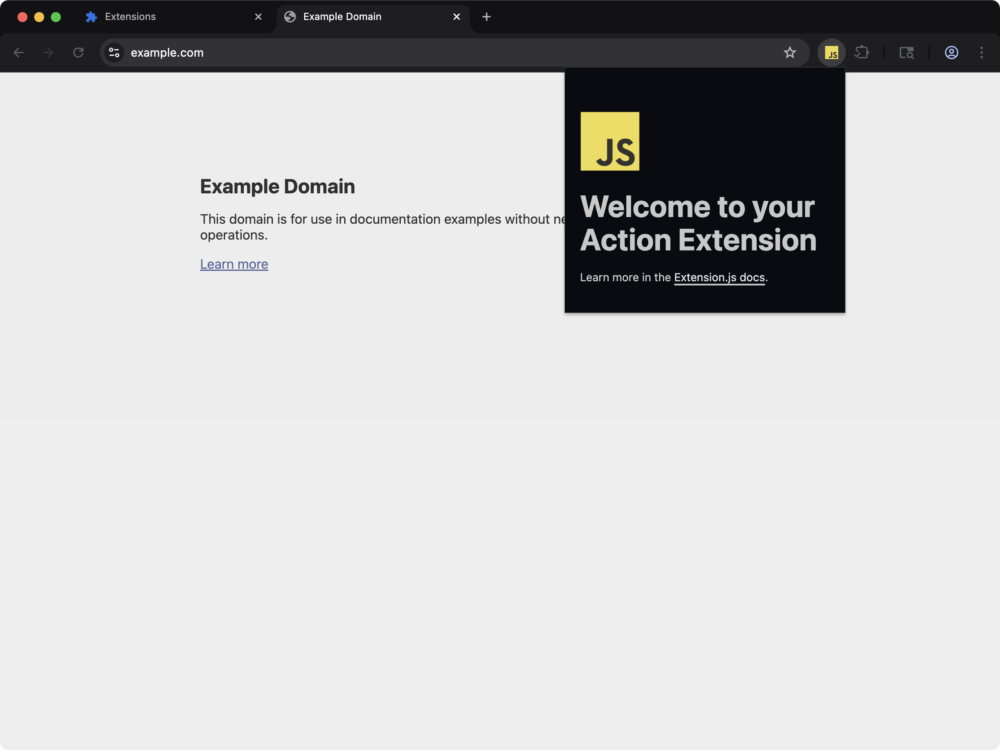

通过在 Extension.js 可以校验、重写并稳定输出的 manifest 字段中声明图标，保持扩展品牌与 action UI 的一致性。

Extension.js 会处理 `manifest.json` 中的图标路径，解析 public/相对路径，输出图标资源，并在开发期监视图标文件。

## 模板示例

### `action`



一个 action 扩展，在 `manifest.json` 中声明了工具栏图标。

<CodeGroup>

```bash npm
npx extension@latest create my-extension --template=action
```

```bash pnpm
pnpx extension@latest create my-extension --template=action
```

```bash yarn 2+
yarn dlx extension@latest create my-extension --template=action
```

```bash bun
bunx extension@latest create my-extension --template=action
```

```bash deno
deno run -A npm:extension@latest create my-extension --template=action
```

</CodeGroup>

仓库：[extension-js/templates/action](https://github.com/extension-js/templates/tree/main/examples/action)

## 图标能力

| 能力                   | 你会得到什么                               |
| ---------------------- | ------------------------------------------ |
| 支持 manifest 图标字段 | 为受支持的扩展表面校验并编译图标           |
| 路径解析               | 一致地处理相对路径与 public-root 图标路径  |
| 开发期监视             | 在本地开发时重新编译图标变更               |
| 浏览器安全的输出       | 在扩展产物中输出图标资源，并保持稳定的引用 |

## 受支持的图标字段

| Manifest 字段                 | Chromium（Chrome、Edge、Brave、Opera） | Firefox                |
| ----------------------------- | -------------------------------------- | ---------------------- |
| `action.default_icon`         | .png、.jpg                             | .png、.jpg、.svg       |
| `browser_action.default_icon` | .png、.jpg                             | .png、.jpg、.svg       |
| `icons`                       | .png、.jpg                             | .png、.jpg、.svg       |
| `page_action.default_icon`    | .png、.jpg                             | .png、.jpg、.svg       |
| `sidebar_action.default_icon` | 不支持                                 | .png、.jpg、.svg（\*） |
| `browser_action.theme_icons`  | 不支持                                 | .png、.jpg、.svg       |

<Note>
  Chromium 不接受 `.svg`（或 `.webp`）作为 `icons` 与 action 图标。把这些字段指向
  SVG 的 manifest 能在 Firefox 中加载，但在 Chrome、Edge、Brave 和 Opera 中会失败。
  面向所有 Chromium 目标请提供 PNG 文件。`sidebar_action` 与
  `browser_action.theme_icons` 是 Firefox 字段，而且 `sidebar_action.default_icon`
  对 `.svg` 的支持在那里也只是部分的（\*）。
</Note>

## `manifest.json` 中的图标声明示例

```json
{
  "manifest_version": 3,
  "name": "My Extension",
  "version": "1.0.0",
  "icons": {
    "16": "icons/icon-16.png",
    "48": "icons/icon-48.png",
    "128": "icons/icon-128.png"
  },
  "action": {
    "default_icon": "icons/action-icon.png"
  }
}
```

## 图标变体

`icon_variants` 为每种配色方案声明一组图标。Extension.js 会读取顶层的这个键，以及 `action`、`browser_action` 和 `page_action` 之下的这个键。

```json
{
  "icons": {
    "16": "icons/icon-16.png",
    "48": "icons/icon-48.png"
  },
  "icon_variants": [
    {
      "16": "icons/dark-16.png",
      "48": "icons/dark-48.png",
      "color_schemes": ["dark"]
    },
    {
      "16": "icons/light-16.png",
      "48": "icons/light-48.png",
      "color_schemes": ["light"]
    }
  ]
}
```

这个键下的文件会像 `icons` 一样被输出和检查：

- 每个变体文件都输出在它的源位置，它在 manifest 中的路径遵循与 `icons` 相同的规则。
- 缺少变体文件时，构建会以图标错误停止，错误里会写出这个键：`Can't find an icon file listed in icon_variants.`

Chromium 只有在开启 `ExtensionIconVariants` 标志时才读取 `icon_variants`，Firefox 目前还不读取这个键。对于这些目标，构建会保留你的 manifest 中声明的 `icons` 和 action 的 `default_icon`。

如果 manifest 中没有它们，构建会先用不带 `color_schemes` 的变体组来填充，其次用浅色组。Chromium 只接受 PNG 尺寸，Firefox 还可以使用 `any` 的 SVG。Safari 的输出会原样保留 manifest。

构建会打印一条提示，说明浏览器显示的是哪些图标：

```plaintext
Firefox does not read icon_variants yet.
Firefox shows icons from your manifest instead.
```

当构建替你填充 `icons` 时，提示也会说明：

```plaintext
Chromium reads icon_variants only with its ExtensionIconVariants flag on.
The manifest had no icons, so the build filled it from the variant that fits every color scheme, or the light one.
```

浏览器前缀对这个键同样有效。`chromium:icon_variants` 或 `firefox:icon_variants` 下的列表只会在对应浏览器的构建中输出它的文件。参见[浏览器特定的 manifest 字段](/zh-Hans/docs/features/browser-specific-fields)。

## 从 SVG 生成各尺寸 PNG

把 SVG 保留为设计源文件，导出所有浏览器都接受的 PNG 尺寸。下面这条命令使用 librsvg 提供的 `rsvg-convert`（macOS 上 `brew install librsvg`，Debian 与 Ubuntu 上 `apt install librsvg2-bin`）：

```bash
for size in 16 32 48 128; do rsvg-convert -w $size -h $size icon.svg -o icons/icon-$size.png; done
```

然后像上面的示例那样，把 `icons` 与 `action.default_icon` 指向这些 PNG 文件。

## 输出路径

典型的图标输出：

```plaintext
<path-relative-to-manifest>            # icons keep their source location
browser_action/<theme-icon-filename>   # for theme_icons
```

图标不会被移动到某个 `icons/` 文件夹里。声明为 `images/icon.png` 的图标会输出在
`images/icon.png`，输出的 manifest 也仍然指向同一个路径。

## 路径行为

- Extension.js 会从 manifest 所在目录解析相对图标路径。
- 以 `/` 开头的路径和 `public/...` 会按扩展 public-root 语义解析。
- Extension.js 可以监视 public 文件夹中的资源，而不必通过图标特性本身重新输出它们。

## 开发期行为

- 修改已存在的图标文件会触发重新编译。
- 修改 manifest 中图标入口的引用可能需要重启开发服务器。
- 缺失必需的图标文件会产生构建错误（某些可选的图标组只会产生警告）。

## 最佳实践

- 显式声明 manifest 图标字段，而不是依赖偶发的资源导入。
- 提供多种图标尺寸（`16`、`32`、`48`、`128`），让 UI 在各浏览器表面更清晰。
- 保持图标文件名稳定，减少开发期对 manifest 的扰动。
- 有意地使用 public-root 路径，并测试由此产生的 manifest 输出路径。

## 下一步

- 继续阅读 [web-accessible 资源](/zh-Hans/docs/implementation-guide/web-accessible-resources)。
- 进一步了解 [特殊文件夹](/zh-Hans/docs/features/special-folders)。
