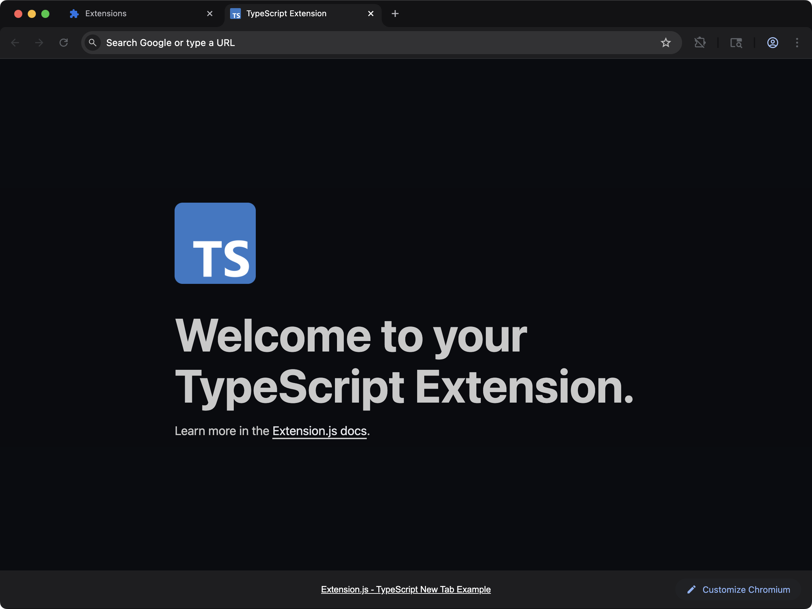
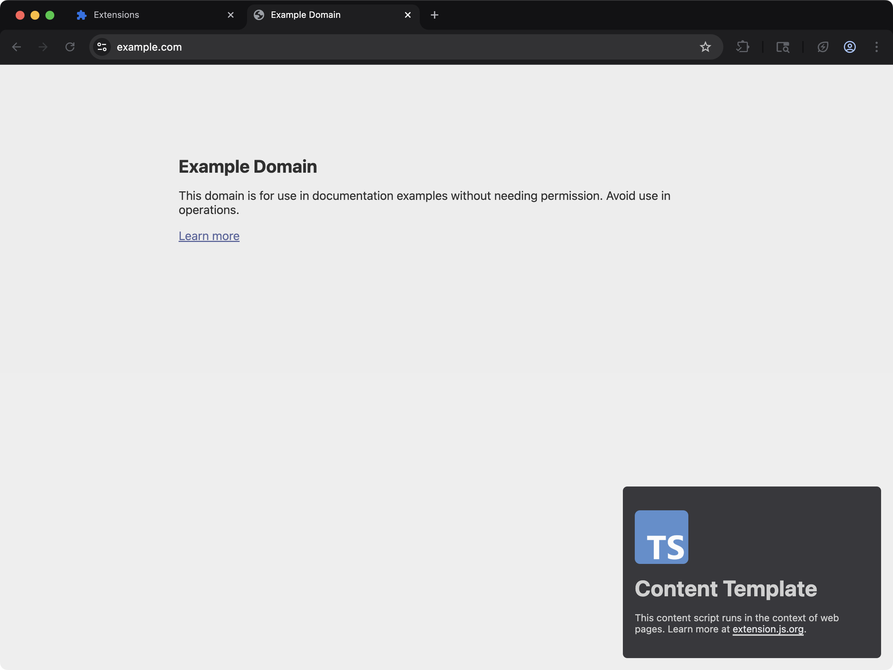
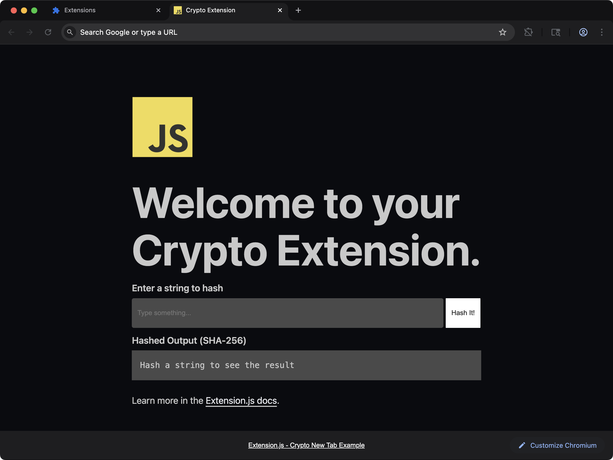

Extension.js 默认以浏览器运行时为目标，不会自动给 Node 核心模块打 polyfill，从而把包体积保持在小范围。如果你的依赖去引用 `buffer`、`stream` 或 `crypto`，构建时就会看到解析错误。下面会说明什么时候该加 polyfill，什么时候应选择浏览器原生的替代方案。

## 什么场景适合用 Node polyfill

- 必需的依赖在浏览器运行时里需要 Node 核心模块。
- 你正在把代码从以 Node 为中心的包逐步迁移过来。
- 为了得到某些运行时能力，你可以接受更大的包体积。

## 模板示例

### `new-typescript`



当扩展需要显式调整打包器/polyfill 时，从 TypeScript 的基准模板开始。

<CodeGroup>

```bash npm
npx extension@latest create my-extension --template=newtab-typescript
```

```bash pnpm
pnpx extension@latest create my-extension --template=newtab-typescript
```

```bash yarn 2+
yarn dlx extension@latest create my-extension --template=newtab-typescript
```

```bash bun
bunx extension@latest create my-extension --template=newtab-typescript
```

```bash deno
deno run -A npm:extension@latest create my-extension --template=newtab-typescript
```

</CodeGroup>

仓库：[extension-js/templates/newtab-typescript](https://github.com/extension-js/templates/tree/main/examples/newtab-typescript)

### `content-typescript`



当依赖 Node 的库需要运行在页面注入流程中时，使用 content script 的 TypeScript 基础模板。

<CodeGroup>

```bash npm
npx extension@latest create my-extension --template=content-typescript
```

```bash pnpm
pnpx extension@latest create my-extension --template=content-typescript
```

```bash yarn 2+
yarn dlx extension@latest create my-extension --template=content-typescript
```

```bash bun
bunx extension@latest create my-extension --template=content-typescript
```

```bash deno
deno run -A npm:extension@latest create my-extension --template=content-typescript
```

</CodeGroup>

仓库：[extension-js/templates/content-typescript](https://github.com/extension-js/templates/tree/main/examples/content-typescript)

### `new-crypto`



查看在 new-tab 扩展中直接使用 Web Crypto API（`window.crypto.subtle`），不需要任何 polyfill。

<CodeGroup>

```bash npm
npx extension@latest create my-extension --template=newtab-crypto
```

```bash pnpm
pnpx extension@latest create my-extension --template=newtab-crypto
```

```bash yarn 2+
yarn dlx extension@latest create my-extension --template=newtab-crypto
```

```bash bun
bunx extension@latest create my-extension --template=newtab-crypto
```

```bash deno
deno run -A npm:extension@latest create my-extension --template=newtab-crypto
```

</CodeGroup>

仓库：[extension-js/templates/newtab-crypto](https://github.com/extension-js/templates/tree/main/examples/newtab-crypto)

## 默认行为

- 构建目标以浏览器优先（`web`）。
- 模块解析优先选用浏览器导出（`browser`、`module`、`main`）。
- `crypto`、`path` 和 `fs` 被映射为 `false`，因此它们会解析到一个空模块。构建会成功，
  但导入会在运行时失败（例如 `path.join` 是 undefined）。
- 其他所有 Node 核心模块，包括 `buffer`、`stream`、`os` 以及带 `node:` 前缀的说明符，
  都没有回退，会以 `Module not found: Can't resolve` 让构建失败。

所以缺失的 Node API 会出现在两个地方之一，具体是哪一个取决于模块。
用下面的显式回退来处理这两种情况。

### `node:` 说明符与构建错误

从 4.1.39 之后的版本起，`node:fs` 和 `fs` 是同一个请求，所以两种写法得到同样的结果：

- `crypto`、`fs` 和 `path` 无论哪种写法都会解析到一个空模块，`fs/promises` 这样的子路径也一样。
- 其他任何内置模块都会让构建停下。消息会写明这个内置模块、导入它的文件，以及要设置的 `resolve.fallback` 键。
- 对没有替身的内置模块调用 `require()` 只是一条警告。这个调用会原样留在输出里，只有那条代码路径真的运行时才会抛错。设置 `EXTENSION_STRICT_REFS=true` 可以让它使构建失败。

```plaintext
The Node.js built-in util does not exist in a browser, and this build has no stand-in for it. background.js imports it.
Only crypto, fs, path are replaced with an empty module. In extension.config.js, set resolve.fallback from the config hook: {'util': false} for an empty module, or the path of a browser polyfill you installed, such as require.resolve('util/'). node:util and util read the same key.
```

在 4.1.39 及更早的版本里，带 `node:` 前缀的说明符对每个模块都会让构建失败，`crypto`、`fs` 和 `path` 也不例外。

## 设置 Node polyfill

使用 `extension.config.js`（或 `.mjs` / `.cjs`）扩展 Rspack 配置，并定义安全的回退。

```js
import NodePolyfillPlugin from "node-polyfill-webpack-plugin";
import { createRequire } from "node:module";

const require = createRequire(import.meta.url);

export default {
  config: (config) => {
    config.resolve = config.resolve || {};
    config.resolve.fallback = {
      ...(config.resolve.fallback || {}),
      crypto: require.resolve("crypto-browserify"),
      path: require.resolve("path-browserify"),
      fs: false,
    };
    config.plugins = config.plugins || [];
    config.plugins.push(new NodePolyfillPlugin());
    return config;
  },
};
```

### 一次只加一个回退

只需要一两个模块时，不必用 polyfill 插件。安装对应的浏览器包，然后在 `config` 钩子里扩展 `resolve.fallback`。把某个键设为 `false` 就得到一个空模块。`Buffer` 在 Node.js 里是全局变量，所以用 `ProvidePlugin` 来提供它。

从 4.1.39 之后的版本起，钩子的第二个参数带有 `rspack`，也就是 Extension.js 用来编译的打包器。从它上面取插件类，你的项目就不需要自己安装 `@rspack/core`：

<CodeGroup>

```bash npm
npm install buffer util
```

```bash pnpm
pnpm add buffer util
```

```bash yarn
yarn add buffer util
```

```bash bun
bun add buffer util
```

```bash deno
deno add npm:buffer npm:util
```

</CodeGroup>

```js extension.config.js
import { createRequire } from "node:module";

const require = createRequire(import.meta.url);

export default {
  config: (config, { rspack }) => {
    config.resolve.fallback = {
      ...config.resolve.fallback,
      buffer: require.resolve("buffer/"),
      util: require.resolve("util/"),
      os: false,
    };
    config.plugins.push(
      new rspack.ProvidePlugin({ Buffer: ["buffer", "Buffer"] }),
    );
    return config;
  },
};
```

请展开已有的 `resolve.fallback`，这样三个默认键会保留下来。`require.resolve("buffer/")` 结尾的斜杠指向已安装的包，而不是 Node.js 的内置模块。

只以带前缀的形式存在的名字，例如 `node:test`，没有 `resolve.fallback` 能匹配到的裸键。请通过 `rspack.NormalModuleReplacementPlugin` 把它替换成你自己的模块：

```js extension.config.js
import { createRequire } from "node:module";

const require = createRequire(import.meta.url);

export default {
  config: (config, { rspack }) => {
    config.plugins.push(
      new rspack.NormalModuleReplacementPlugin(
        /^node:test$/,
        require.resolve("./src/test-stand-in.js"),
      ),
    );
    return config;
  },
};
```

## 安装可选的 polyfill 包

<CodeGroup>

```bash npm
npm install -D node-polyfill-webpack-plugin crypto-browserify path-browserify
```

```bash pnpm
pnpm add -D node-polyfill-webpack-plugin crypto-browserify path-browserify
```

```bash yarn
yarn add -D node-polyfill-webpack-plugin crypto-browserify path-browserify
```

```bash bun
bun add -d node-polyfill-webpack-plugin crypto-browserify path-browserify
```

```bash deno
deno add -D npm:node-polyfill-webpack-plugin npm:crypto-browserify npm:path-browserify
```

</CodeGroup>

## 扩展 API 与 Node API

在 CLI/config 中设置 `polyfill: true` 会启用 `webextension-polyfill`，这是一个兼容层，让早于 148 的 Chromium 浏览器（带 `devtools_page` 时为早于 152）也能访问 `browser.*` API 命名空间。更新的版本原生提供 `browser`。它不会启用 Node 核心模块的 polyfill。

仅在某些库无法使用标准 Web API 时才使用 Node polyfill。

## 注意事项

- 不要假设扩展运行时可以访问文件系统；除非你有特定的、对浏览器安全的策略，否则把 `fs` 保持为 `false`。
- 在可能的情况下，优先用 Web Crypto（`crypto.subtle`），而不是体积庞大的 Node crypto shim。
- Polyfill（Node API 的浏览器兼容替代品）会增大包体积，并可能影响扩展页面和 content script 的启动时间。
- 从 4.1.39 之后的版本起，`node:` 说明符读取的 `resolve.fallback` 键与它的裸名相同。在更早的版本里，它会让构建失败。

## 下一步

- 学习如何自定义 [Rspack 配置](/zh-Hans/docs/features/rspack-configuration)。
- 了解如何管理[扩展配置](/zh-Hans/docs/features/extension-configuration)。

## 视频讲解

<Frame>
  <iframe
    className="w-full aspect-video rounded-xl"
    src="https://www.youtube-nocookie.com/embed/dPdh5H_sTgw?rel=0"
    title="Extension.js: New Tab Crypto template"
    loading="lazy"
    allow="encrypted-media; picture-in-picture; fullscreen"
    allowFullScreen
  />
</Frame>
