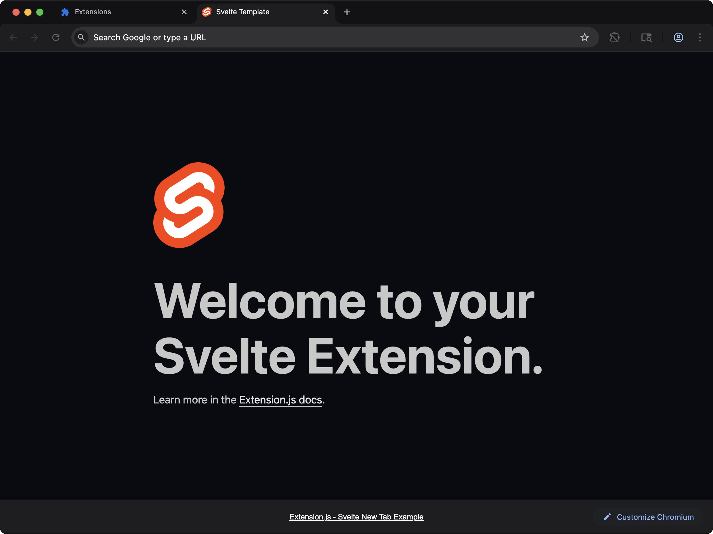
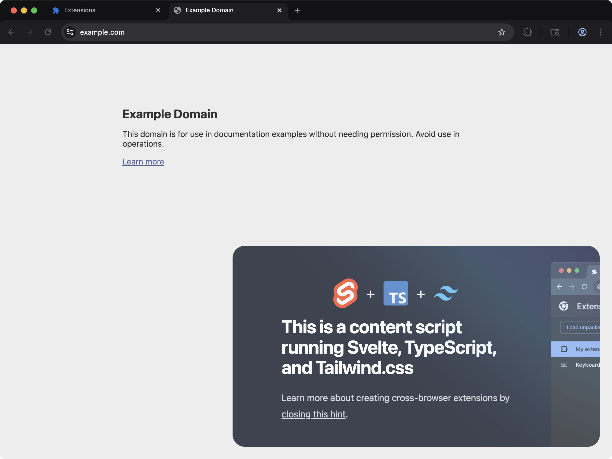

用 Svelte 组件搭建扩展 UI，同时把框架接线交给 Extension.js 负责。

Extension.js 会从项目依赖中检测 Svelte，并自动配置 `.svelte` 解析、loader 设置以及 Svelte 客户端别名。

## 什么场景适合用 Svelte

- 你希望 popup、options、sidebar 或新标签页 UI 拥有更小的运行时。
- 你偏好以组件为先、语法简洁的写法。
- 你希望选择一个既能用于扩展页面、又能用于 content script UI 挂载的框架。

## 模板示例

### `new-svelte`



当你想要一个以框架为先、配置最少的扩展 UI 时，使用 Svelte 起步模板。

<CodeGroup>

```bash npm
npx extension@latest create my-extension --template=newtab-svelte
```

```bash pnpm
pnpx extension@latest create my-extension --template=newtab-svelte
```

```bash yarn 2+
yarn dlx extension@latest create my-extension --template=newtab-svelte
```

```bash bun
bunx extension@latest create my-extension --template=newtab-svelte
```

```bash deno
deno run -A npm:extension@latest create my-extension --template=newtab-svelte
```

</CodeGroup>

仓库：[extension-js/templates/newtab-svelte](https://github.com/extension-js/templates/tree/main/examples/newtab-svelte)

### `content-svelte`



通过 content script 把 Svelte 组件注入网页。

<CodeGroup>

```bash npm
npx extension@latest create my-extension --template=content-svelte
```

```bash pnpm
pnpx extension@latest create my-extension --template=content-svelte
```

```bash yarn 2+
yarn dlx extension@latest create my-extension --template=content-svelte
```

```bash bun
bunx extension@latest create my-extension --template=content-svelte
```

```bash deno
deno run -A npm:extension@latest create my-extension --template=content-svelte
```

</CodeGroup>

仓库：[extension-js/templates/content-svelte](https://github.com/extension-js/templates/tree/main/examples/content-svelte)

## 在现有扩展中使用

安装 Svelte：

<CodeGroup>

```bash npm
npm install svelte
```

```bash pnpm
pnpm add svelte
```

```bash yarn
yarn add svelte
```

```bash bun
bun add svelte
```

```bash deno
deno add npm:svelte
```

</CodeGroup>

如果想在现有项目中显式配置，再安装 Svelte 的 loader：

<CodeGroup>

```bash npm
npm install -D svelte-loader typescript
```

```bash pnpm
pnpm add -D svelte-loader typescript
```

```bash yarn
yarn add -D svelte-loader typescript
```

```bash bun
bun add -d svelte-loader typescript
```

```bash deno
deno add -D npm:svelte-loader npm:typescript
```

</CodeGroup>

当可选的 `svelte-loader` 包缺失时，构建报错会指明与内置工具链匹配的确切版本。报错中的安装命令会按你项目实际使用的包管理器给出。

## 开发期行为

当 Extension.js 检测到 Svelte 时，会：

- 启用 `.svelte` 文件解析。
- 在 JS 框架管线中配置 Svelte loader，并在开发期启用热重载，让改动过的组件无需整页刷新就能更新。
- 应用 Svelte 客户端别名（例如 `svelte`、`svelte/store` 和 `svelte/reactivity`）。

如果项目缺少可选工具，Extension.js 不会替你安装，而是给出确切的安装命令作为警告。之后请重启。

## 用法示例

### 在扩展页面中

```html
<!doctype html>
<html lang="en">
  <head>
    <meta charset="utf-8" />
    <meta name="viewport" content="width=device-width, initial-scale=1" />
    <title>Svelte Extension</title>
  </head>
  <body>
    <div id="app"></div>
  </body>
  <script src="./main.ts"></script>
</html>
```

```ts
import {mount} from "svelte";
import App from "./App.svelte";

mount(App, {
  target: document.getElementById("app")!,
});
```

Extension.js 面向 Svelte 5。Svelte 4 的 class API（`new App(...)` 与 `app.$destroy()`）
在模板所安装的版本上会抛出 `component_api_invalid_new`。

### 在 `content_script` 文件中

对于 content script，创建一个挂载节点，并在默认导出中返回一个清理函数。这样 Extension.js 可以在开发期安全地重新挂载：

```ts
import {mount, unmount} from "svelte";
import App from "./App.svelte";

export default function main() {
  const target = document.createElement("div");
  target.id = "extension-root";
  document.body.appendChild(target);

  const app = mount(App, {target});

  return () => {
    unmount(app);
    target.remove();
  };
}
```

从 4.1.39 之后的版本起，组件的 `<style>` 块在 content script 里会生效。它落在哪里取决于 Svelte 编译器的 `css` 选项：

- **默认设置。** Extension.js 把这个块编译成一份独立的样式表。构建会把它以一个 `<style>` 元素加进 document，所以它进不了 shadow root。
- **`css: "injected"`。** 编译后的组件自带样式，Svelte 5 会在组件挂载时把它们加进去。挂载在 shadow root 里的组件，它的 `<style>` 元素会放进那个 root。其他组件的 `<style>` 元素会放进 document 的 `<head>`。

Extension.js 从项目根目录的 `svelte.loader.js` 文件读取 Svelte loader 选项。在 `compilerOptions` 下设置这个选项：

```js
export default {
  compilerOptions: {
    css: "injected",
  },
};
```

## 最佳实践

- 让 Svelte 组件专注于 UI，把浏览器 API 的编排放到专门的模块里。
- 在 content script 里始终返回清理函数，保证重新挂载行为可预期。
- 先在扩展页面里使用 Svelte，等功能边界清晰后，再扩展到 content script UI。

## 下一步

- 进一步了解 [TypeScript 支持](/zh-Hans/docs/languages-and-frameworks/typescript)。
- 阅读 [Content scripts](/zh-Hans/docs/implementation-guide/content-scripts) 中的 content script 契约。

## 视频演示

<Frame>
  <iframe
    className="w-full aspect-video rounded-xl"
    src="https://www.youtube-nocookie.com/embed/g01ymrVUPQY?rel=0"
    title="Extension.js: Svelte HMR"
    loading="lazy"
    allow="encrypted-media; picture-in-picture; fullscreen"
    allowFullScreen
  />
</Frame>

## 模板演示

<Frame>
  <iframe
    className="w-full aspect-video rounded-xl"
    src="https://www.youtube-nocookie.com/embed/g6-GZ6_Rn38?rel=0"
    title="Extension.js: Content Svelte template"
    loading="lazy"
    allow="encrypted-media; picture-in-picture; fullscreen"
    allowFullScreen
  />
</Frame>
