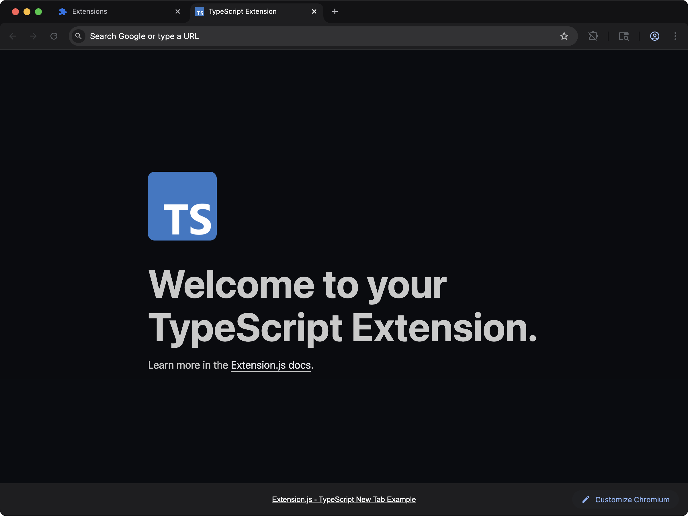
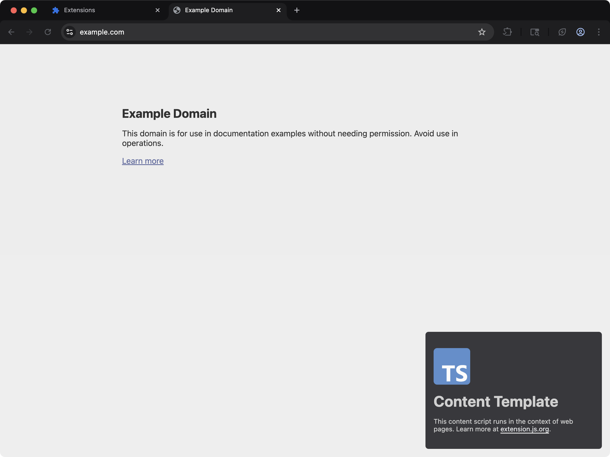

Extension.js 从一个 `manifest.json` 出发，为 Chrome、Edge、Firefox 和 Safari 构建并运行浏览器扩展。它在所有扩展上下文中都能跑 TypeScript：background、content script、popup、options 和 sidebar。它默认使用 Rspack + SWC 管线。你不需要单独的 `tsc` 步骤、ts-loader，也不需要额外的打包器规则。

构建过程完全不需要 `typescript` 包。SWC 会编译你的源码并擦除类型。这个包只对编辑器工具和 `tsc --noEmit` 类型检查有意义。正因如此，缺少 `typescript` 包永远不会让构建失败，这一点和缺少框架集成包不同。

## 什么场景适合用 TypeScript

- 你希望在各个扩展上下文中获得更安全的重构和更清晰的契约。
- 你在 background script、content script 和 UI 界面之间共享逻辑。
- 你需要在使用 AI 生成代码时让 API 的用法保持可预期。

## 模板示例

### `new-typescript`



适合搭建一个已配置好 TypeScript 默认设置的新标签页扩展。

<CodeGroup>

```bash npm
npx extension@latest create my-extension --template=newtab-typescript
```

```bash pnpm
pnpx extension@latest create my-extension --template=newtab-typescript
```

```bash yarn 2+
yarn dlx extension@latest create my-extension --template=newtab-typescript
```

```bash bun
bunx extension@latest create my-extension --template=newtab-typescript
```

```bash deno
deno run -A npm:extension@latest create my-extension --template=newtab-typescript
```

</CodeGroup>

仓库：[extension-js/templates/newtab-typescript](https://github.com/extension-js/templates/tree/main/examples/newtab-typescript)

### `content-typescript`



适合把 TypeScript 驱动的 content script 注入到现有页面。

<CodeGroup>

```bash npm
npx extension@latest create my-extension --template=content-typescript
```

```bash pnpm
pnpx extension@latest create my-extension --template=content-typescript
```

```bash yarn 2+
yarn dlx extension@latest create my-extension --template=content-typescript
```

```bash bun
bunx extension@latest create my-extension --template=content-typescript
```

```bash deno
deno run -A npm:extension@latest create my-extension --template=content-typescript
```

</CodeGroup>

仓库：[extension-js/templates/content-typescript](https://github.com/extension-js/templates/tree/main/examples/content-typescript)

## 自动生成的环境类型

对于 TypeScript 项目，Extension.js 会在项目根目录生成 `extension-env.d.ts`，里面包含环境声明（浏览器/运行时全局变量、`EXTENSION_PUBLIC_*` 环境变量以及打包器类型）。[`dev`](/zh-Hans/docs/commands/dev)、[`build`](/zh-Hans/docs/commands/build) 和 [`start`](/zh-Hans/docs/commands/start) 都会重新生成它，所以编辑器的类型与 CI 中的 `tsc --noEmit` 始终保持一致。把它提交进版本库（或加进 git-ignore）都可以，下次运行时会重新创建。

从 4.1.39 之后的版本起，这个文件不存在时，只有在你的 `tsconfig.json` 会读到它的情况下才会被创建。见[让 extension-env.d.ts 留在 include 列表里](/zh-Hans/docs/languages-and-frameworks/extension-api-types)。

## 在现有扩展中使用

按下面的步骤把 TypeScript 添加到现有扩展。

### 安装

1. 把 TypeScript 安装为开发依赖：

<CodeGroup>

```bash npm
npm install -D typescript
```

```bash pnpm
pnpm add -D typescript
```

```bash yarn
yarn add -D typescript
```

```bash bun
bun add -d typescript
```

```bash deno
deno add -D npm:typescript
```

</CodeGroup>

2. 初始化 TypeScript 配置文件 `tsconfig.json`：

<CodeGroup>

```bash npm
npx tsc --init
```

```bash pnpm
pnpm exec tsc --init
```

```bash yarn
yarn tsc --init
```

```bash bun
bunx tsc --init
```

```bash deno
deno run -A npm:typescript/tsc --init
```

</CodeGroup>

### 配置

#### TypeScript 检测和要求

Extension.js 会在 `package.json` 旁边查找 `tsconfig.json`。

- 有 `.ts` 源文件却没有 `tsconfig.json` 时，Extension.js 会往项目里写入一份基线配置。构建会提示 `Creating a default tsconfig.json` 并继续。
- 如果项目声明了 `typescript` 依赖，但还没有 `tsconfig.json`、也还没有 `.ts` 源文件，Extension.js 会为它写入一份基线配置。

基线配置示例：

```json
{
  "compilerOptions": {
    "allowJs": true,
    "allowSyntheticDefaultImports": true,
    "esModuleInterop": true,
    "forceConsistentCasingInFileNames": true,
    "isolatedModules": false,
    "jsx": "react-jsx",
    "jsxImportSource": "react",
    "lib": ["dom", "dom.iterable", "esnext"],
    "moduleResolution": "bundler",
    "module": "esnext",
    "resolveJsonModule": true,
    "strict": true,
    "target": "esnext",
    "skipLibCheck": true
  },
  "exclude": ["node_modules", "dist"]
}
```

有两个默认值值得了解：

- `moduleResolution` 为 `bundler`，它对应 Rspack + SWC 管线。已被移除的 `node`（node10）模式会让 TypeScript 7 上的 `tsc --noEmit` 失败。
- 只有当 Extension.js 在项目中检测到 JSX 框架时，`jsx` 才是 `react-jsx`。没有检测到时，它保持 `preserve`，也不会写入 `jsxImportSource`。从 4.1.20 起，框架项目还会得到 `jsxImportSource`，按检测到的框架设为 `react`、`preact`、`vue` 或 `solid-js`，这样 `tsc --noEmit` 解析的 JSX 运行时与构建一致。

#### 自动类型

Extension.js 会在项目根目录生成 `extension-env.d.ts`。`dev`、`build` 和 `start` 每次都会重写它。该文件引用扩展 API、Extension.js 环境变量键和资源导入的类型声明。

```ts extension-env.d.ts
// Required Extension.js types for TypeScript projects.
// This file is auto-generated and should not be excluded.
// If you need additional types, consider creating a new *.d.ts file and
// referencing it in the "include" array of your tsconfig.json file.
// See https://www.typescriptlang.org/tsconfig#include for more information.
/// <reference types="extension/types" />

// Polyfill types for browser.* APIs
/// <reference types="extension/types/polyfill" />
```

#### 扩展 API 的类型

Extension.js 用 [`chrome-types`](https://www.npmjs.com/package/chrome-types) 为扩展 API 提供类型。这个包由 Chrome 从 Chromium 源码生成。`browser` 是原生命名空间，它的方法返回 Promise。`chrome` 是它的别名。这个包随 `extension` 一起安装，所以新项目不需要额外的类型包。

```ts
const [tab] = await browser.tabs.query({ active: true, currentWindow: true });
```

`chrome-types` 没有声明只有 Firefox 才有的 API。Firefox 的 `browser.sidebarAction` 和 `browser.browserAction` 由 Extension.js 自己提供类型。

#### 安装了 @types/chrome 的项目

安装了 `@types/chrome` 的项目会继续使用它。`chrome` 的类型来自这个包，`browser` 的类型和以前一样来自 `webextension-polyfill`。

`@types/chrome` 和 `chrome-types` 都声明了 `chrome` 全局变量，所以这两个包不能同时加载。生成的 `extension-env.d.ts` 只引用其中一个。当你的 `package.json` 列出了 `@types/chrome` 时，它引用 `@types/chrome`。当项目目录或某个上级目录里存在 `node_modules/@types/chrome` 时，也是如此：

```ts extension-env.d.ts
/// <reference types="extension/types/legacy" />

// This project installs @types/chrome, so it types the extension APIs.
// Remove that package to get chrome-types and the native browser namespace.
/// <reference types="chrome" />

// Polyfill types for browser.* APIs
/// <reference types="extension/types/polyfill" />
```

改用 `chrome-types`：

1. 从项目里移除 `@types/chrome`。
2. 运行一次 `extension dev` 或 `extension build`。

回到 `@types/chrome`：

1. 把 `@types/chrome` 安装为开发依赖。
2. 运行一次 `extension dev` 或 `extension build`。

#### Polyfill 的类型

在默认配置下，`browser` 全局变量拥有来自 `chrome-types` 的原生类型。想要 `webextension-polyfill` 的类型，请导入这个模块：

```ts
import browser from "webextension-polyfill";
```

这条导入只改变类型，以及你的代码所调用的对象。polyfill 何时运行，请阅读[跨浏览器兼容性](/zh-Hans/docs/features/cross-browser-compatibility)。

#### 升级说明

更早的版本会随 `extension` 一起安装 `@types/chrome`，并用 `webextension-polyfill` 为 `browser` 提供类型。安装了 `@types/chrome` 的项目会保留这些类型。没有 `@types/chrome` 的项目在升级后会改用 `chrome-types`。

改用之后，`tsc` 可能会报告 `chrome.tabs.TabChangeInfo` 这样的名称不存在。安装 `@types/chrome` 可以保留以前的类型，然后运行一次 `extension dev` 或 `extension build`。

#### 转译与类型检查

默认的打包管线会编译 TypeScript，但不会在打包时跑完整的 `tsc` 类型检查。

推荐的脚本：

```json
{
  "scripts": {
    "dev": "extension dev",
    "typecheck": "tsc --noEmit"
  }
}
```

`tsc` 不会写出 `extension-env.d.ts`。只有 `dev`、`build` 和 `start` 会重新生成它。在 CI 中，请先运行其中一条命令，再运行 `tsc`：

```bash
npx extension build
npx tsc --noEmit
```

## 下一步

- 了解 Extension.js 如何处理 [ECMAScript 模块](/zh-Hans/docs/languages-and-frameworks/ecmascript-modules)。
- 探索 [Sass 模块](/zh-Hans/docs/languages-and-frameworks/sass)等样式方案。
- 阅读[浏览器扩展中的 JavaScript 和 TypeScript 文件](/zh-Hans/docs/concepts/javascript-typescript-browser-extension-files)。
- 对比各[浏览器扩展框架](/zh-Hans/docs/compare)对 TypeScript 的支持。

## 视频讲解

<Frame>
  <iframe
    className="w-full aspect-video rounded-xl"
    src="https://www.youtube-nocookie.com/embed/9OBuuh3N_cM?rel=0"
    title="Extension.js: Content TypeScript template"
    loading="lazy"
    allow="encrypted-media; picture-in-picture; fullscreen"
    allowFullScreen
  />
</Frame>
