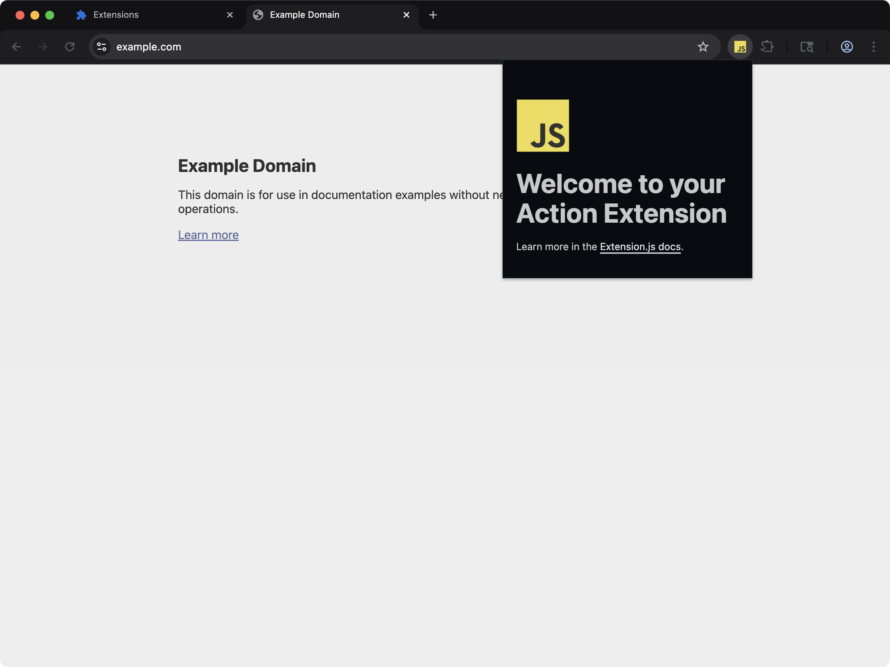

Extension.js 會在開發與建置期間處理瀏覽器專屬的設定。你可以用同一個專案 為
Chromium、Gecko（Firefox 引擎）與 Safari 目標產出符合執行階段需求的輸出。

## 跨瀏覽器擴充功能開發

跨瀏覽器擴充功能開發指的是寫一個擴充功能，能同時上架到 Chrome、Edge、Firefox 與 Safari，而不需要分叉程式碼。Extension.js 會把單一專案編譯成各瀏覽器專屬的產物（`dist/chrome`、`dist/edge`、`dist/firefox`、`dist/safari`），並依當前目標過濾 manifest。重新載入流程、執行階段 API 與打包行為都會對應你正在除錯的瀏覽器。

只使用一份 `manifest.json`，就能鎖定特定瀏覽器或自訂瀏覽器二進位檔。若你需要在早於 148 版的 Chromium 瀏覽器中使用 `browser.*`，可以啟用 polyfill。

## Chrome 與 Firefox 擴充功能相容性

Chrome 與 Firefox 擴充功能共用大部分 WebExtensions 表面，但每天都會碰到三個關鍵差異：

- **背景腳本：** Chrome（Manifest V3）需要 `background.service_worker`。Firefox 則使用 `background.scripts` 搭配非持久的 event page。Extension.js 會在這兩種形態之間做雙向轉換，因此同一份 manifest 中兩種寫法都可行。
- **執行階段 API 命名空間：** Firefox 原生支援 `browser.*`。Chromium 在每個版本上都支援 `chrome.*`，並自 148 版起支援 `browser.*`（擴充功能宣告了 `devtools_page` 時自 152 版起）。在更舊的 Chromium 版本上可以加上 `--polyfill` 來彌平差異。
- **權限與內容安全政策（CSP）：** 不同瀏覽器對某些 `permissions` 與 `host_permissions` 條目的判斷不同。將瀏覽器專屬的值放在帶前綴的 manifest 鍵內，而不是在執行階段做功能偵測。

## 瀏覽器專屬的 manifest 欄位

Extension.js 透過帶前綴的 manifest 欄位，讓單一份 `manifest.json` 在各瀏覽器上都能運作。在編譯時，Extension.js 會把帶前綴的鍵（`chromium:`、`chrome:`、`edge:`、`firefox:`、`gecko:`、`safari:`）過濾到當前目標。`chromium:` 套用到所有 Chromium 家族瀏覽器，`chrome:` 與 `edge:` 只套用到對應的那個瀏覽器，未加前綴的鍵則套用到所有目標。完整前綴清單請見 [瀏覽器專屬的 manifest 欄位](/zh-Hant/docs/features/browser-specific-fields)。

## 範本範例

### `action`



用一個可在 Chrome、Firefox 與 Edge 執行的 action 彈出視窗，試試跨瀏覽器相容性。

<CodeGroup>

```bash npm
npx extension@latest create my-extension --template=action
```

```bash pnpm
pnpx extension@latest create my-extension --template=action
```

```bash yarn 2+
yarn dlx extension@latest create my-extension --template=action
```

```bash bun
bunx extension@latest create my-extension --template=action
```

```bash deno
deno run -A npm:extension@latest create my-extension --template=action
```

</CodeGroup>

儲存庫：[extension-js/templates/action](https://github.com/extension-js/templates/tree/main/examples/action)

## 運作方式

### 1) 選擇瀏覽器目標

選擇你要執行擴充功能的瀏覽器。

常見目標使用 `--browser`，或傳入自訂的瀏覽器二進位檔。

<CodeGroup>

```bash npm
npx extension@latest dev --browser firefox
```

```bash pnpm
pnpx extension@latest dev --browser firefox
```

```bash yarn
yarn dlx extension@latest dev --browser firefox
```

```bash bun
bunx extension@latest dev --browser firefox
```

```bash deno
deno run -A npm:extension@latest dev --browser firefox
```

</CodeGroup>

<CodeGroup>

```bash npm
npx extension@latest dev --chromium-binary /Applications/Brave\\ Browser.app/Contents/MacOS/Brave\\ Browser
```

```bash pnpm
pnpx extension@latest dev --chromium-binary /Applications/Brave\\ Browser.app/Contents/MacOS/Brave\\ Browser
```

```bash yarn
yarn dlx extension@latest dev --chromium-binary /Applications/Brave\\ Browser.app/Contents/MacOS/Brave\\ Browser
```

```bash bun
bunx extension@latest dev --chromium-binary /Applications/Brave\\ Browser.app/Contents/MacOS/Brave\\ Browser
```

```bash deno
deno run -A npm:extension@latest dev --chromium-binary /Applications/Brave\\ Browser.app/Contents/MacOS/Brave\\ Browser
```

</CodeGroup>

依你的作業系統使用對應的二進位檔路徑：

- **macOS**：`/Applications/Brave Browser.app/Contents/MacOS/Brave Browser`
- **Linux**：`/usr/bin/brave-browser`（或其他 Chromium 系瀏覽器的二進位檔）
- **Windows**：`"C:\\Program Files\\BraveSoftware\\Brave-Browser\\Application\\brave.exe"`

在 macOS 上，`--browser safari` 會轉換擴充功能，並透過 Xcode 建置 Safari 應用程式。請見[建置 Safari 擴充功能](/zh-Hant/docs/browsers/safari)。

當你傳入二進位檔時，Extension.js 會把它對應到一個瀏覽器引擎目標：

- `--chromium-binary` 對應 `chromium-based`
- `--gecko-binary` 對應 `gecko-based`

### 2) 以瀏覽器專屬的 manifest 過濾進行編譯

在編譯時，Extension.js 只會包含你選定瀏覽器所需的 manifest 欄位。

例如：

```json
{
  "chromium:background": {
    "service_worker": "sw.js"
  },
  "firefox:background": {
    "scripts": ["sw.js"]
  }
}
```

對 Chromium 家族目標，Extension.js 以 `chromium:` 涵蓋整個家族，以 `chrome:` 或 `edge:` 指定單一瀏覽器。  
對 Firefox 家族目標，Extension.js 會使用 `firefox:` 與 `gecko:`。  
對 Safari 目標，`safari:` 與 `webkit:` 優先於 Safari 繼承的 `chromium:` 鍵。

<Note>
  完整的帶前綴 manifest 欄位細節，請參閱 [瀏覽器專屬的 manifest
  欄位](/zh-Hant/docs/features/browser-specific-fields)。
</Note>

#### background 的轉換是雙向的

常見情況下你不需要為 background 加前綴。Extension.js 會雙向轉換一般的 MV3 `background`：

- Gecko 建置若找到 `background.service_worker` 而沒有 `background.scripts`，會透過 `scripts` 把 background 重新指向產出的 bundle，並移除 Firefox 會拒絕的 `service_worker` 與 `type`。
- Chromium MV3 建置若找到 `background.scripts` 且尚未設定 worker，會用第一個 script 來填入 `service_worker`。

在 Chromium 這個方向，`scripts` 一律會從輸出中移除。只要出現 `background.scripts`，即使旁邊有合法的 `service_worker`，Chromium MV3 也會拒絕整個擴充功能，因此這個鍵永遠不能出現在 Chromium 建置中。

#### Firefox 建置會移除 Firefox 拒絕的權限

從 4.1.39 之後的版本起，Gecko 建置會從 `permissions` 與 `optional_permissions` 裡移除 Firefox 拒絕的權限字串，例如 `sidePanel`、`debugger` 與 `offscreen`。建置會印出一則警告，列出每一項。這些字串在 Firefox 上不授予任何東西，所以擴充功能不會失去任何它本來能執行的功能。如果你有只用於 Firefox 的替代項，請用 `firefox:` 前綴宣告它。

建置會依宣告保留 `incognito: "split"`，並印出一則警告說明這一點。Firefox 沒有 split 模式，會把這個值讀作 `"not_allowed"`，所以擴充功能永遠不會在隱私視窗裡執行。把 `firefox:incognito` 設為 `"spanning"` 或 `"not_allowed"` 來做出選擇。

#### 每個建置只修復它的瀏覽器拒絕的鍵

有些 manifest 鍵在一個瀏覽器裡能載入，卻會讓另一個瀏覽器拒絕整個擴充功能。建置只為自己的目標修復產出的 manifest，並指名每一次修復。你的原始 `manifest.json` 保持原樣。

- **`options_ui.chrome_style`**：Manifest V3 下的 Chromium 建置會移除這個鍵。無論它的值是什麼，Chrome 都會因為它拒絕整個擴充功能。Firefox 與 Safari 建置會保留它，Manifest V2 建置也會保留。
- **圖示尺寸鍵**：Chrome 與 Firefox 建置會移除引擎拒絕的每一個尺寸鍵，範圍包括 `icons`，以及 `action`、`browser_action` 與 `page_action` 的 `default_icon`。兩個引擎都只接受 `"48"` 這樣的整數像素尺寸，所以 `"48.5"`、`"big"` 與 `"0"` 會被移除。Firefox 還會拒絕 `"016"` 這樣帶前導零的鍵，所以只有 Firefox 建置會移除它。Safari 建置保留所有鍵。
- **空的 `background.scripts`**：Firefox 建置會移除空清單。Firefox 會為它啟動一個空的 background 頁面，而 Chrome 與 Safari 不會啟動任何 background。如果沒有別的欄位指明 background，`background` 鍵也會一併移除。
- **帶 `../` 的 `web_accessible_resources` 樣式**：這個樣式會原樣留在 manifest 裡，建置不會為它複製任何檔案，並會印出一則警告，給出應該改寫成的路徑。Chrome 與 Firefox 都不會為這樣的樣式公開任何檔案。請從擴充功能根目錄寫起，例如 `assets/*`。
- **`trial_tokens` 與 `background.async_listener_registration`**：這兩個鍵在每個目標上都原樣通過。

每個被移除的鍵都會印出一行修復說明，並指名是哪個引擎：

```plaintext
Repaired the icons.48.5 field, which Firefox refuses to load the extension over.
REASON removed "48.5": "images/icon.png", Firefox takes only a whole pixel size such as "48" as the key and refuses the whole extension over any other
Fix the field in your manifest.json file.
```

### 3) 為每個瀏覽器目標輸出

Extension.js 會把各目標寫入各自的建置資料夾：

- `dist/chrome`
- `dist/edge`
- `dist/firefox`
- `dist/chromium`（預設目標）
- `dist/chromium-based`（自訂 Chromium 引擎）
- `dist/gecko-based`（自訂 Gecko 引擎）
- `dist/safari`（Safari，產生的 Xcode 專案位於 `dist/safari-xcode`）

這讓你的建置產物結構分明，也更容易在 CI 中發佈。

### 4) Chromium 目標可選的 `browser.*` polyfill

Chromium 148 及更新版本把每個擴充功能 API 同時放在 `browser` 與 `chrome` 之下，所以 `browser.*` 程式碼在那裡不需要 polyfill 就能執行。宣告了 `devtools_page` 的擴充功能要到 Chromium 152 才有原生的 `browser` 命名空間。起決定作用的是 Chromium 版本，而不是 Chrome 這個品牌，所以同樣的版本號也適用於 Edge 與其他 Chromium 瀏覽器。

polyfill 在 `dev`、`start` 與 `build` 中預設關閉。要啟用它，請傳入 `--polyfill`，或在 `extension.config.js` 中把 `commands.<command>.polyfill` 設為 `true`。

當你的使用者執行早於 148 的 Chromium 瀏覽器（帶有 `devtools_page` 時為早於 152）時，你仍然需要 polyfill。如果你不支援這些版本，請在 manifest 中設定 `"minimum_chrome_version": "148"`（帶有 `devtools_page` 時為 `"152"`），並在不帶 polyfill 的情況下建置。

<Warning>
  在低於 152 的 Chromium 上，宣告了 `devtools_page` 的擴充功能在任何指令碼裡都沒有
  `browser` 物件。不只是 DevTools 頁面，background、各個頁面與 content script
  也都沒有。請為這樣的擴充功能啟用 polyfill，或改用 `chrome.*`。
</Warning>

如果你的程式碼使用 `browser.*`，並且要支援這些更舊的版本，可為 Chromium 家族目標啟用 `--polyfill`：

<CodeGroup>

```bash npm
npx extension@latest build --browser chrome --polyfill
```

```bash pnpm
pnpx extension@latest build --browser chrome --polyfill
```

```bash yarn
yarn dlx extension@latest build --browser chrome --polyfill
```

```bash bun
bunx extension@latest build --browser chrome --polyfill
```

```bash deno
deno run -A npm:extension@latest build --browser chrome --polyfill
```

</CodeGroup>

啟用時，Extension.js 只會在 Chromium 目標使用 `webextension-polyfill`（Mozilla 的 `browser.*` 相容性函式庫）。Firefox 和 Safari 原生提供 `browser.*`。  
Firefox 本身已原生支援 `browser.*`，Extension.js 會略過這一步。

polyfill 模組會先從你的專案解析，接著才是 Extension.js 內建的相依套件。套件管理器可能會把 `webextension-polyfill` 提升到你的專案根目錄，而你自己安裝的那份會優先於內建的那份。若完全解析不到任何一份，建置會印出警告並在沒有 polyfill 的情況下繼續，而不是直接失敗。

如果某個指令碼在 polyfill 關閉時讀取 `browser.*`，而 manifest 仍然允許更舊的 Chromium 安裝這個擴充功能，建置會印出一則警告：

```plaintext
background.ts:3 uses browser.*, which chrome has natively only from Chromium 148. The cross-browser polyfill is off, the default for every command, and manifest.json sets no minimum_chrome_version, so a chrome older than 148 can install this extension, where this code may throw "browser is not defined". Set minimum_chrome_version to "148" in manifest.json if older versions are out of scope, run extension build with --polyfill, set commands.build.polyfill to true in extension.config.js, guard the read with a typeof browser check or a branch on import.meta.env.EXTENSION_PUBLIC_BROWSER, or call chrome.* instead.
```

`dev` 工作階段只會對宣告了 `devtools_page` 的擴充功能印出這則警告。

#### 升級說明

更早的版本在 `dev` 與 `start` 中預設開啟 polyfill。如果你的程式碼讀取 `browser.*`，並且要支援早於 148 的 Chromium 瀏覽器，請為這兩個指令加上 `--polyfill`。你也可以把 `commands.dev.polyfill` 與 `commands.start.polyfill` 設為 `true`。

宣告了 `devtools_page` 的擴充功能也需要同樣的改動，直到它的使用者都執行 Chromium 152 或更新版本，因為 `dev` 啟動的瀏覽器仍可能低於 152。`build` 原本就預設關閉 polyfill，所以它的輸出沒有變化。

## 針對瀏覽器差異的建置警告

有些程式碼在一個瀏覽器裡能用，在另一個瀏覽器裡卻會失敗，而建置時沒有任何錯誤。建置會對三種這樣的情況發出警告。每則警告都不會更動輸出，建置會繼續。

### 在 Chrome 上，內容腳本的 matches 不等於主機存取權限

Firefox 會把內容腳本的 `matches` 當作主機存取權限，Chrome 不會。當 manifest 宣告了 `scripting`、`cookies` 或 `webRequest`，帶有內容腳本，卻沒有寫任何主機權限時，Manifest V3 擴充功能的 Chromium 建置會發出警告：

```plaintext
manifest.json declares "scripting", "cookies", "webRequest" and no host permission, and Chromium takes none from content_scripts matches.
MATCHES http://localhost/*
The content script still runs on those pages, but on Chrome the permission reaches none of them: scripting.executeScript rejects, cookies.getAll comes back empty, webRequest events never fire. Firefox reads the same matches as host access, so this works on Firefox and not on Chrome.
Add the hosts to host_permissions, or to chromium:host_permissions to keep them out of the other builds.
```

請把這些主機加到 `host_permissions`，或者加到 `chromium:host_permissions`。只要 manifest 裡有任何 `host_permissions`、任何 `optional_host_permissions` 或 `activeTab`，這則警告就不會出現。Firefox 與 Safari 建置不會印出它。`dev` session 只印出一次，正式建置每次執行都會印出。

在 Chrome 上，即使沒有主機權限，`permissions.contains` 也會列出比對到的來源，所以這個呼叫查不出這個落差。

### 六個方法在 Firefox 上不接受回呼

Firefox 只接受這些方法的 Promise 形式，腳本傳入回呼時會拋出 `Incorrect argument types`：

- `action.setBadgeTextColor`
- `action.getBadgeTextColor`
- `action.isEnabled`
- `action.openPopup`
- `tabs.discard`
- `tabs.ungroup`

Chrome 對這六個方法都會執行回呼。Firefox 正式建置會依每個檔案裡的每個方法警告一次：

```plaintext
background.js passes a callback to chrome.tabs.discard, which Firefox takes in promise form only.
Firefox throws "Incorrect argument types for tabs.discard" on that call, where Chrome runs the callback.
Drop the callback and await browser.tabs.discard, which returns a promise on Firefox.
```

請改為 await 這個 Promise。

### Chrome 拒絕的規則集

Chromium 建置會對兩種 `declarativeNetRequest` 規則集形態發出警告，它們會讓 Chrome 拒絕整個擴充功能。兩種形態都寫在 [Chrome 拒絕的規則集](/zh-Hant/docs/implementation-guide/json)裡。

## 最佳實務

- **保持單一程式碼庫**：可能的話，把瀏覽器差異放在帶前綴的 manifest 欄位裡。
- **一次只建一個目標**：在持續整合（CI）中為每個瀏覽器產出獨立的產物（`dist/<browser>`）。
- **必要時才使用 `--polyfill`**：`dev`、`start` 與 `build` 預設都關閉它，需要你明確傳入 `--polyfill`。只有面向早於 148 的 Chromium 瀏覽器（帶有 `devtools_page` 時為早於 152）時才需要 polyfill。
- **及早確認 API 支援**：在依賴特定瀏覽器 API 前，先查閱 [MDN WebExtensions 文件](https://developer.mozilla.org/en-US/docs/Mozilla/Add-ons/WebExtensions)。

## 下一步

- 進一步了解 [可用的瀏覽器](/zh-Hant/docs/browsers/browsers-available)。
- 進一步了解 [瀏覽器專屬的 manifest 欄位](/zh-Hant/docs/features/browser-specific-fields)。
