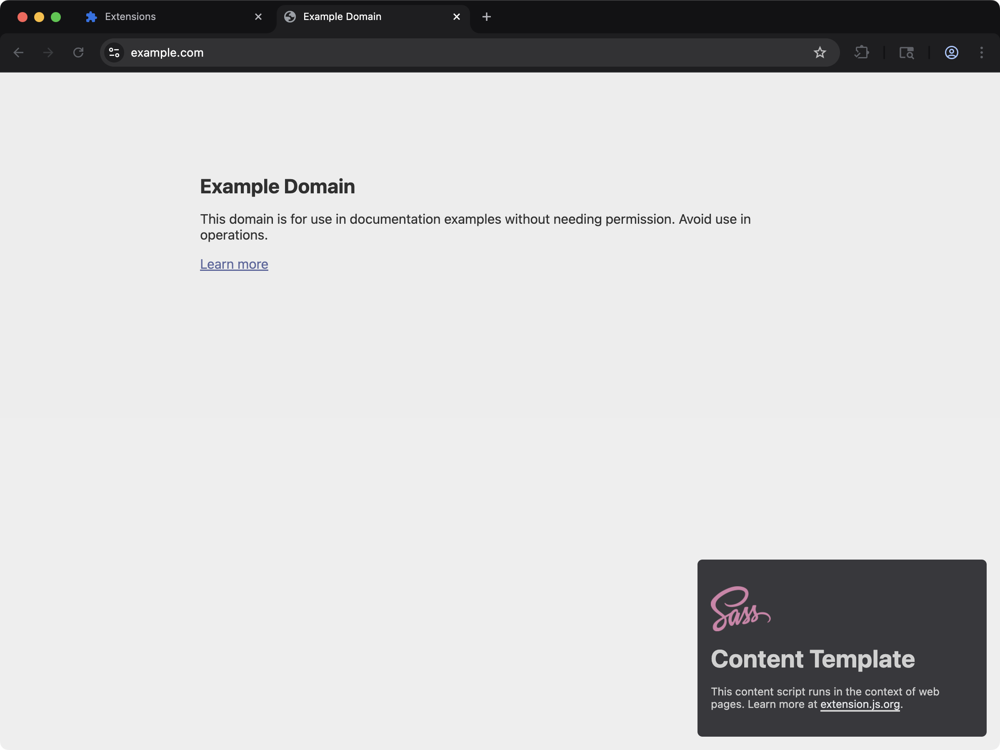
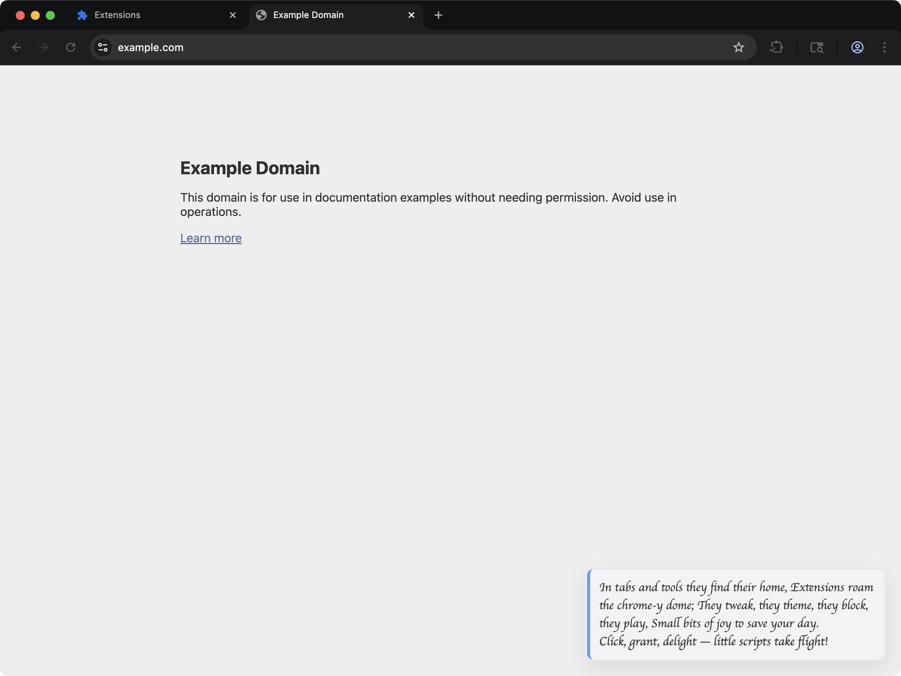

Extension.js 支援純 CSS，以及 Sass 與 Less 等預處理器，無需任何設定。它會針對頁面情境（popup、options、side panel）與 content script 情境採用不同的路由方式。

頁面樣式以連結資產的方式出貨。在 content script 裡，樣式套用在哪裡取決於你怎麼引用它。本頁的 content script 一節列出了每一種方式。

## 範本範例

### `content-sass`



把 Sass 樣式注入網頁的 content script。

<CodeGroup>

```bash npm
npx extension@latest create my-extension --template=content-sass
```

```bash pnpm
pnpx extension@latest create my-extension --template=content-sass
```

```bash yarn 2+
yarn dlx extension@latest create my-extension --template=content-sass
```

```bash bun
bunx extension@latest create my-extension --template=content-sass
```

```bash deno
deno run -A npm:extension@latest create my-extension --template=content-sass
```

</CodeGroup>

儲存庫：[extension-js/templates/content-sass](https://github.com/extension-js/templates/tree/main/examples/content-sass)

### `content-custom-font`



示範透過 CSS 載入自訂字型的 content script。

<CodeGroup>

```bash npm
npx extension@latest create my-extension --template=content-custom-font
```

```bash pnpm
pnpx extension@latest create my-extension --template=content-custom-font
```

```bash yarn 2+
yarn dlx extension@latest create my-extension --template=content-custom-font
```

```bash bun
bunx extension@latest create my-extension --template=content-custom-font
```

```bash deno
deno run -A npm:extension@latest create my-extension --template=content-custom-font
```

</CodeGroup>

儲存庫：[extension-js/templates/content-custom-font](https://github.com/extension-js/templates/tree/main/examples/content-custom-font)

## CSS 能力

| 能力            | 你會獲得的成果                                                           |
| --------------- | ------------------------------------------------------------------------ |
| 多情境樣式      | 為頁面與 content script 採用一致的撰寫模型                               |
| Sass／Less 編譯 | 在安裝對應相依時自動編譯 Sass／Less                                      |
| 情境感知輸出    | 將頁面 CSS 與 content script CSS 輸出到正確目標                          |
| 開發更新流程    | 在支援的情況下，透過 hot module replacement（HMR）／重新掛載套用樣式更新 |

## 在哪裡參考 CSS

- `manifest.json`（`content_scripts[].css`）
- HTML 檔案（`<link rel="stylesheet" href="...">`）
- Script 中的 import（`import "./styles.css"`，啟用時也包含 Sass／Less）。在 content script 裡，這種 import 本身不會替任何東西加上樣式。

## CSS 支援

Manifest 中的 CSS 進入點：

| Manifest 欄位         | 預期檔案類型                      |
| --------------------- | --------------------------------- |
| `content_scripts.css` | `.css`, `.scss`, `.sass`, `.less` |

## 範例：`manifest.json` 中的 CSS

```json
{
  "manifest_version": 3,
  "name": "My Extension",
  "version": "1.0.0",
  "content_scripts": [
    {
      "matches": ["<all_urls>"],
      "css": ["./styles/content.css"],
      "js": ["./scripts/content.ts"]
    }
  ]
}
```

## 範例：在擴充功能頁面 script 中引用 CSS

```ts
import "./styles/popup.scss";
```

## content script 中的樣式

在 content script 裡，單純的 `import "./styles.css"` 得到的值是一個 `data:` URL 形式的樣式表。它本身不會替任何東西加上樣式。Sass 與 Less 的 import 也是一樣。

Extension.js 只在一種情況下替你放置這份樣式表。這條 import 必須寫在已宣告的 content script 的入口檔裡，而且腳本必須用 `data-extension-root` 標記一個宿主元素。樣式表隨後會進入這個宿主的 shadow root。請見 [Shadow DOM](/zh-Hant/docs/implementation-guide/shadow-dom)。

要替頁面本身加上樣式，請使用下列任一種方式：

| 你寫的內容                                                             | 在哪裡有效                                |
| ---------------------------------------------------------------------- | ----------------------------------------- |
| 列在 manifest 的 `content_scripts[].css` 下的樣式表                    | 已宣告的 content script                   |
| CSS module，`import styles from "./x.module.css"`                      | 已宣告的 content script                   |
| `import href from "./styles.css"`，再設到 `<link rel="stylesheet">` 上 | 已宣告的 content script 與 `scripts/` 檔案 |

最後一種方式會讀取 import 得到的值，再自己放置它：

```ts
import href from "./styles.css";

export default function main() {
  const link = document.createElement("link");
  link.rel = "stylesheet";
  link.href = href;
  document.head.appendChild(link);

  return () => link.remove();
}
```

你在執行階段注入的 `scripts/` 檔案不會得到任何自動放置。在那裡請讀取這個值，再把它設到 `<link>` 上。

從 4.1.39 之後的版本起，如果一條只為副作用而寫的樣式 import 沒有被任何東西放置，建置會印出一則警告。

### 樣式政策嚴格的頁面

頁面的內容安全政策（CSP）也決定 content script 自己的 DOM 呼叫能做什麼。結果取決於腳本執行在哪個 world。在送出 `style-src 'self'` 的頁面上：

| 腳本自己的呼叫                              | isolated world | MAIN world |
| ------------------------------------------- | -------------- | ---------- |
| `fetch(href)`                               | 有回應         | 有回應     |
| 裝著所取文字的 `<style>` 元素               | 生效           | 被拒絕     |
| 指向這個 `data:` URL 的 `<link>`            | 生效           | 被拒絕     |
| 指向 web accessible 擴充功能檔案的 `<link>` | 生效           | 生效       |
| `adoptedStyleSheets` 裡的建構樣式表         | 生效           | 生效       |

這些結果是在 Chrome 151 與 Firefox 160 上量測的，`dev` 與正式建置都一樣。shadow root 裡的 `<style>` 元素會和文件裡的一樣被拒絕。

在送出 `default-src 'self'` 的頁面上，`fetch(href)` 也會被拒絕。在 MAIN world 裡兩個瀏覽器都是如此，在 isolated world 裡只有 Firefox 如此。

建置看不到腳本將要造訪的頁面的政策。它不會更動這些呼叫，也不會印出警告。必須在這種政策下運作的 MAIN world 腳本，可以不發請求，直接從 URL 裡讀出樣式表並採用它：

```ts
import href from "./panel.css";

const sheet = new CSSStyleSheet();
sheet.replaceSync(decodeURIComponent(href.slice(href.indexOf(",") + 1)));
document.adoptedStyleSheets = [...document.adoptedStyleSheets, sheet];
```

## 內容腳本中的網頁字型

把介面渲染到 shadow root 的內容腳本，無法只靠 CSS 載入網頁字型。有兩條平台規則會擋住它，而且都是靜默的。

**shadow root 內部的 `@font-face` 永遠不會生效。** 字型（font face）解析的是文件的字型集，而不是 shadow 樹，所以 Chrome 會忽略該規則並靜默回退。修正前在 `content-custom-font` 範本上實測：`document.fonts` 為空，沒有發出任何字型請求，以 `"Momo Signature", cursive` 排版的文字寬度與純 `cursive` 完全相同。

**注入樣式表中的根絕對 `url()` 會相對宿主頁面解析。** 注入到 `example.com` 的樣式表中的 `url(/fonts/Momo.woff2)` 請求的是 `https://example.com/fonts/Momo.woff2`，而不是擴充功能自己的那份檔案。

改為把字型註冊到頁面自身的字型集上，URL 指向擴充功能，並在內容腳本卸載時移除它：

```js
export default function initial() {
  const rootDiv = document.createElement("div");
  document.body.appendChild(rootDiv);
  const shadowRoot = rootDiv.attachShadow({ mode: "open" });

  const customFace = new FontFace(
    "Momo Signature",
    `url("${chrome.runtime.getURL("fonts/MomoSignature-Regular.woff2")}")`,
  );

  customFace
    .load()
    .then((face) => document.fonts.add(face))
    .catch(() => {
      // Ignore
    });

  return () => {
    document.fonts.delete(customFace);
    rootDiv.remove();
  };
}
```

該字型檔必須能被頁面存取，所以要在 `web_accessible_resources` 中宣告：

```json
{
  "web_accessible_resources": [
    {
      "resources": ["fonts/*.woff2"],
      "matches": ["<all_urls>"]
    }
  ]
}
```

字型一旦進入 `document.fonts`，shadow 樹就可以在一般的 `font-family` 規則裡以名稱使用它。可運行的版本見 [content-custom-font](https://github.com/extension-js/templates/tree/main/examples/content-custom-font)。

## 依情境的輸出行為

| 情境           | 輸出行為                                                                           |
| -------------- | ---------------------------------------------------------------------------------- |
| HTML／頁面情境 | Extension.js 將 CSS 與頁面進入點打包在一起（`feature.css`）                        |
| Content script | Extension.js 將 CSS 以 `content_scripts/[name].css` 形式輸出為資產，並同步改寫 manifest |

Extension.js 會依照哪一個進入點 import 該 CSS 自動拆分情境。

## 開發行為

- Content script 的 CSS import 會參與 content script 的 HMR／重新掛載流程。
- Extension.js 會為純 CSS 的 content script 進入點加上開發輔助 script，讓更新可以傳播。
- 頁面 CSS 會走標準的頁面 HMR 流程。
- 結構性 manifest／content script 變更仍可能需要重新載入或重新啟動整個擴充功能。

## 模組與預處理器

- CSS Modules 在擴充功能頁面情境中運作得最好。
- 當你安裝相關相依套件時，Extension.js 會啟用 Sass／Less 支援。
- 如果專案引用了 `.scss`／`.less` 檔案但沒有安裝預處理器，建置不會失敗，而是發出警告並把原始檔原封不動地複製過去（不編譯）。瀏覽器會把這份未編譯的原始碼當成壞掉的 CSS，那些畫面就會完全沒有樣式，所以請安裝預處理器以取得真正的編譯。
- 當 Extension.js 偵測到專案中的 PostCSS 設定、或你明確設定時，會自動執行 PostCSS。

## 最佳實務

- 刻意限制 content script 樣式範圍，降低與主機頁面的衝突。
- 為擴充功能頁面 UI 優先採用元件本地的 module 樣式。
- 明確保留預處理器與 PostCSS 設定，避免建置設定隨時間意外改變。
- 在持續整合（CI）中驗證被 manifest 欄位參考的 CSS 路徑。

## 後續步驟

- 在 [dev 更新行為](/zh-Hant/docs/workflows/dev-update-behavior)中了解更新結果。
- 進一步了解 [CSS Modules](/zh-Hant/docs/languages-and-frameworks/css-modules)。
- 進一步了解 [PostCSS 整合](/zh-Hant/docs/integrations/postcss)。

## 影片導覽

<Frame>
  <iframe
    className="w-full aspect-video rounded-xl"
    src="https://www.youtube-nocookie.com/embed/IAbckjfGO5Y?rel=0"
    title="Extension.js: Content Custom Font template"
    loading="lazy"
    allow="encrypted-media; picture-in-picture; fullscreen"
    allowFullScreen
  />
</Frame>
