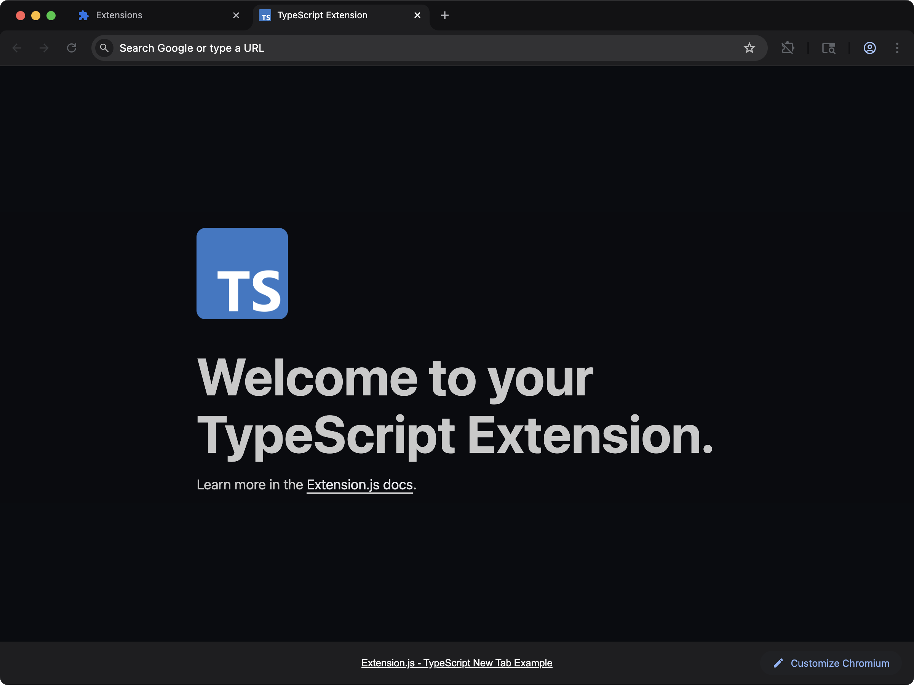
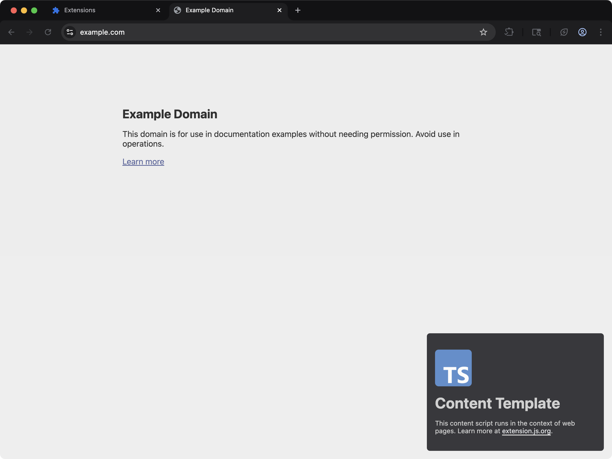

Extension.js 從一個 `manifest.json` 出發，為 Chrome、Edge、Firefox 與 Safari 建置並執行瀏覽器擴充功能。它在所有擴充功能情境下都能執行 TypeScript：background、content script、popup、options 與 sidebar。它預設使用 Rspack + SWC pipeline。你不需要額外的 `tsc` 步驟、ts-loader 或額外的 bundler rule。

建置完全不需要 `typescript` 套件。SWC 會編譯你的原始碼並移除型別。這個套件只對編輯器工具與 `tsc --noEmit` 型別檢查有意義。也因此，缺少 `typescript` 套件永遠不會讓建置失敗，這一點和缺少框架整合套件不同。

## 什麼情況下適合使用 TypeScript

- 你希望在擴充功能各情境之間有更安全的重構與更明確的介面。
- 你會在 background script、content script 與 UI 介面之間共用邏輯。
- 你需要在使用 AI 產生程式碼時，仍能取得可預期的 API 使用方式。

## 範本範例

### `new-typescript`



最適合用來打造以 TypeScript 為預設的 new-tab 擴充功能。

<CodeGroup>

```bash npm
npx extension@latest create my-extension --template=newtab-typescript
```

```bash pnpm
pnpx extension@latest create my-extension --template=newtab-typescript
```

```bash yarn 2+
yarn dlx extension@latest create my-extension --template=newtab-typescript
```

```bash bun
bunx extension@latest create my-extension --template=newtab-typescript
```

```bash deno
deno run -A npm:extension@latest create my-extension --template=newtab-typescript
```

</CodeGroup>

Repository: [extension-js/templates/newtab-typescript](https://github.com/extension-js/templates/tree/main/examples/newtab-typescript)

### `content-typescript`



最適合在既有頁面中注入 TypeScript 驅動的 content script。

<CodeGroup>

```bash npm
npx extension@latest create my-extension --template=content-typescript
```

```bash pnpm
pnpx extension@latest create my-extension --template=content-typescript
```

```bash yarn 2+
yarn dlx extension@latest create my-extension --template=content-typescript
```

```bash bun
bunx extension@latest create my-extension --template=content-typescript
```

```bash deno
deno run -A npm:extension@latest create my-extension --template=content-typescript
```

</CodeGroup>

Repository: [extension-js/templates/content-typescript](https://github.com/extension-js/templates/tree/main/examples/content-typescript)

## 自動產生的 ambient 型別

對於 TypeScript 專案，Extension.js 會在你的專案根目錄產生 `extension-env.d.ts` 檔，包含 ambient 宣告（browser/runtime 全域、`EXTENSION_PUBLIC_*` 環境變數，以及打包工具型別）。[`dev`](/zh-Hant/docs/commands/dev)、[`build`](/zh-Hant/docs/commands/build) 與 [`start`](/zh-Hant/docs/commands/start) 都會重新產生它，因此編輯器型別與 CI 上的 `tsc --noEmit` 會保持同步。可以把它納入版本控管或加入 git ignore，兩種方式都可以，下一次執行時會重新建立。

從 4.1.39 之後的版本起，這個檔案不存在時，只有在你的 `tsconfig.json` 會讀到它的情況下才會被建立。見[讓 extension-env.d.ts 留在 include 清單裡](/zh-Hant/docs/languages-and-frameworks/extension-api-types)。

## 在既有擴充功能中使用

依下列步驟把 TypeScript 加入既有擴充功能。

### 安裝

1. 將 TypeScript 安裝為 development dependency：

<CodeGroup>

```bash npm
npm install -D typescript
```

```bash pnpm
pnpm add -D typescript
```

```bash yarn
yarn add -D typescript
```

```bash bun
bun add -d typescript
```

```bash deno
deno add -D npm:typescript
```

</CodeGroup>

2. 初始化 TypeScript 設定檔 `tsconfig.json`：

<CodeGroup>

```bash npm
npx tsc --init
```

```bash pnpm
pnpm exec tsc --init
```

```bash yarn
yarn tsc --init
```

```bash bun
bunx tsc --init
```

```bash deno
deno run -A npm:typescript/tsc --init
```

</CodeGroup>

### 設定

#### TypeScript 偵測與需求

Extension.js 會在 `package.json` 旁邊尋找 `tsconfig.json`。

- 沒有 `tsconfig.json` 的專案，只要建置會編譯到 TypeScript，就會得到一份基準設定：manifest 指明的指令碼、頁面載入的指令碼，或是它們透過相對路徑匯入的檔案。建置會顯示 `Creating a default tsconfig.json` 並繼續進行。
- 沒有任何地方載入的 `.ts` 檔案不算，單獨宣告 `typescript` 相依套件也不算。從 4.1.41 之後的版本開始，建置不會在這樣的專案中寫入任何檔案。

範例基準設定：

```json
{
  "compilerOptions": {
    "allowJs": true,
    "allowSyntheticDefaultImports": true,
    "esModuleInterop": true,
    "forceConsistentCasingInFileNames": true,
    "isolatedModules": false,
    "jsx": "react-jsx",
    "jsxImportSource": "react",
    "lib": ["dom", "dom.iterable", "esnext"],
    "moduleResolution": "bundler",
    "module": "esnext",
    "resolveJsonModule": true,
    "strict": true,
    "target": "esnext",
    "skipLibCheck": true
  },
  "exclude": ["node_modules", "dist"]
}
```

有兩個預設值值得知道：

- `moduleResolution` 是 `bundler`，對應 Rspack + SWC pipeline。已被移除的 `node`（node10）模式會讓 TypeScript 7 上的 `tsc --noEmit` 失敗。
- 只有當 Extension.js 在專案中偵測到 JSX 框架時，`jsx` 才會是 `react-jsx`。沒有偵測到時，它會維持 `preserve`，也不會寫入 `jsxImportSource`。從 4.1.20 起，框架專案還會得到 `jsxImportSource`，依偵測到的框架設為 `react`、`preact`、`vue` 或 `solid-js`，這樣 `tsc --noEmit` 解析的 JSX 執行階段與建置一致。

#### 自動型別

Extension.js 會在專案根目錄產生 `extension-env.d.ts`。`dev`、`build` 與 `start` 每次都會重寫它。這個檔案引用擴充功能 API、Extension.js 環境變數鍵與資源匯入的型別宣告。

```ts extension-env.d.ts
// Required Extension.js types for TypeScript projects.
// This file is auto-generated and should not be excluded.
// If you need additional types, consider creating a new *.d.ts file and
// referencing it in the "include" array of your tsconfig.json file.
// See https://www.typescriptlang.org/tsconfig#include for more information.
/// <reference types="extension/types" />

// Polyfill types for browser.* APIs
/// <reference types="extension/types/polyfill" />
```

#### 擴充功能 API 的型別

Extension.js 用 [`chrome-types`](https://www.npmjs.com/package/chrome-types) 為擴充功能 API 提供型別。這個套件由 Chrome 從 Chromium 原始碼產生。`browser` 是原生 namespace，它的方法回傳 Promise。`chrome` 是它的別名。這個套件隨 `extension` 一起安裝，所以新專案不需要額外的型別套件。

```ts
const [tab] = await browser.tabs.query({ active: true, currentWindow: true });
```

`chrome-types` 沒有宣告只有 Firefox 才有的 API。Firefox 的 `browser.sidebarAction` 與 `browser.browserAction` 由 Extension.js 自己提供型別。

從 4.1.40 之後的版本起，Extension.js 還在 `chrome-types` 之上補充了三項內容，讓瀏覽器接受的程式碼能夠通過型別檢查：

- 緊接在你傳入的引數之後的回呼，例如 `chrome.tabs.sendMessage(tabId, message, callback)`。單獨使用 `chrome-types` 時，回呼只有放在所有選用引數之後才有型別。
- Chrome 在執行階段提供的列舉物件，例如 `chrome.runtime.OnInstalledReason.INSTALL`。這些是 Chrome 的物件。Firefox 提供的較少，部分鍵名也不同，所以同時支援兩個瀏覽器的程式碼應該直接比較字串，例如 `reason === 'install'`。
- `chrome.tabs.OnUpdatedInfo`，也可以寫成 `chrome.tabs.TabChangeInfo`，用於 `tabs.onUpdated` 的變更引數。

還有一個呼叫會回報 Chrome 並不會回報的錯誤：`new chrome.declarativeContent.ShowAction()` 會提示缺少引數。請寫成 `new chrome.declarativeContent.ShowAction({})`，Chrome 對兩者的處理相同。

#### 安裝了 @types/chrome 的專案

安裝了 `@types/chrome` 的專案會繼續使用它。`chrome` 的型別來自這個套件，`browser` 的型別和以前一樣來自 `webextension-polyfill`。

`@types/chrome` 與 `chrome-types` 都宣告了 `chrome` 全域變數，所以這兩個套件不能同時載入。產生的 `extension-env.d.ts` 只引用其中一個。當你的 `package.json` 列出了 `@types/chrome` 時，它引用 `@types/chrome`。當專案資料夾或某個上層資料夾裡存在 `node_modules/@types/chrome` 時，也是如此：

```ts extension-env.d.ts
/// <reference types="extension/types/legacy" />

// This project installs @types/chrome, so it types the extension APIs.
// Remove that package to get chrome-types and the native browser namespace.
/// <reference types="chrome" />

// Polyfill types for browser.* APIs
/// <reference types="extension/types/polyfill" />
```

改用 `chrome-types`：

1. 從專案裡移除 `@types/chrome`。
2. 執行一次 `extension dev` 或 `extension build`。

回到 `@types/chrome`：

1. 把 `@types/chrome` 安裝為開發相依套件。
2. 執行一次 `extension dev` 或 `extension build`。

#### Polyfill 的型別

在預設設定下，`browser` 全域變數擁有來自 `chrome-types` 的原生型別。想要 `webextension-polyfill` 的型別，請匯入這個模組：

```ts
import browser from "webextension-polyfill";
```

這條匯入只改變型別，以及你的程式碼所呼叫的物件。polyfill 何時執行，請閱讀[跨瀏覽器相容](/zh-Hant/docs/features/cross-browser-compatibility)。

#### 升級說明

更早的版本會隨 `extension` 一起安裝 `@types/chrome`，並用 `webextension-polyfill` 為 `browser` 提供型別。安裝了 `@types/chrome` 的專案會保留這些型別。沒有 `@types/chrome` 的專案在升級後會改用 `chrome-types`。

改用之後，`tsc` 可能會回報 `chrome.tabs.TabChangeInfo` 這樣的名稱不存在。安裝 `@types/chrome` 可以保留以前的型別，然後執行一次 `extension dev` 或 `extension build`。

#### 轉譯與型別檢查的差別

預設的打包 pipeline 會編譯 TypeScript，但不會在打包過程中執行完整的 `tsc` 型別檢查。

建議的 scripts：

```json
{
  "scripts": {
    "dev": "extension dev",
    "typecheck": "tsc --noEmit"
  }
}
```

`tsc` 不會寫出 `extension-env.d.ts`。只有 `dev`、`build` 與 `start` 會重新產生它。在 CI 中，請先執行其中一個指令，再執行 `tsc`：

```bash
npx extension build
npx tsc --noEmit
```

## 下一步

- 了解 Extension.js 如何處理 [ECMAScript modules](/zh-Hant/docs/languages-and-frameworks/ecmascript-modules)。
- 探索 [Sass modules](/zh-Hant/docs/languages-and-frameworks/sass) 等樣式選項。
- 閱讀 [瀏覽器擴充功能中的 JavaScript 與 TypeScript 檔案](/zh-Hant/docs/concepts/javascript-typescript-browser-extension-files)。
- 比較各個 [瀏覽器擴充功能框架](/zh-Hant/docs/compare) 對 TypeScript 的支援。

## 影片導覽

<Frame>
  <iframe
    className="w-full aspect-video rounded-xl"
    src="https://www.youtube-nocookie.com/embed/9OBuuh3N_cM?rel=0"
    title="Extension.js: Content TypeScript template"
    loading="lazy"
    allow="encrypted-media; picture-in-picture; fullscreen"
    allowFullScreen
  />
</Frame>
